# Internal authorization

[Русский](auth.md)

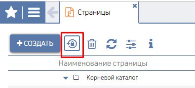

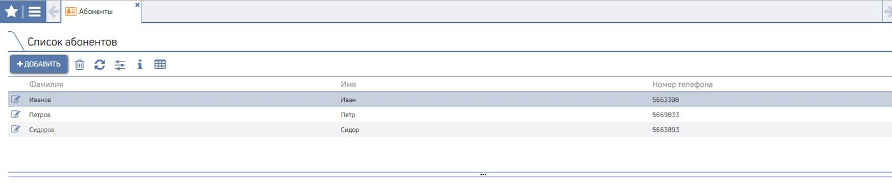

The Platform implements internal authorization through the authcore provider, which looks at the core_auth schema.

Authorization is administered in the Authorization block (CORE Authorization).

> **Note!**
> For modified authorization data (Users, roles, actions, etc.) to take effect immediately,
> you must reset the authorization provider.

Actions
Each Platform page corresponds to a pair of actions:

a page view action (only displaying the page and navigating it; all action buttons (for example,
"Add" or "Edit" are disabled), refresh and pagination are available, as well as applying filters);
a page modification action (the ability to modify data on the page).

> **Note!**
> If no view action is specified for a page, then when attempting to open that page the System will return
> the error "Page is unavailable (no access rights or the page does not exist)"

More about creating and configuring actions

Roles
A role is a set of actions.

After all required actions have been added, the role is assigned to Users.

More about creating and configuring roles

Users
Users are also created in the Internal authorization block.

Roles are assigned to Users.

If necessary, additional information can be maintained for each user.

More about creating and configuring users

The list of users, their data, and the actions available to them can be viewed on the "Authorization" tab of the
"Gateway" page (Menu -> CORE -> Administration -> Gateway):

## Configuring actions

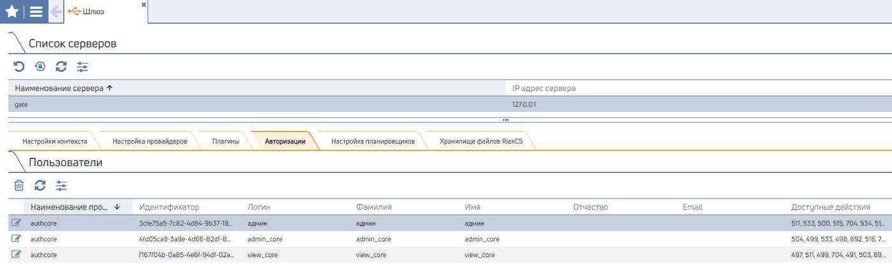

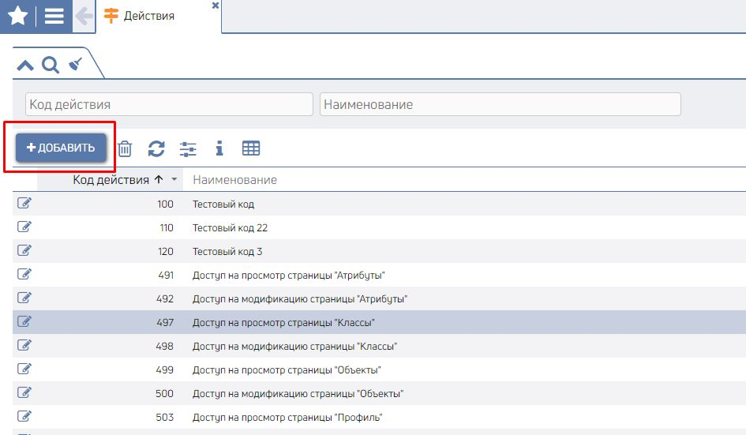

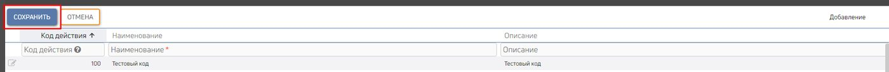

> **Note!**
> For modified authorization data (Users, roles, actions, etc.) to take effect immediately,
> you must reset the authorization provider.

Creating an action
To create an action:

1. go to the "Actions" page (Menu -> CORE -> Authorization -> Actions);
2. click the "Add" button;

3. fill in the fields;
4. click the "Save" button.

Fields available to fill in:

Field name Data type Comments

Action code Integer If no value is specified, then on
save a value is assigned
from the sequence.

Name Text Required.

Description Text

> **Note!**
> If you attempt to create actions with the same "Action code" value, the System will return an error and will not
> save.

Editing an action
To edit an action:

1. select an action;
2. click the "Edit value" column button;
3. make changes;
4. click the "Save" button.

4.

> **Note!**
> The "Action code" field cannot be edited

Deleting an action
To delete an action:

1. select an action;
2. click "Delete";
3. confirm deletion by clicking the "Yes" button.

> **Note!**
> If you attempt to delete an action that is used on any role, the System will return the error "Deletion
> is not possible because related records exist"

## Configuring roles

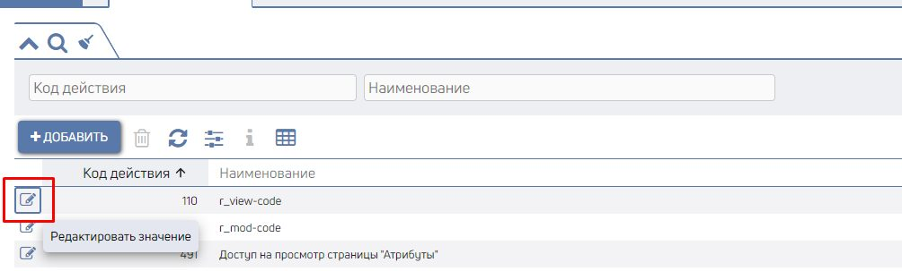

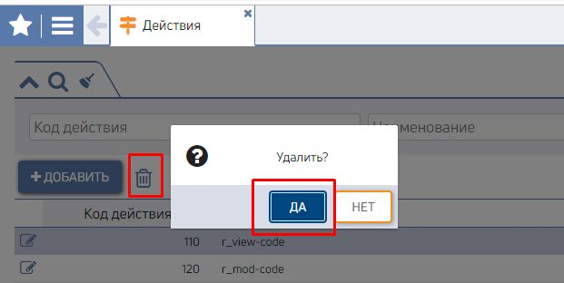

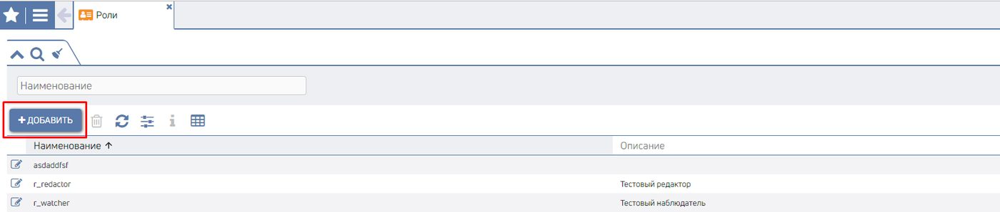

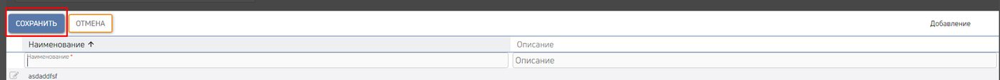

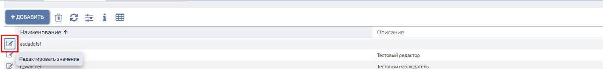

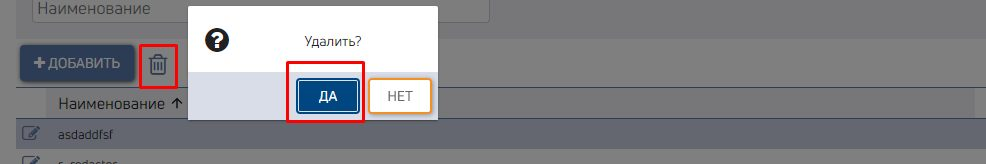

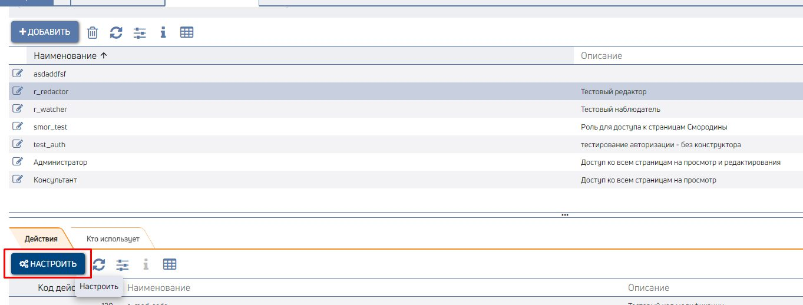

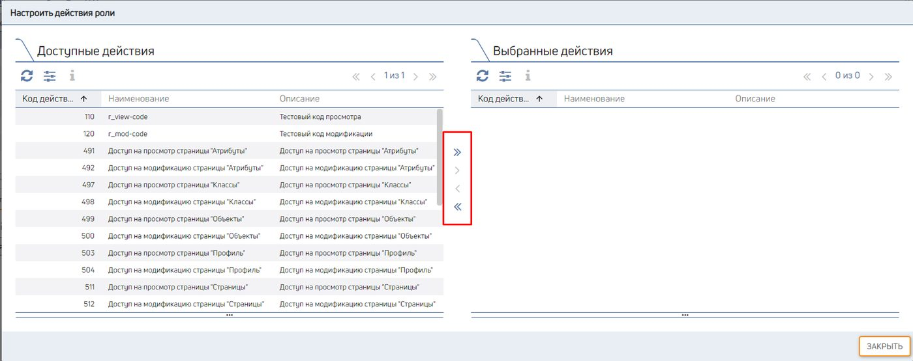

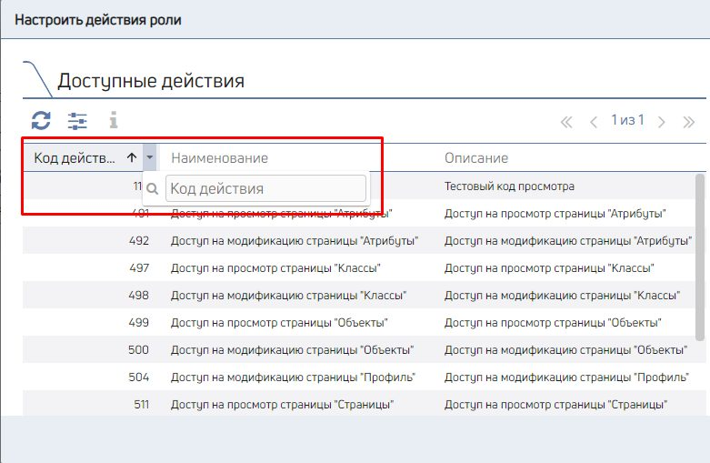

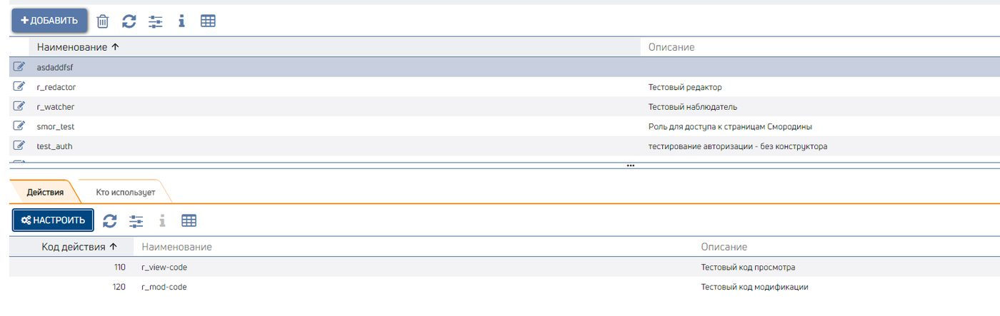

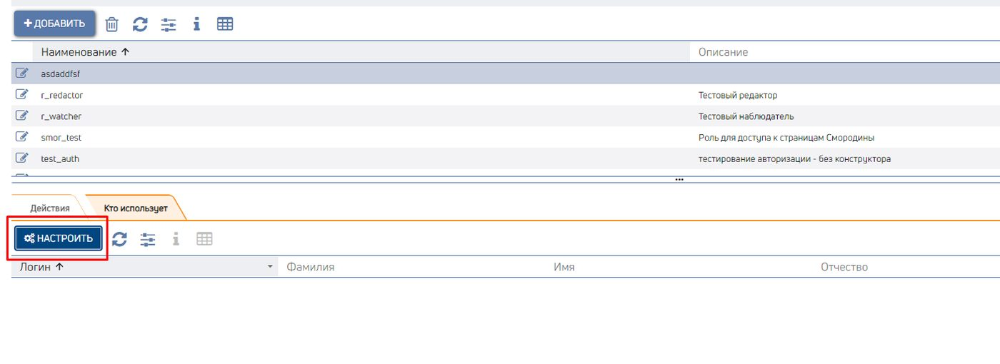

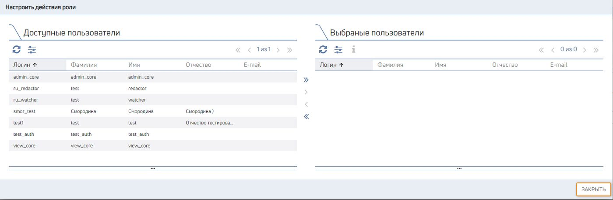

> **Note!**
> For modified authorization data (Users, roles, actions, etc.) to take effect immediately,
> you must reset the authorization provider.

Creating a role
To create a role:

1. go to the "Roles" page (Menu -> CORE -> Authorization -> Roles);
2. click the "Add" button;

3. fill in the fields;
4. click the "Save" button.

Fields available to fill in:

Field name Data type Comments

Name Text Required.

Description Text

> **Note!**
> If you attempt to create roles with the same "Name" value, the System will return an error and will not
> save.

Editing a role
To edit a role:

1. select a role;
2. click the "Edit value" column button;
3. make changes;

4. click the "Save" button.

Deleting a role
To delete a role:

1. select a role;
2. click "Delete";
3. confirm deletion by clicking the "Yes" button.

Adding and configuring role actions
After creating a role, you can configure the list of action codes for it.

To do this:

1. select a role;
2. in the "Actions" grid, click the "Configure" button;

3. in the window that opens, all available actions are shown on the left, and selected ones on the right. Actions are moved using single ("Add/remove record") and double ("Add/remove all") controls;

4. to find a specific action, you can use the column filter;

5. click the "Close" button. All selected actions will appear in the "Actions" grid.

Adding and configuring users who use the role
1. select a role;
2. in the "Who uses" grid, click the "Configure" button;

3. in the window that opens, all available users are shown on the left, and selected ones on the right. Users are moved using single ("Add/remove record") and double ("Add /remove all") controls;

4. click the "Close" button. All selected users will appear in the "Who uses" grid.

## Configuring users

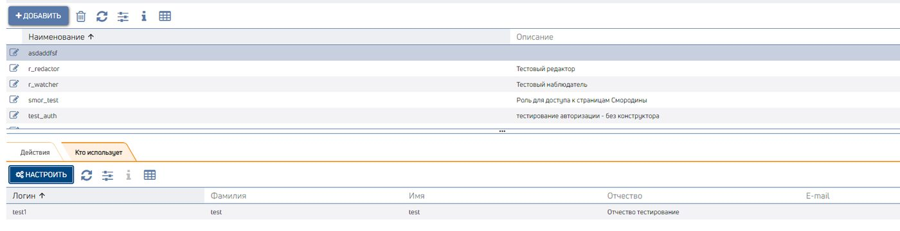

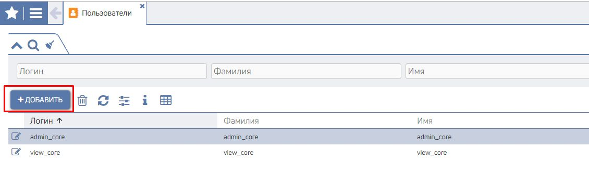

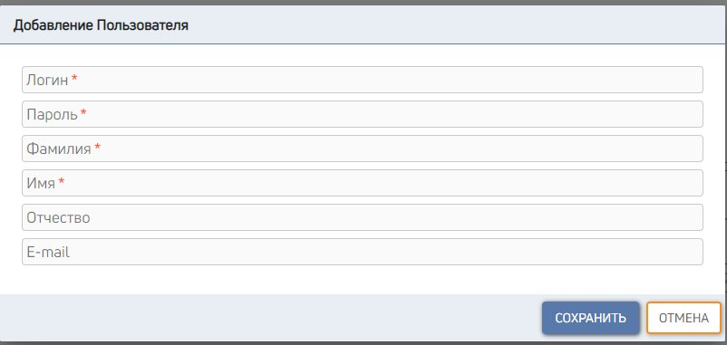

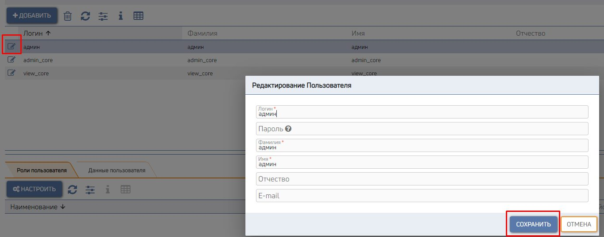

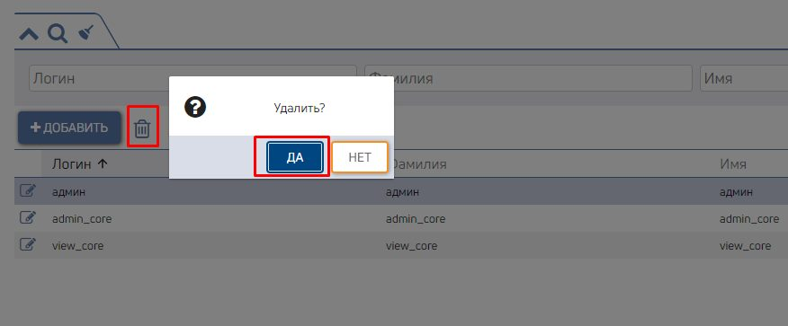

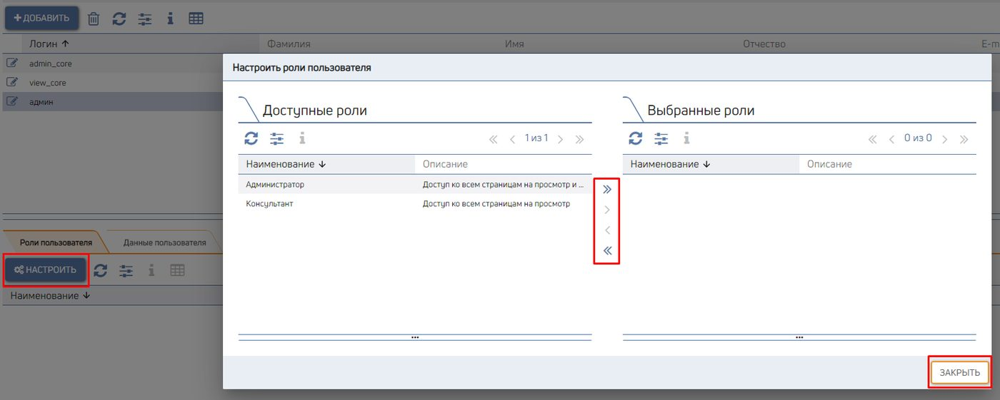

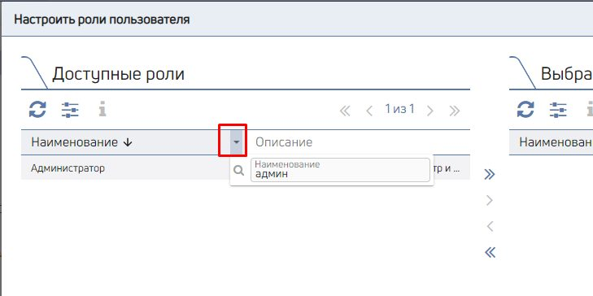

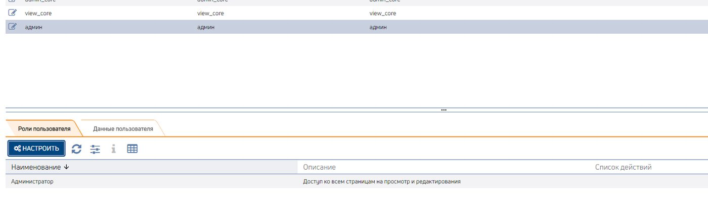

> **Note!**
> For modified authorization data (Users, roles, actions, etc.) to take effect immediately,
> you must reset the authorization provider.

Adding a user
To create a user:

1. go to the "Users" page (Menu -> CORE -> Authorization -> Users);
2. click the "Add" button;

3. fill in the fields;
4. click the "Save" button.

Fields available to fill in:

Field name Data type Comments

Login Text Required

Password Text Required

Last name Text Required

First name Text Required

Patronymic Text

E-mail Text

> **Note!**
> If you attempt to create users with the same "Login" value, the System will return an error and will not
> save.

> **Note!**
> If any values are defined on the "User additional data list" page, they will be shown in
> the Add User window. More details

Editing a user
To edit a user:

1. select a user;
2. click the "Edit value" column button;
3. make changes;
4. click the "Save" button.

> **Note!**
> For information security, the previously saved user password is not displayed in the
> edit window.

Deleting a user
To delete a user:

1. select a user;
2. click "Delete";
3. confirm deletion by clicking the "Yes" button.

Adding and configuring user roles
1. Select the user whose roles will be configured;
2. in the "User roles" grid, click the "Configure" button;

2.

3. in the window that opens, all available roles are shown on the left, and selected ones on the right. Roles are moved using single ("Add/remove record") and double ("Add/remove all") controls;
4. to find a specific role, you can use the column filters;

5. click the "Close" button. All selected actions will appear in the "User roles" grid.

Adding and configuring additional user data
A description of adding data to the User additional data dictionary is here

For previously created users, a new record from the Dictionary will appear in the "User data" grid with an empty
value:

You can fill in this information by editing the record:

> **Note!**
> If you attempt to delete user data with Required flag = "Yes", the System will return an error and will not
> delete it.

### User additional data dictionary

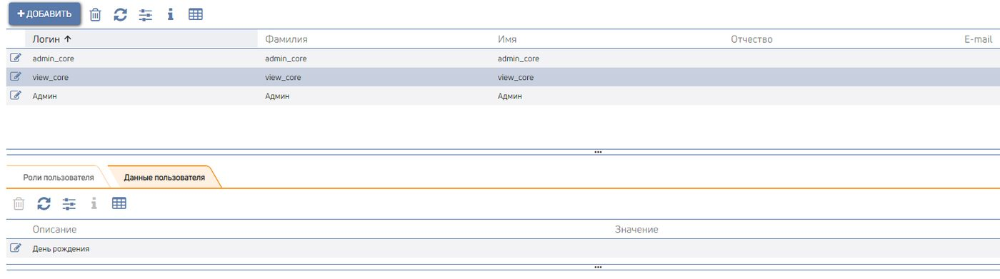

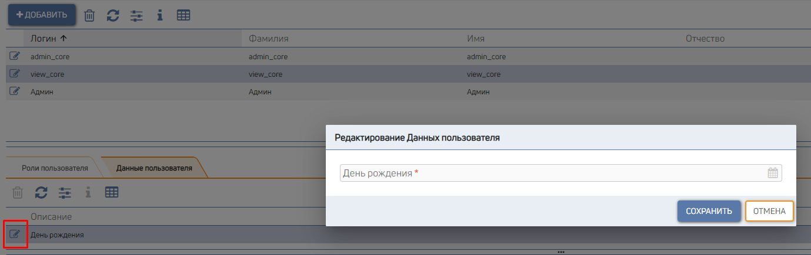

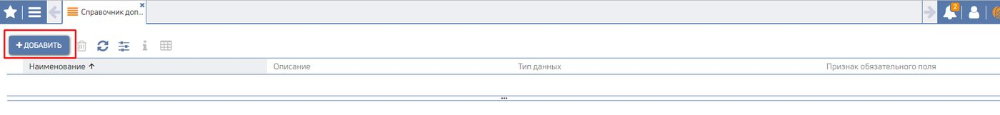

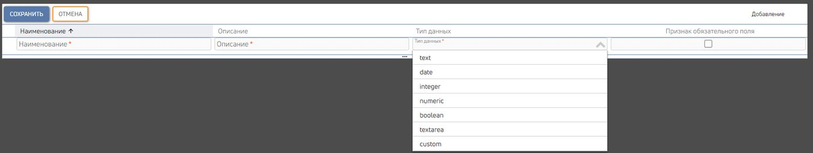

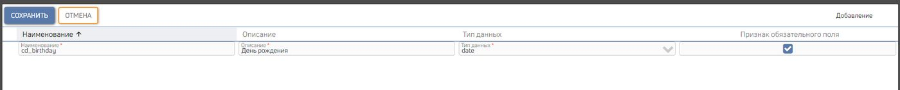

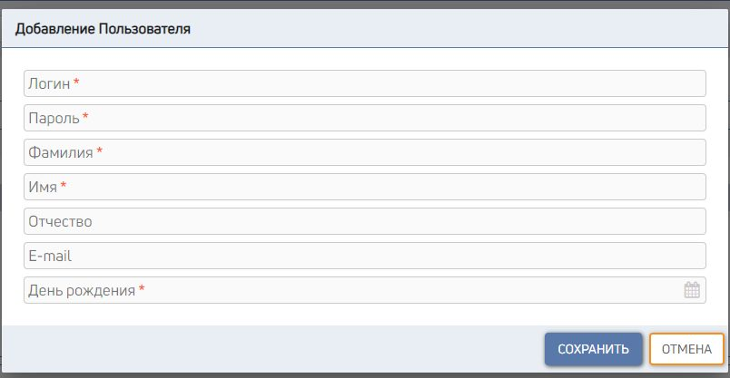

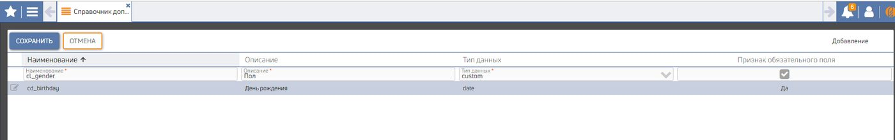

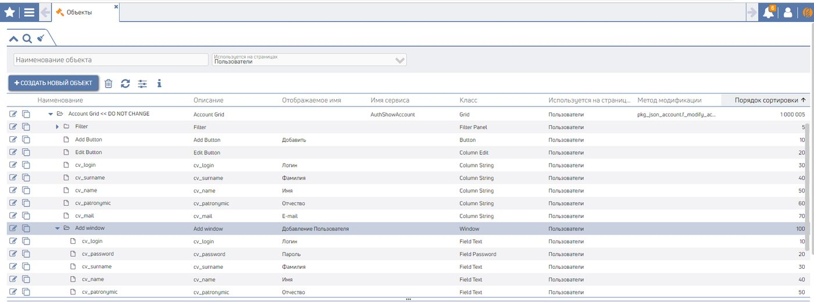

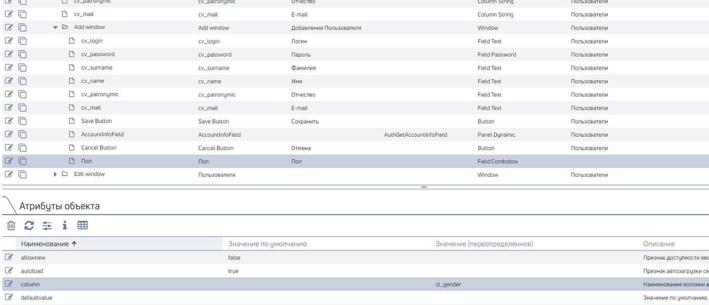

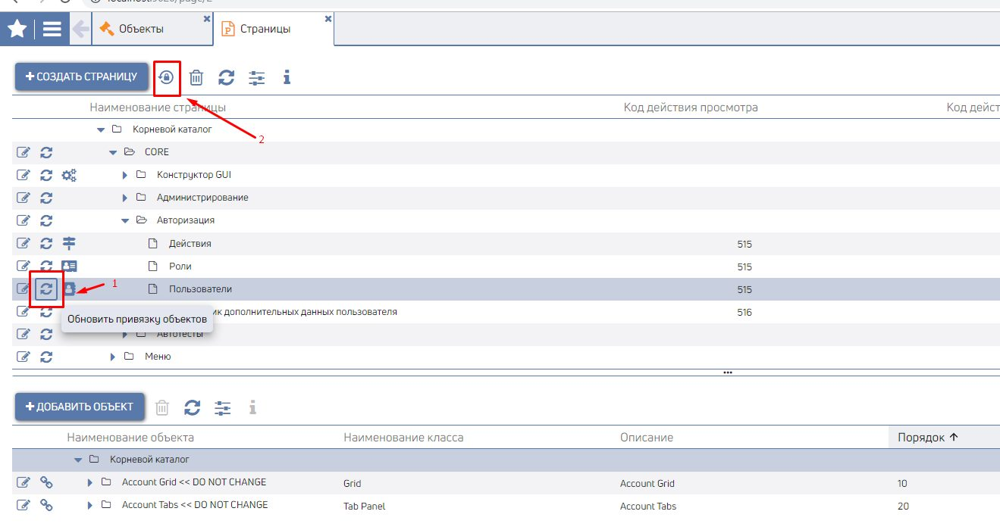

If, when creating users, you need to fill in additional information besides the main fields (login, password, full name, e-mail),
create the required fields in the User additional data dictionary.

Adding data to the list
1. go to the "User additional data dictionary" page (Menu -> CORE -> Authorization -> User additional data dictionary);

2.

2. click the "Add" button;

3. fill in the fields;
4. click the "Save" button.

Fields available to fill in:

Field name Data type Comments

Name Text Required.

Will be used as the
parameter name when
creating a user and in the grid with
user data.

Description Text Required.

Will be used as the
display name of the field in the
add-user window and in the grid with
user data.

Data type List selection Required.

Will be used as the field
type in the add-user window
and in the grid with user data.

Available values:

boolean;
custom;
date;
integer;
numeric;
text;
textarea

Required field flag Yes/No

> **Note!**
> If you attempt to create records with the same "Name" value, the System will return an error and will not
> save.

All data created in the Dictionary will be shown in the new-user creation window and in the "User
data" grid on the "Users" page.

The field class in the new-user window and when editing in the "User data" grid depends on the selected
"Data type" value:

Data type Field class Comment

boolean Field Checkbox

custom Used when you need
to add a field of a complex class
(for example, Combobox, Field Grid, etc.)

date Field Date

integer Field Integer

numeric Field Numeric

text Field Text

textarea Field Textarea

Example

1. Let us add a date of birth as additional user information.

2. Now let us create a new user.

3.

3. The created "Date of birth" field with type "Date" is shown in the add-user window and is required. When creating a new user, this field will be passed in the modification with the "cd_birthday" parameter:

"data": {
"ck_id": "",
"cv_login": "",
"cv_hash_password": "",
"cv_surname": "",
"cv_name": "",
"cv_patronymic": "",
"cd_birthday": "2019-10-23T00:00:00"
},
"service": {
"ck_main": null,
"ck_page": "D9ED58074C5F4972A5CEEED5B35FFCC7",
"ck_page_object":
"687CEFC7180141B2A0628B8157933438",
"cl_warning": 0,
"cv_action": "I"
}

4. Date of birth data will appear in the "User data" grid. For previously created users, this field will be empty:

5. You can fill in the date of birth for previously created users by editing the record:

Data of type "custom"
When creating Dictionary records with type "custom", a corresponding record will appear in the "User data" grid,
but the fields will not appear automatically in the edit window or in the new-user window.

For the required field to display correctly, you must create an object of the appropriate class in the corresponding windows.

Example

User gender data needs to be added. To do this, use a Field Combobox class field.

1. Create a record with type "custom" in the User additional data dictionary;

2. add a "Dropdown list" field to the new-user creation window.
3. go to the "Objects" page (Menu CORE GUI Constructor Objects), find the new-user creation window:

4. Create a Field Combobox class field with attribute column = cl_gender. Also specify the correct service for this Field Combobox and the idproperty, valuefield, and dispayfield attribute values.

5. Refresh the object bindings for the Users page (Menu CORE GUI Constructor Pages) and reset the cache:

6. Go to the Users page and click the "Add" button. The "Gender" field of class Field Cobobox has been added successfully.

7. A field is added to the record-edit window in the "User data" grid in the same way

## Resetting the authorization provider

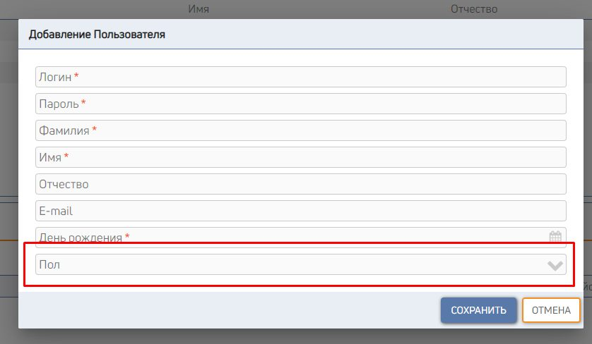

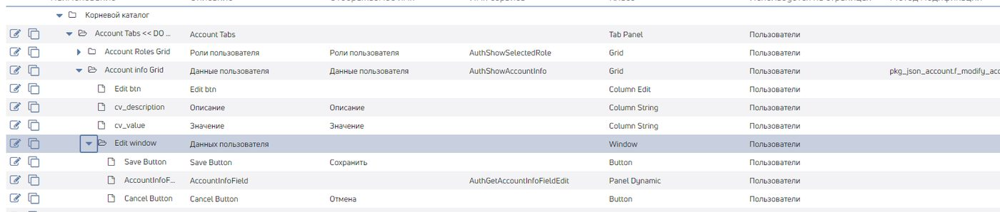

All authorization data (the list of users, roles, actions, etc.) is initialized by the platform when the gateway starts.
This information is stored by the authorization provider, which restarts automatically every night.

If:

authorization data has been modified (creating/changing users, actions, etc.);
the changes need to take effect immediately

you must restart the authorization provider.

To do this:

1. go to the "Gateway" page (Menu -> CORE -> Administration -> Gateway);
2. select the server for which the authorization provider will be reset;
3. go to the "Provider settings" tab;
4. in the "Gateway providers" grid, select the authcore authorization provider;
5. click the "Reset provider" button and confirm;

5.

The list of users, their data, and the actions available to them can be viewed on the "Authorization" tab of the
"Gateway" page (Menu -> CORE -> Administration -> Gateway):
