# Front-end

Каталог для описания компонентов и настроек Front-end


## Конструктор

Конструктор – фреймворк, т.е программная платформа, определяющая структуру
программного проекта; облегчает разработку и объединение нескольких компонентов Атрибут
проекта. Класс

### Объект

Цель создания конструктора – упростить и ускорить разработку программного Страница
продукта. Конструктор предоставляет иерархию и набор типовых компонентов, из
которых можно "собрать" любой программный продукт.


Структура метамодели
Основные компоненты:

1. Класс;
2. Объект;
3. Страница.


### Атрибут

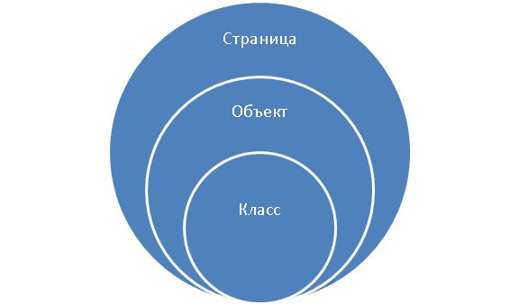

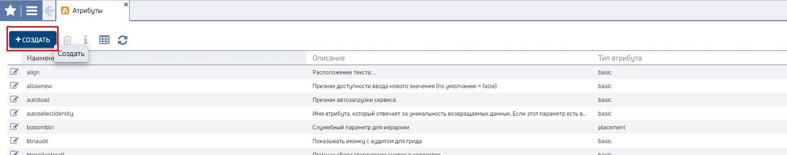

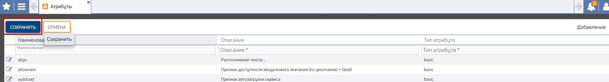

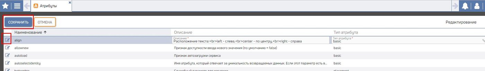

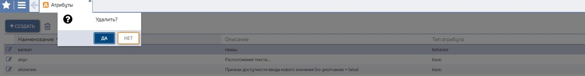

Атрибут – свойство класса либо объекта.
Создание атрибута
Каждому классу соответствует набор атрибутов. Типы атрибутов
Редактирование атрибута
Удаление атрибута
В каких классах используется

Создание атрибута
Для создания атрибута необходимо:

1. перейти на страницу «Атрибуты» (Меню -> CORE -> Конструктор GUI -> Классы);
2. нажать кнопку «Создать атрибут»;


3. заполнить поля;
4. нажать кнопку «Сохранить».


Доступные поля для заполнения:

Наименование поля Тип данных Комментарии

Наименование Текст Обязательно для заполнения.

Описание Текст

Тип атрибута Выбор из списка


Типы атрибутов
Выделяют несколько типов атрибутов:

Наименование Описание

basic обычный атрибут

behavior поведенческий атрибут для зависимости отображения от данных. Переопределяется только на
страницах.

system системный атрибут, не переопределяется для объекта/страницы

placement место для размещения дочернего элемента

view атрибут, влияющий на визуализацию


Редактирование атрибута
Для редактирования атрибута необходимо:

1. выбрать атрибут;

2.

2. нажать на кнопку-колонку «Редактировать значение»;
3. внести необходимые изменения;
4. нажать кнопку «Сохранить».


Удаление атрибута
Для удаления атрибута необходимо:

1. выбрать атрибут;
2. нажать на кнопку «Удалить»;
3. подтвердить удаление, нажав на кнопку «Да».


> **Важно!**
> Если атрибут назначен какому-либо классу, то система вернет ошибку: «Атрибут используется в [Наименование
> класса]».


Для удаления такого атрибута необходимо удалить привязку атрибута классу, а затем выполнить удаление самого
атрибута.


В каких классах используется
Для Просмотра классов, в которых используется тот или иной атрибут необходимо:

1. перейти на страницу «Атрибуты» (Меню -> CORE -> Конструктор GUI -> Классы);
2. выбрать атрибут, для которого необходимо уточнить список использующих классов;
3. в гриде "В каких классах используется" будет отображен список классов, использующих выделенный атрибут.


### Класс


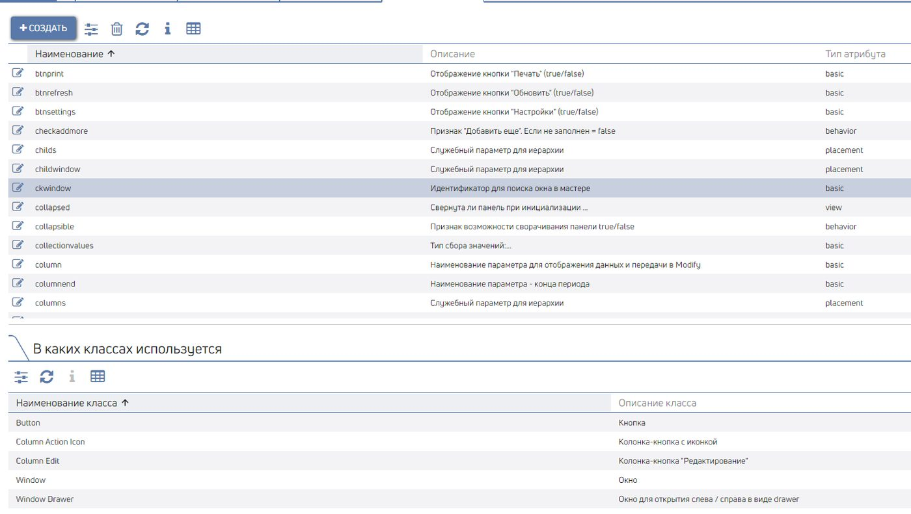

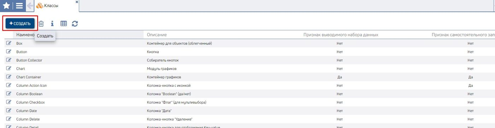

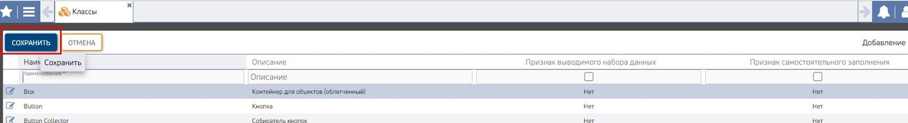

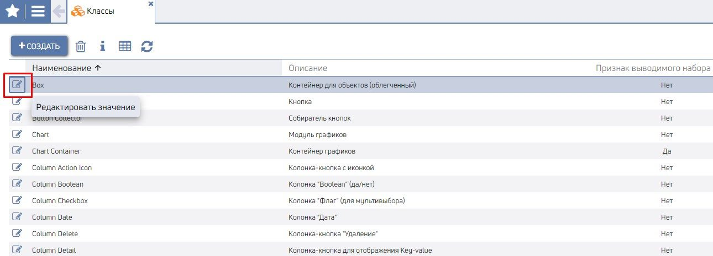

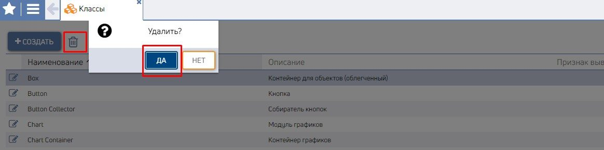

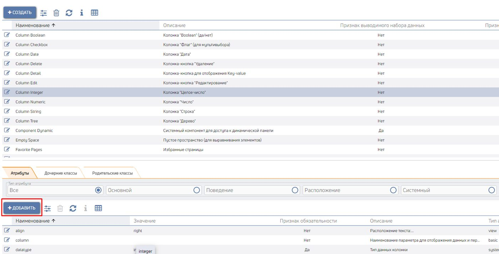

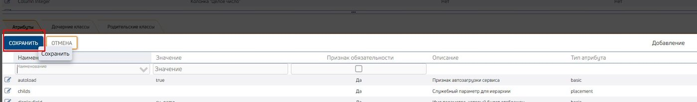

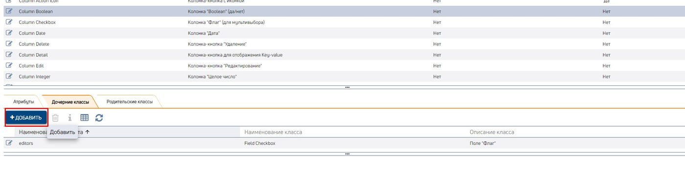

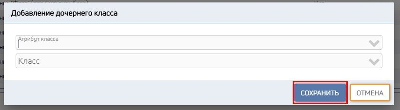

Класс – базовый компонент Конструктора.
Создание класса
Представляет собой шаблон объекта с набором атрибутов и Редактирование класса
их значений. Удаление класса
Добавление атрибутов класса
Дочерние и родительские классы


Создание класса
Для создания класса необходимо:

1. перейти на страницу «Классы» (Меню -> CORE -> Конструктор GUI -> Классы);
2. нажать кнопку «Создать»;


3. заполнить поля;

4. нажать кнопку «Сохранить».


Доступные поля для заполнения:

Наименование поля Тип Комментарии
данных

Наименование Текст Обязательно для заполнения.

Описание Текст

Признак выводимого набора Да/Нет Можно ли привязать сервис к объекту класса.
данных

Признак самостоятельного Да/Нет Может ли объект класса быть объектом верхнего уровня либо обязательно
заполнения должен иметь родителя.


Редактирование класса
Для редактирования класса необходимо:

1. выбрать класс;
2. нажать кнопку-колонку «Редактировать значение»;
3. внести изменения;
4. нажать кнопку «Сохранить».


Удаление класса
Для удаления класса необходимо:

1. выбрать класс;
2. нажать кнопку «Удалить»;
3. подтвердить удаление, нажав на кнопку «Да».

3.


> **Важно!**
> Если существует объект удаляемого класса, то система вернет ошибку: «Удаление класса невозможно, так как
> существуют связанные записи».


Для удаления такого класса необходимо удалить объект данного класса, а затем выполнить удаление самого
класса.


Добавление атрибутов класса
После создания нового класса для него добавляют набор атрибутов. Для этого необходимо:

1. выделить класс, для которого будут создаваться атрибуты;
2. выбрать вкладку «Атрибуты»;
3. нажать кнопку «Добавить»;


4. заполнить поля;

5. нажать кнопку «Сохранить».


Доступные поля для заполнения:

Наименование поля Тип данных Комментарии

Наименование Выбор из списка

Значение Текст

Признак обязательности Да/Нет

Описание Заполняется автоматически при сохранении.

Тип атрибута Заполняется автоматически при сохранении.


Дочерние и родительские классы
Иерархию классов можно настроить, добавив дочерние классы.

Для каждого класса можно привязать дочерние классы. Для этого необходимо:

1. выделить класс, к которому будут добавляться дочерние классы;
2. выбрать вкладку «Дочерние классы»;
3. нажать кнопку «Добавить»;


4. заполнить поля;
5. нажать кнопку «Сохранить».

Доступные поля для заполнения:

Наименование поля Тип данных Комментарии

Атрибут класса Выбор из списка Перечень доступных значений зависит от выбранного родительского класса

Класс Выбор из списка Перечень доступных значений зависит от выбранного родительского класса


Список родительских классов выбранного класса отображается на вкладке «Родительские классы».


### Объект


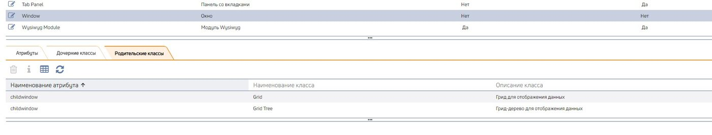

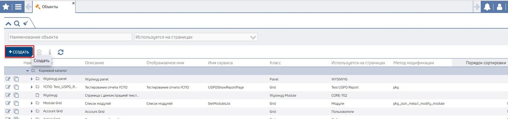

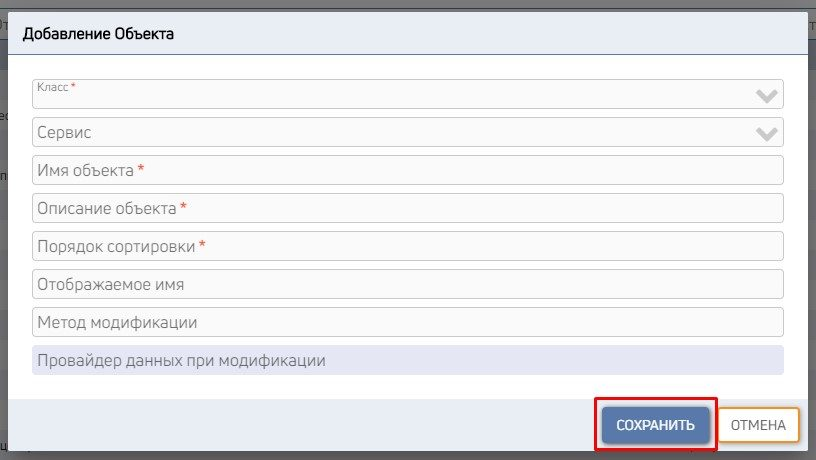

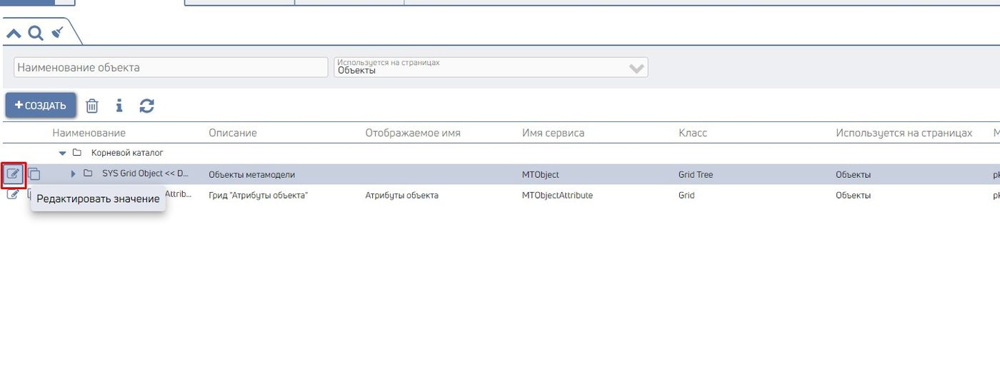

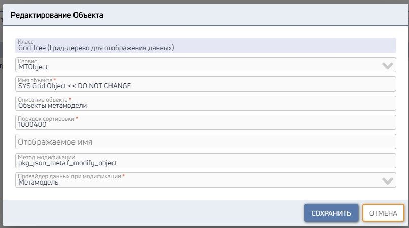

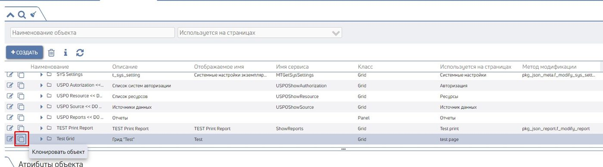

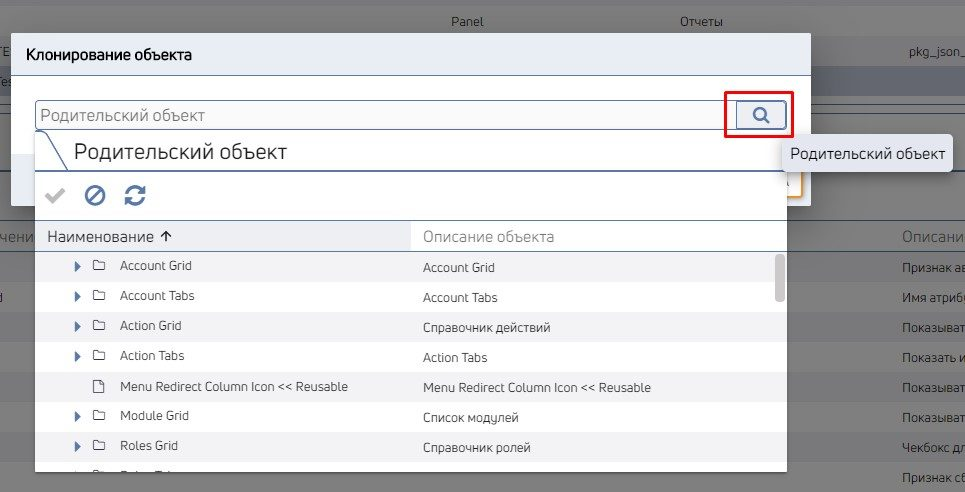

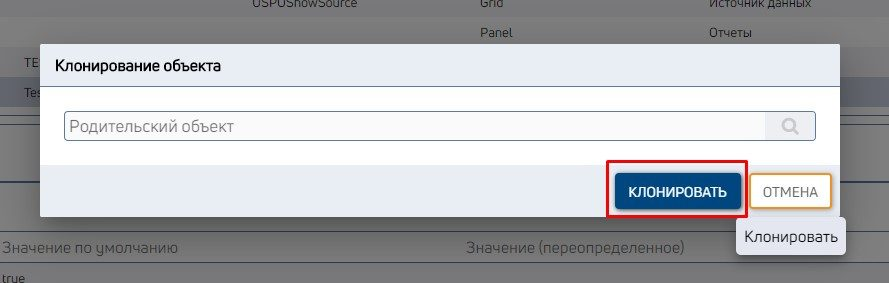

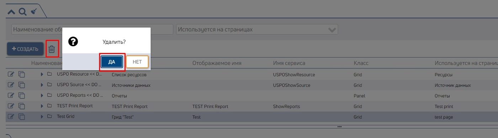

Создание объекта
Объект – экземпляр класса с заданным набором атрибутов. Редактирование объекта
Клонирование объекта
Удаление объекта
Переопределение значения атрибутов объекта


Создание объекта
Для создания объекта необходимо:

1. перейти на страницу «Объекты» (Меню -> CORE -> Конструктор GUI -> Объекты);
2. выбрать родительский объект либо корневой каталог и нажать кнопку «Создать»;


3. заполнить поля появившегося модального окна;

4. нажать кнопку «Сохранить».


Доступные поля для заполнения:

Наименование поля Тип данных Комментарии

Класс Выбор из списка Обязательно для заполнения.

Сервис Выбор из списка

Имя объекта Текст Обязательно для заполнения.

Описание объекта Текст Обязательно для заполнения.

Порядок сортировки Число Обязательно для заполнения.

Отображаемое имя Текст

Метод модификации Текст

Провайдер данных при модификации Выбор из списка Заполняется только при указании Метода модификации.


Редактирование объекта
Для редактирования объекта необходимо:

1. выбрать объект;
2. нажать на кнопку-колонку «Редактировать значение»;

3. внести необходимые изменения;
4. нажать кнопку «Сохранить».


Клонирование объекта
Клонирование позволяет создать точную копию объекта со всеми его дочерними объектами и переопределенными
значениями атрибутов. Наименование клонированного объекта будет иметь префикс "COPY of ".

Для клонирования объекта необходимо:

1. выбрать объект;
2. нажать на кнопку «Клонировать объект»;

3. выбрать в появившемся модальном окне родительский объект, в котором будет создана клонированная копия объекта. Если необходимо создать копию в корневом каталоге, то необходимо очистить поле «Родительский объект»;


4. нажать кнопку «Клонировать».


> **Важно!**
> При клонировании объекта выполняется проверка на соответствие Иерархии классов.


Если класс клонируемого объекта не является дочерним для класса родительского объекта, система вернет ошибку:
«Можно добавлять дочерние объекты только при наличии связи в т. С_Иерархия классов».


Удаление объекта
Для удаления объекта необходимо:

1. выбрать объект;
2. нажать на кнопку «Удалить»;
3. подтвердить удаление, нажав на кнопку «Да».


> **Важно!**
> Если объект используется на какой-либо странице, то система вернет ошибку: «Удаление Объекта невозможно, так как
> существует привязка объекта к странице».


Для удаления такого объекта необходимо удалить привязку объекта на странице, а затем выполнить удаление самого
объекта.


Переопределение значения атрибутов объекта

После создания объекта при необходимости переопределяются значения его атрибутов. Переопределенное значение
атрибута на объекте приоритетнее значения атрибута на классе.

Для переопределения значения атрибута на объекте необходимо:

1. выбрать объект на странице «Объекты»;
2. выбрать нужный атрибут на вкладке «Атрибуты объекта» и нажать на кнопку-колонку «Редактировать значение»;

3. ввести переопределенное значение атрибута объекта;
4. нажать кнопку «Сохранить».


Для редактирования переопределенного значения атрибута объекта необходимо:

1. выбрать атрибут;
2. нажать на кнопку-колонку «Редактировать значение»;
3. ввести новое значение;
4. нажать кнопку «Сохранить».

Для удаления переопределенного значения атрибута объекта необходимо выбрать атрибут и нажать кнопку «Удалить».


### Страница


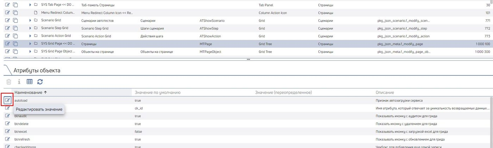

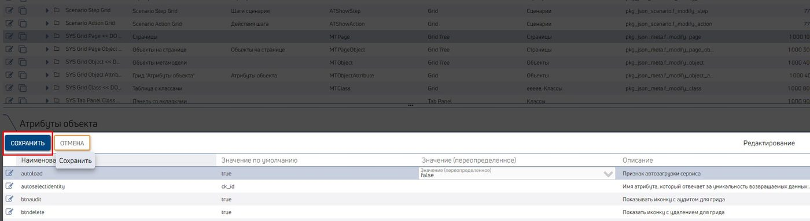

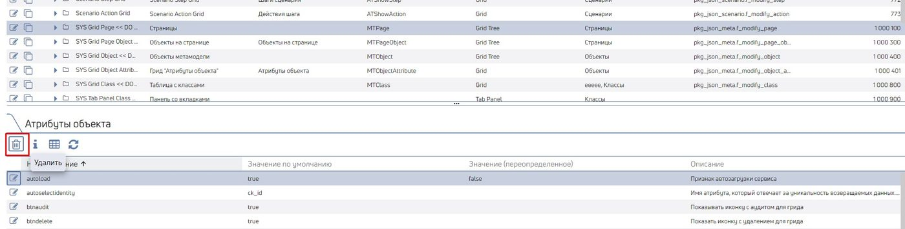

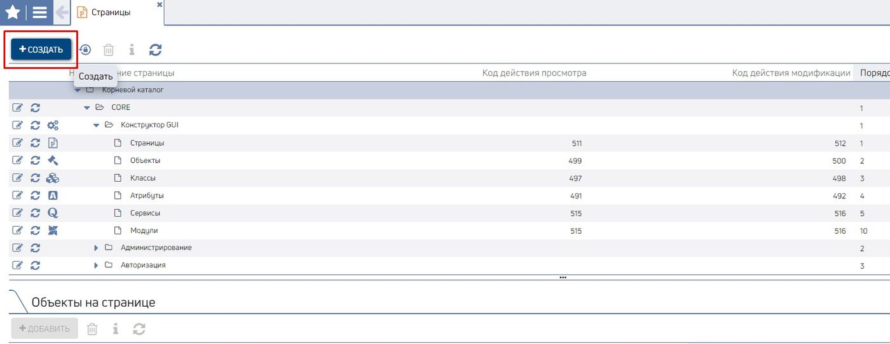

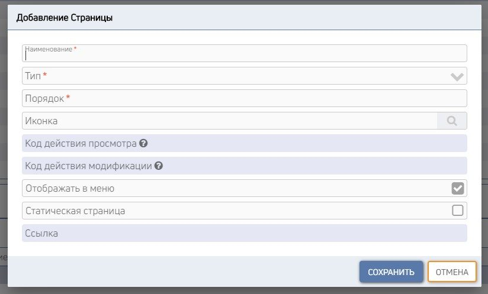

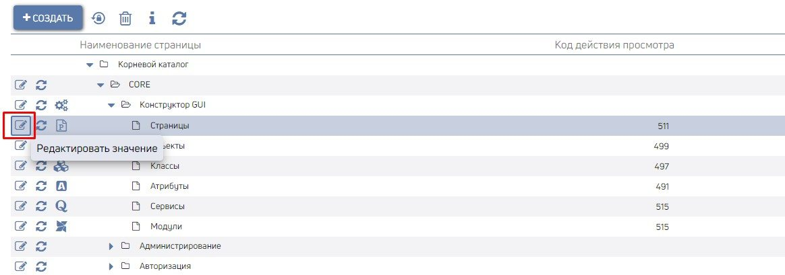

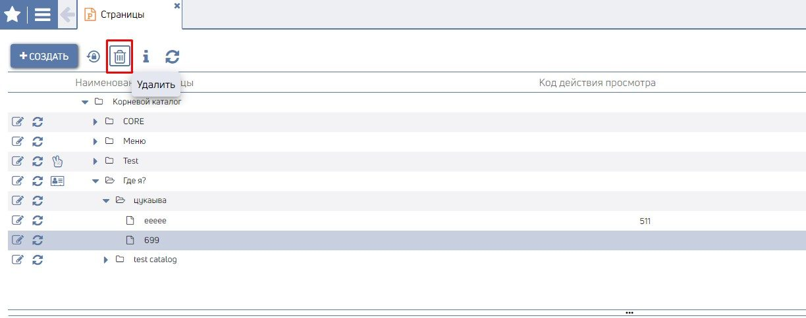

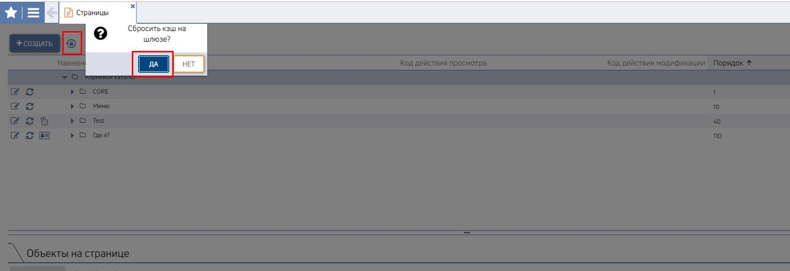

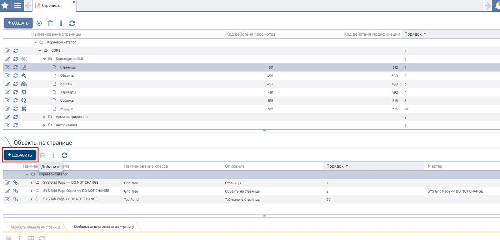

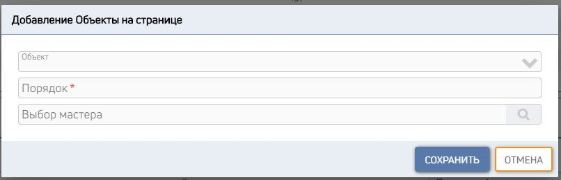

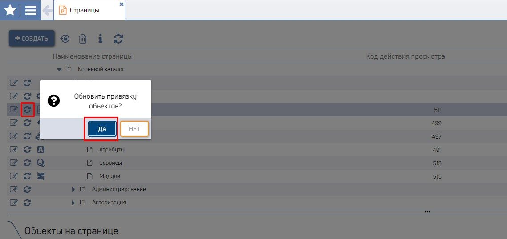

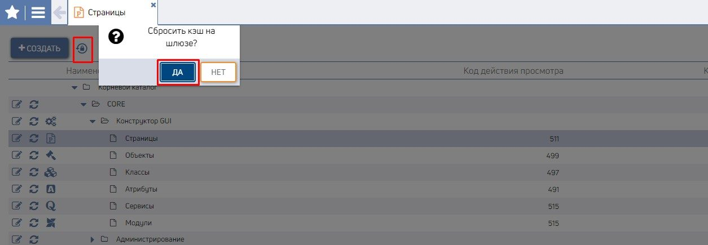

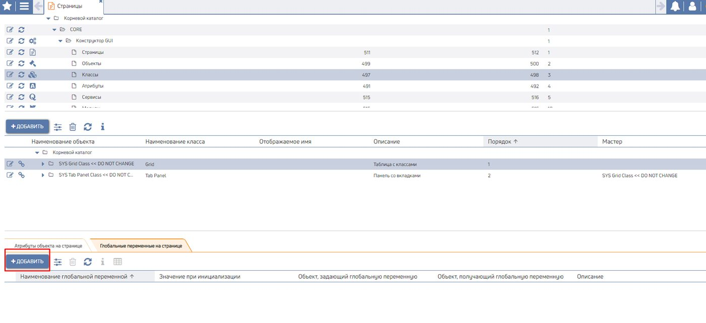

Создание страницы
Страница - верхний компонент в иерархии объектов конструктора; включает в себя Редактирование страниц
объекты и атрибуты. Удаление страниц
Сброс кэша
Типы страниц: Добавление объектов на
страницу
1. Модуль - Абстрактное понятие, отражает крупную функциональную часть Редактирование системы, включает в себя каталоги и страницы; объектов на странице 2.

2. Каталог - смысловой раздел, который «группирует» страницы и вложенные Удаление объекта со каталоги; страницы
3. Страница - базовый раздел, содержащий объекты. Добавить объекты в каталог Мастера Обновление привязки объектов на странице Переопределение атрибутов объектов на странице

### Глобальные переменные

на странице


Создание страницы
Для создания страницы необходимо:

1. перейти на страницу «Страницы» (Меню -> CORE -> Конструктор GUI -> Страницы);
2. выбрать родительский модуль/каталог либо корневой каталог, в котором будет создана страница;
3. нажать кнопку «Создать»;


4. заполнить поля появившегося модального окна;

5. нажать кнопку «Сохранить».


Доступные поля для заполнения:

Наименование поля Тип данных Комментарии

Наименование Текст Обязательно для заполнения.

Тип Выбор из Обязательно для заполнения.
списка

Порядок Число Обязательно для заполнения.

Иконка Выбор из
списка

Код действия просмотра Число Заполняется только для типа «Страница».

Код действия Число Заполняется только для типа «Страница».
модификации

Отображать в меню Да/Нет Отображать ли страницу (каталог/модуль) в Меню.

Статическая страница Да/Нет Является ли страница статической.

Ссылка Текст Адрес статической страницы.

Заполняется только при значении поля «Статическая страница» = «Да».

Доступные символы: [0-9],[a-z],[A-Z],[_],[-].

Например, при указании значения "test" ссылка на страницу будет: http://адрес
/page/test


Создание каталога и модуля аналогичны созданию страницы.

Редактирование страниц
Для редактирования страницы необходимо:

1. выбрать страницу;
2. нажать на кнопку-колонку «Редактировать значение»;


3. внести необходимые изменения;
4. нажать кнопку «Сохранить».


Удаление страниц
Для удаления страницы необходимо:

1. выбрать страницу;
2. нажать на кнопку «Удалить»;
3. подтвердить удаление, нажав на кнопку «Да».


> **Важно!**
> Если на страницу добавлен какой-либо объект, то система вернет ошибку: «Существуют объекты, привязанные к
> этой странице. Необходимо сначала удалить привязку»


Для удаления такой страницы необходимо удалить привязку объекта, а затем выполнить удаление самой страницы.

Сброс кэша
Для уменьшения количества запросов к БД и повышения быстродействия при первичном открытии страницы всё её
наполнение кэшируется.

После изменений настроек страницы (редактирования самой страницы, добавлении/редактировании/удалении объектов на
странице, обновления привязки и т.д.) необходимо осуществлять сброс кэша.

Для этого следует:

1. перейти на страницу «Страницы» (Меню -> CORE -> Конструктор GUI -> Страницы);
2. нажать на кнопку «Сбросить кэш на шлюзе»;
3. подтвердить сброс, нажав на кнопку «Да»;


4. дождаться завершения технологических работ, связанных со сбросом.


Добавление объектов на страницу
После создания страницы можно приступить к добавлению объектов. Для этого необходимо:

1. выбрать созданную страницу;
2. нажать кнопку «Добавить»;


3.

3. заполнить поля появившегося модального окна;
4. нажать кнопку «Сохранить».


Доступные поля для заполнения:

Наименование поля Тип данных Комментарии

Объект Выбор из списка Обязательно для заполнения.

Порядок Число Обязательно для заполнения.

Выбор мастера Выбор из списка Используется для установки зависимости между объектами.


Редактирование объектов на странице
Для редактирования объекта на странице необходимо:

1. выбрать объект;
2. нажать на кнопку-колонку «Редактировать значение»;
3. ввести новое значение;
4. нажать кнопку «Сохранить».


Удаление объекта со страницы
Для удаления объекта на странице необходимо:

1. выбрать объект;
2. нажать на кнопку «Удалить»;
3. подтвердить удаление, нажав на кнопку «Да».


> **Важно!**
> Если удаляемый объект либо его дочерний объект является мастером для другого объекта на странице, то система
> вернет ошибку: «Существует объект "наименование объекта", связанный через ИД мастер-объекта».


Для удаления такого объекта необходимо удалить связь с подчиненным объектом, а затем выполнить удаление
самого объекта.


Мастера
В рамках одной страницы можно настроить зависимость объекта. Главный объект, влияющий на другие объекты, является
мастером. Каждый объект может иметь только одного мастера. Мастер может иметь неограниченное количество зависимых
объектов на странице.

Взаимодействие мастера и подчиненного объекта можно настроить с помощью атрибутов:

Наименование Описание

disabledemptym Признак блокировки, если мастер вернул пустое значение
aster

getmastervalue Наименование параметра из мастера, который будет передан в json в виде "master":
{"наименование_параметра":"значение"}

reloadmaster Признак обновления родителя по мастеру

reloadservice Признак повторного вызова сервиса комбобокса во время раскрытия в случае, если изменился мастер

reqsel Признак зависимости от мастера (true/false)


Обновление привязки объектов на странице
В случае, если в объект, который уже используется на странице, были внесены изменения (например, добавлены новые
дочерние объекты) необходимо обновить привязку объектов на странице. В этом случае все внесенные изменения
отобразятся на странице.

Для обновления привязки необходимо:

1. выбрать страницу, на которой необходимо обновить привязку объектов;
2. нажать на кнопку-колонку «Обновить привязку объектов»;
3. подтвердить обновление, нажав на кнопку «Да»;


4. нажать кнопку «Сброс кэша на шлюзе»;
5. подтвердить сброс, нажав на кнопку «Да».

Переопределение атрибутов объектов на странице
После добавления объектов на страницу и настройки мастеров можно, при необходимости, переопределить значения
атрибутов объектов на странице. Переопределенное значение атрибута объекта на странице приоритетнее значения
атрибута на объекте.

Переопределение значения атрибута объекта на странице аналогично переопределению значения атрибута на объекте (ссыл
ка).

Глобальные переменные на странице
В рамках одной страницы необходимо задать список глобальных переменных. Подробнее

Для создания глобальной переменной на странице необходимо:

1. выбрать страницу;
2. перейти на вкладку «Глобальные переменные на странице»;
3. нажать кнопку «Добавить»;


4. заполнить поля;

5. нажать кнопку «Сохранить».


Для редактирования глобальной переменной необходимо:

1. выбрать глобальную переменную;
2. нажать на кнопку-колонку «Редактировать значение»;
3. ввести новое значение;
4. нажать кнопку «Сохранить».

Для удаления глобальной переменной необходимо выбрать глобальную переменную и нажать кнопку «Удалить».


> **Важно!**
> Если глобальная переменная используется на странице, то система вернет ошибку: «Удаление переменной
> невозможно, так как она все еще используется на странице».


Для удаления такой глобалки необходимо удалить привязку у объектов, задающих/получающих эту глобальную
переменную, а затем выполнить удаление самой глобалки.


## Интерфейс и элементы управления

Пользовательский интерфейс (графический интерфейс) Конструктора состоит из стандартных элементов, таких как: кнопки,
меню, вкладки, фильтры, панели навигации и управления и т.п.

Пользовательский интерфейс выполнен в двух вариантах: «Светлая тема» и «Темная тема». Выбор темы не влияет на
выполнение функций и сделан для удобства конкретного пользователя. Основные различия тем – цветовые, шрифтовые и
компонентные решения, а также расположение панелей управления. По умолчанию, при первичной авторизации
пользователя подгружается «Светлая тема», при последующих авторизациях – выбранная пользователем тема.


### Авторизация


Для входа в систему необходимо
пройти авторизацию на стартовой
странице системы. В поля ввода ввести
логин и пароль, нажать кнопку
«Войти». Пока поля не будут
заполнены, данная кнопка будет
неактивна.

Символы введённого пароля будут
скрыты.


Для возможности просмотра пароля
необходимо навести курсор на поле
ввода пароля, справа отобразятся
значки «глаз» и «крестик». Нажать на
значок «глаз». Скрыть пароль можно
повторным нажатием на «глаз».


### Глобальная панель


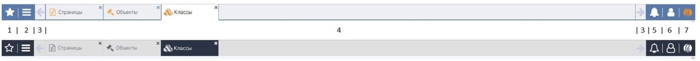

Конструктор имеет глобальную статичную панель, расположенную в верхней части страницы и состоит из следующих элементов
(слева направо):

1. Кнопка вызова раздела быстрого доступа
2. Кнопка вызова раздела основного меню
3. Кнопки навигации по вкладкам
4. Область вкладок
5. Кнопка вызова раздела оповещений
6. Кнопка вызова профиля пользователя
7. Кнопка вызова информации о программе


1. Кнопка вызова раздела быстрого доступа Кнопка осуществляет вызов бокового меню с вкладками, которые будут помечены пользователем как «Избранные». При отсутствии таких вкладок, боковое меню будет пустым. При первоначальной авторизации пользователя панель также будет пустой. Для того, чтобы в меню отображались «Избранные» вкладки, необходимо пометить их в основном меню.

2. Кнопка вызова раздела основного меню Кнопка осуществляет вызов основного бокового меню со всеми вкладками программы. Здесь осуществляется переход ко всем необходимым разделам, для удобства все функции сгруппированы по категориям.

3. Кнопки навигации по вкладкам Предназначены для перемещения по вкладкам, вправо и влево соответственно, если все активные вкладки не помещаются в область вкладок, отображаемую браузером пользователя.

4. Область вкладок Предназначена для быстрого переключения между активными разделами. Активная вкладка выделяется на панели другим цветом.

5. Кнопка вызова раздела оповещений Кнопка осуществляет вызов информации по возникающим в процессе работы предупреждениям, ошибкам, системной информации. Данный раздел необходим для быстрой диагностики работы программы и упрощению поддержки пользователя при работе с программой.

6. Кнопка вызова профиля пользователя Кнопка открывает информацию о пользователе, осуществляющем работу с программой, а также позволяет осуществить выбор подразделения, период и тему оформления.

7. Кнопка вызова информации о программе Кнопка вызывает информацию о версии программы и разработчике.


#### Основное меню, панель закладок (быстрого доступа)


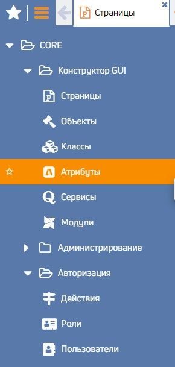

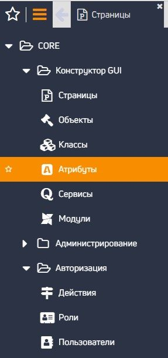

Основное меню визуально
представляет собой дерево каталогов.

Каталог раскрывается при нажатии на
название. Если в каталоге вложены
ещё каталоги, то раскрытие будет
происходить до достижения конечной
страницы. Выбор страницы также
происходит нажатием на название.
Каталог имеет значок «Папка», при
раскрытии каталога значок меняет
свой вид на «раскрытый», а стрелка,
расположенная слева от значка,
меняет направление и указывает вниз.
При скрытии содержимого каталога,
значок меняет вид с «раскрытый» на
«скрытый», стрелка указывает вправо.


Для добавления страниц в панели
быстрого доступа «Избранное»
необходимо навести курсор на
страницу, слева появится значок
«звёздочка». Нажать на этот значок.
«Звёздочка» выделится и будет
постоянно отображаться напротив
названия страницы в основном меню.
Для снятия значка необходимо нажать

на него повторно. При снятии значка,
страница будет удалена из панели
«Избранное»


При добавлении страниц в панель
быстрого доступа «Избранное»,
страницы будут отображены не
иерархией, а списком. Расположение
позиций в списке будет изменяться по
мере добавления позиций в
зависимости от основной иерархии
страниц по каталогам.


Для удаления страниц из панели
быстрого доступа «Избранное»
необходимо навести курсор мыши на
графический значок станицы слева от
названия, значок поменяет свой вид
на «крестик», нажать его, страница
будет удалена.


#### Панель оповещения

Для просмотра системной
информации необходимо открыть
меню «Оповещения».

Здесь содержится информация для
разработчиков, системного
администратора и технической
поддержки. Здесь можно
переключаться по вкладкам и типам
оповещений.

Распределение информации по блокам:

Все - все полученные сообщения независимо от типа и оповещения из БД;
Информация - информационные сообщения (тип info);
Ошибки - сообщения об ошибках (тип error);
Предупреждения - предупреждения, требующие подтверждения пользователя (тип warning);
Оповещения - сообщения, полученные от службы оповещения;
Разработка - сообщения отладки и список глобальных переменных для каждой открытой страницы.


#### Профиль пользователя


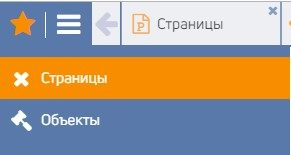


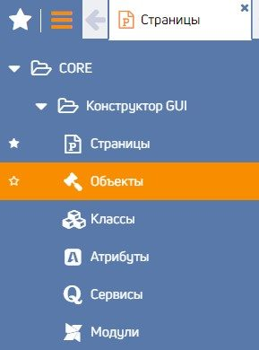

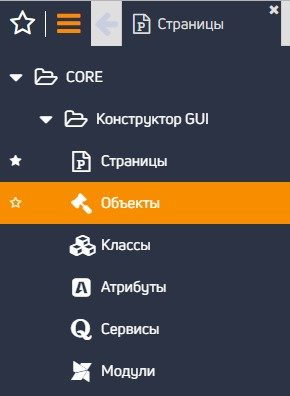


Для просмотра информации об
авторизованном в системе
пользователе необходимо открыть
профиль пользователя. Также здесь
можно сменить тему интерфейса.


#### Информация о программе

Информация о версии и сборке
программы отображается во
всплывающем окне после нажатия на
кнопку «Информация о программе».


### Рабочая область

Рабочая область представляет собой страницы, на которых расположены фильтры, связанные таблицы с вкладками, панели
управления.

Представление рабочей области отличается в светлой и тёмной темах.

Связь между таблицами осуществляется по принципу «Аккордеон» - при выборе элемента в верхней таблице (блоке данных),
отображается информация по выбранной записи в нижней таблице (блоке данных), если таблиц несколько, необходимо в
каждой таблице (блоке данных) выбирать записи последовательно сверху вниз. В случае, если запись в верхней таблице
выбрана не будет, панели управления на нижней таблице будут неактивны.


### Элементы управления и их обозначение


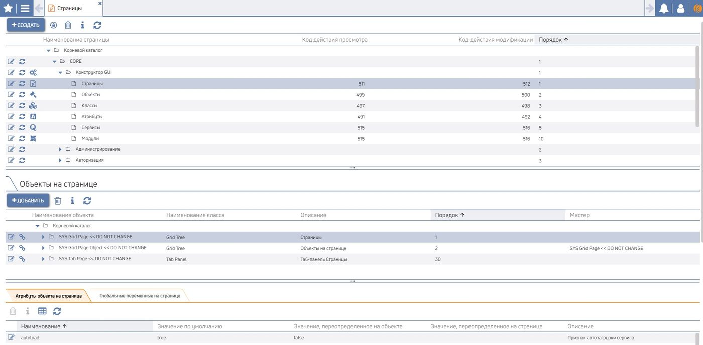


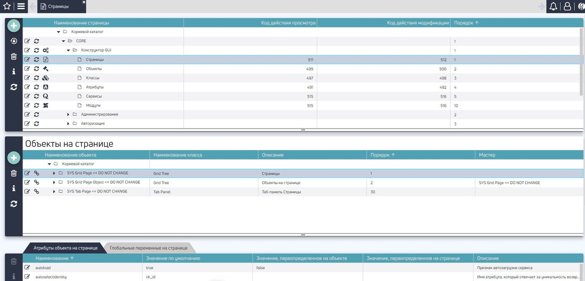

Основные элементы управления представлены для каждого блока, с которым производятся действия и являются
стандартными. Сгруппированы элементы также по блокам. Расположение в Тёмной теме – вертикальное, в Светлой теме –
горизонтальное. В Светлой теме некоторые функциональные кнопки подписаны, в Тёмной теме используются интуитивные
иконки, поэтому для уточнения назначения кнопки на неё следует навести курсор, появится всплывающая подсказка с
наименованием кнопки.

Глобальные фильтры всегда расположены вверху рабочей области страницы.

Таблица 1 – Панель управления для блоков фильтрации

Активный элемент Неактивный элемент Описан Активный элемент Неактивный элемент
ие
элемента

Собира
тель
кнопок
(кнопка

«еще»).
Элемен
т
предна
значен
для
скрыти
я
функци
ональн
ых
кнопок
фильтр
а. Для
отобра
жения
всех
возмож
ностей
фильтр
а,
требует
ся
нажать
на
элемент
, после
чего
раскрое
тся
список
скрыты
х
функци
й
фильтр
ации,
выбрат
ь
нужную.

- Скрыть -
/развер
нуть
фильтр
ы.
Предна
значен
для
отобра
жения
/скрыти
я
панели
фильтр
ации.
Скрыти
е
/развор
ачиван
ие
панели
не
влияет
на
введён
ные в
фильтр
данные.

- Поиск. -
Ключев
ой

элемент
для
панеле
й
фильтр
ов,
информ
ация
по
выбран
ному
фильтр
у не
отобра
жается,
пока не
будет
нажат
поиск

- Очистк -
а
фильтр
а. Для
быстрог
о
сброса
всех
заданн
ых
параме
тров
фильтра

Выбрат
ь. Элем
ент
присутс
твует
во
вложен
ных и
составн
ых
фильтр
ах. Осу
ществл
яет
выбор
записи
из
таблиц
ыс
отфиль
трован
ной
информ
ацией

- Отмена. -
Элемен
т
присутс
твует
во
вложен
ных и
составн
ых
фильтр
ах.
Отменя
ет

выбор
записи
из
таблиц
ыс
отфиль
трован
ной
информ
ацией

Светлая тема Темная тема


Таблица 2 – Панель управления для блоков данных

Активный элемент Неактивный элемент Описание Активный элемент Неактивны
элемента й элемент

Собиратель
кнопок (кнопка
«еще»). Элемент
предназначен для
скрытия
функциональных
кнопок, которые
не требуется
использовать
часто. Для выбора
скрытой в
собирателе
кнопки, требуется
нажать на
элемент, после
чего раскроется
список скрытых
кнопок, выбрать
нужную.

Собиратель
кнопок для
периодов. Элемент
предназначен для
скрытия
обобщения
процедур
закрытия
/открытия
расчетных
периодов.

Добавить.
Элемент для
добавления
данных в
выбранном блоке

- Редактировать. Эл -
емент для
редактирования
данных в
выбранном блоке

- Клонировать. Элем -
ент предназначен
для добавления
новых данных
путём
копирования
имеющихся
данных

Удалить. Элемент
для удаления

данных в
выбранном блоке


Информация. Отоб
ражает
информацию о
последнем
изменении записи
– дату и
пользователя
системы

Обновить.
Посылает запрос
на актуализацию
записей в базе
данных

Вызов мастера
заполнения. Прису
тствует не на всех
формах,
используется для
массовых
операций.
Функции будут
рассмотрены при
описании
конкретных форм.

Выгрузка (печать)
в Excel. Осуществл
яет выгрузку
представления
или сформированной
в рабочей области или
таблицы в
формате Excel-
документа. Для
каждой таблицы
(блока данных)
используется
отдельный
элемент данного
типа.

Светлая тема Темная тема


Для удобства представления и работы данные могут быть разбиты по вкладкам, страницам, логическим группам, имеют
навигацию по истории изменений, а также возможность сортировок по столбцам.

Таблица 3 – Панели представления информации

Светлая тема Описание Темная тема
элемента

Вкладки.
Все
данные
записей
сгруппиро
ваны по
определён
ным
показателя
м. Для
удобства
отображен
ия,

исчерпыва
ющая
информац
ия
отображае
тся по
группам
на
вкладках

Пагинатор.
В случае,
если все
данные не
помещают
ся на
рабочую
область,
данные
разбивают
ся на
страницы,
переход
по
страницам
осуществл
яется
путём
пролистыв
ания
страниц
кнопками
пагинатор
а («<» -
переход
на
предыдущ
ую
страницу,
«>» -
переход
на
следующу
ю
страницу,
«<<» -
переход к
первой
странице,
«>>» -
переход к
последней
странице).
Также
здесь
отображае
тся
количеств
о страниц
и текущее
положение.

История. П
росмотр
историчны
х данных

по записи
(при
наличии)


Сортировк
а. Для
выполнен
ия
сортировк
и по
необходим
ому
столбцу,
необходим
о
щёлкнуть
по
заголовку
столбца
(по
возрастани
ю «а-я» –
стрелка
вверх, по
убыванию
«я-а» -
стрелка
вниз). При
отсутствии
стрелки,
сортировк
а
производи
тся по
умолчани
ю (дате
добавлени
я).
Столбец,
по
которому
выполнена
сортировк
а,
выделяетс
я другим
цветом,
рядом с
наименова
нием
отображае
тся стрелка

Группиров
ки. Исполь
зуются для
удобства
отображен
ия
информац
ии при
наличии

логических
групп
информац
ионных
полей. По
умолчани
ю все
панели
развёрнут
ы, их
можно
свернуть
нажатием
на
наименова
ние
группы.
Разворачи
вание
происходи
т
аналогично


Для удобства работы записи в гридах также имеют элементы управления. Это позволяет осуществлять безошибочное
редактирование, просмотр подчинённых записей, быстрый переход к связанным данным на других страницах. Располагаются
такие элементы всегда слева в первом столбце, непосредственно напротив каждой записи.

Таблица 4 – Элементы управления для записей

Светлая тема Описание элемента Темная тема

Иерархия. Отображение/скрытие иерархии или дополнительных данных. Если в
записи присутствует список дополнительной информации или подчинённых
записей, которые можно просмотреть, раскрыть/скрыть список следует нажатием
на данный элемент (значок «>» - список скрыт, значок «V» - список раскрыт)

Редактирование. Для внесения изменений в выбранную запись


Связанные данные. Для быстрого перехода к формам со связанными данными


### Элементы ввода данных


Все элементы ввода данных являются стандартными.

Элементы могут быть обязательными и необязательными для заполнения.

Обязательные для заполнения элементы отмечены красной звёздочкой. Признак обязательности заполнения элемента
распространяется на элементы ввода данных любого типа.

Необязательные поля могут быть заполнены при наличии информации или по мере её поступления.

Элементы также могут быть неактивны, тогда они будут подсвечены другим цветом и заблокированы для заполнения.

Таблица 1 – Элементы ввода данных

Светлая тема Описание Темная тема
элемента

Признак
обязательности
поля

Поле
фильтрации. Для
внесения
данных в такие
поля,
необходимо
нажать на
значок лупы и
выбрать запись
из
выпадающего
фильтра

Простое поле. В
поле
осуществляется
ввод текстовой
или числовой
информации.

Поле даты. В
поле
осуществляется
ввод даты в
заданном
формате
(например, ДД.
ММ.ГГГГ) или из
выпадающего
календаря при
нажатии на
значок.

Выпадающий
список. Содержи
т определённый
список данных,
из которых
нужно выбрать
один пункт. В
выпадающем
списке можно
производить
поиск по
наименованию
записи из
списка. Поле
может быть
обязательным

Чекбокс.
Атрибут,
выполняет
логическую
функцию «да
/нет», в
соответствии с
подписью

Поле быстрого
перехода. Такие
поля позволяют
осуществить
быстрый
переход к

другой
странице с
автоматическим
внесением
имеющихся в
поле данных

Подсказка. Распо
лагается
непосредственн
о в поле для
заполнения.
При наведении
курсора на
значок
подсказки
появляется
информация по
правилам
заполнения
данного поля


### Окна для ввода данных


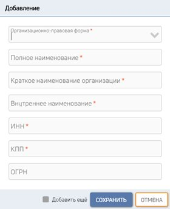

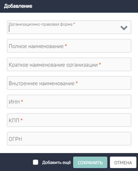

Ввод и редактирование данных для таблиц происходит с помощью всплывающих модальных окон в центре рабочей области,
для групп полей – поверх полей заполнения. Принцип заполнения таких окон одинаковый, необходимо внести информацию
и нажать кнопку «Сохранить». Расположение кнопки «Сохранить» может быть в правом нижнем или в левом верхнем углу.


### Мастер ввода данных (песочные часы)


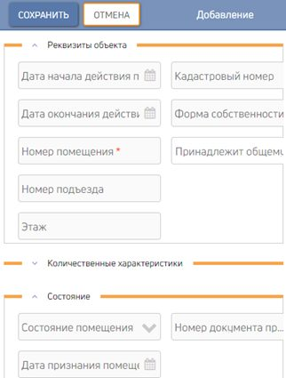

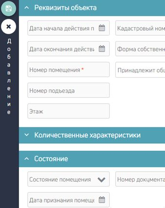

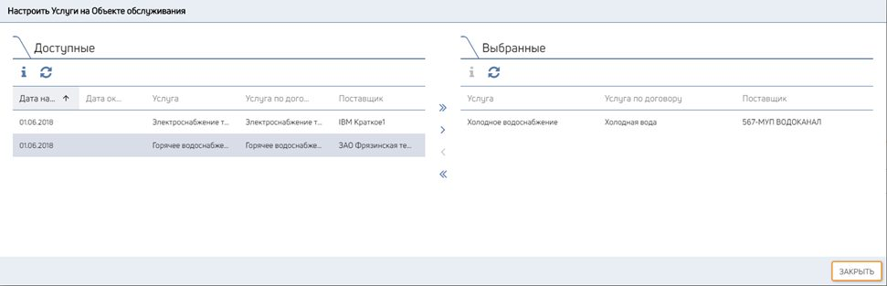

В некоторых случаях, для внесения информации требуется выполнить несколько однотипных действий. Для оптимизации
таких процессов используется множественный выбор из мастера ввода данных.

В мастере ввода данных содержатся два окна, слева отображаются доступные для выбора записи, справа – выбранные
записи. Для добавления записей, необходимо выбрать запись и перенести в правое окно кнопкой единичного переноса «>».
Таким же образом осуществляется снятие выбора с записи, путём нажатия кнопки «<». При необходимости, можно выбрать
все доступные записи кнопкой «>>» или снять выбор со всех записей «<<». После выбора необходимых записей, окно следует
закрыть при помощи кнопки «Закрыть». Выбранные записи будут добавлены в соответствующий блок.

Преимущество такого подхода заключается в удобстве представления и добавления информации. Также одна запись не
может быть выбрана дважды, что исключает возможность дублирования или пересечения данных.


## Компоненты конструктора

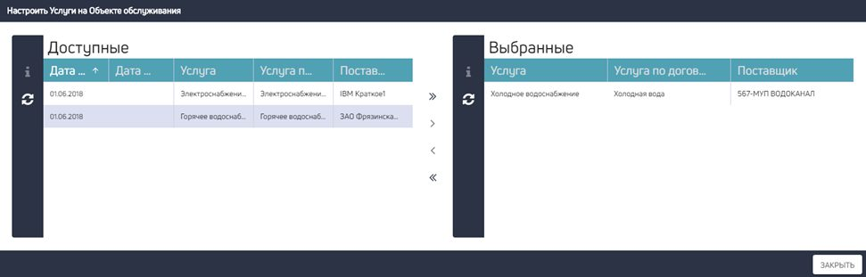

В данном каталоге содержатся статьи с описанием всех объектов и основных настроек их атрибутов


### Гриды

Объекты классов Кнопка (Button) либо Собиратель кнопок (Button/Collector) со
значением cn_order < 1 000 000 будут отображены до блока с кнопками по умолчанию. Простой грид (Grid)
Грид типа "Дерево" (Grid
Компоненты для отображения данных в виде таблиц. Tree)


Основные настройки для всех типов гридов
Может содержать в себе следующие типы объектов:

Кнопки, кнопки-колонки, собиратели кнопок;
Фильтр;
Колонки (числовые, строковые, с датами и т.д.);
Поля детализации;
Переходы на другую страницу;
Окна.


Кнопки с основными действиями вынесены в атрибуты грида и по умолчанию имеют значение «true»:


1. btndelete – кнопка «Удалить»;
2. btnaudit – кнопка «Информация»;
3. btnexcel – кнопка «Экспорт в Excel»;
4. btnrefresh – кнопка «Обновить».

Для всех статических кнопок порядок сортировки (cn_order) = 1 000 000.

Объекты классов Кнопка (Button) либо Собиратель кнопок (Button/Collector) со значением cn_order < 1 000 000 будут
отображены до блока с кнопками по умолчанию.

Объекты классов Кнопка (Button) либо Собиратель кнопок (Button/Collector) со значением cn_order > 1 000 000 будут
отображены после блока с кнопками по умолчанию.


Сортировка данных в гриде настраивается с помощью атрибутов:

orderproperty – наименование параметра из сервиса, по которому будет отсортирован грид;
orderdirection – направление сортировки (ASC/DESC).


Настройка работы со значениями грида производится с помощью атрибутов:

Наименование Описание

атрибута

collectionvalues Тип сбора значений:
object - виде объекта;
array - массив строк.

selmode Возможность выделения нескольких значений в GRID и TREEGRID

SINGLE - только 1 значение

SIMPLE - позволяет выбирать значения одно-за-другим. Каждое нажатие добавляет/удаляет
значение.

MULTI - позволяет комплексно выбирать значения, с учетом ctrl и shift


С помощью атрибута spliter настраивается отображение сплитера.


#### Простой грид (Grid)


Представляет собой таблицу, отображающий данные в строках и столбцах.


Настройки

Основные настройки для всех типов гридов можно посмотреть тут.


Режим добавления/редактирования данных в гриде определяется атрибутом edittype и может принимать значения:

inline – в строке;


modalwindow – в модальном окне.

При указании типа редактирования inline происходит преобразование колонок грида в поля в соответствии с Таблицей:

Колонка грида Поле при добавлении/редактировании

Column Boolean Field Checkbox

Column Date Field Date

Column Integer Field Integer

Column Numeric Field Numeric

Column String Field Text


В случае, если необходимо, чтобы на основании колонки класса String в режим модификации попало не текстовое поле (Field
Text), а, например, Поле "Выпадающий список" (Field Combobox), необходимо:

1. выбрать нужную колонку грида;
2. создать дочерний объект класса Combobox;
3. корректно настроить его (указать верные column, displayfield, idproperty, valuefield, сервис)
4. указать необходимый режим добавления/редактирования в атрибуте editmode поля Combobox. Возможные значения: all - доступно во всех режимах;

```
       insert - возможен ввод данных только при добавлении;
       update - возможно только редактирование;
       disabled - недоступно для ввода данных.

При указании значения disabled поле не будет отображаться в модальном окне.
Если необходимо, чтобы поле все-таки отображалось в модальном окне, но было недоступно для ввода/редактирования,
необходимо указать значение "true" в атрибуте visibleinwindow на колонке.
```

5. Наименование поля в автособираемом окне будет браться из наименования колонки.

При указании типа редактирования modalwindow и отсутствии объекта класса Окно (Window) в гриде, на основании колонок
грида будет сформировано автособираемое окно (подробнее тут).


Число, указанное в атрибуте pagesize, будет влиять на количество отображаемых строк грида на одной странице.

Также у грида будет отрисован пагинатор, указывающий какая страница из общего количества сейчас отображена.


#### Грид типа "Дерево" (Grid Tree)

Представляет собой данные, отображаемые в виде иерархической таблицы.


В гридах типа «Дерево» отсутствуют пагинация и колоночные фильтры.

Для корректного отображения Грид-дерево должен содержать колонку класса – Колонка "Дерево" (Column Tree). В данной
колонке должны содержаться данные о родительских объектах первого уровня для построения верной иерархии.


Настройки

Основные настройки для всех типов гридов можно посмотреть тут.


Атрибут rootvisible - включает (true) / выключает (false) отображение корневого элемента грида.


Особенности сервиса

Для корректного отображение иерархической структуры грида типа "Дерево" в результатирующем наборе сервиса должны быть
следующие ключ-значения:

Наименование ключа Комментарии

ck_id Уникальный идентификатор записи

ck_parent Уникальный идентификатор родительского узла.

Пустой для корневого узла.

leaf Является ли узел листом.

true - если узел является листом;

false - если узел является корнем.


### Кнопки (Button)


Если грид содержит несколько окон, то настроить взаимосвязь конкретной кнопки с конкретным окном позволяет парный
атрибут ckwindow. Для настройки связи необходимо указать одинаковое значение атрибута ckwindow и у окна, и у кнопки.


Если для выполнения действия после нажатия кнопки необходимо получить подтверждение пользователя, то вопрос-
подтверждение указывается в атрибуте confirmquestion.


Для настройки операции, которую будет выполнять кнопка используются атрибуты:

handler - какой обработчик использовать.

Возможные значения:

Наименование Описание

onCreateChildWindowMaster вызывает окно (Window) при добавлении записи в гриде со
значением атрибута edittype = modalwindow

onRowCreateChildWindowMaster вызывает окно (Window) при редактировании записи в гриде
со значением атрибута edittype = modalwindow

onSimpleSaveWindow сохранение данных по кнопке для модального окна

onCloseWindow закрытие модального окна.

После нажатия на кнопку отображается сообщение-
подтверждение действия: "Отменить? Да/Нет"

onCloseWindowSilent закрытие модального окна без сообщения

onPrintHandleOnline Онлайн печать

onPrintHandleOffline Отложенная печать

mode - Тип операции, вызываемой кнопкой

Возможные значения:


Наименование Описание

1 Добавление

2 Редактирование

3 Удаление

4 Вызов сервиса из атрибута updatequery

5 Вызов меню с информацией

6 Режим клонирования значений

7 Режим выгрузки файла

8 Режим загрузки файла


modeaction - Значение action, передаваемое в json вместо стандартных I,U,D
updatequery - Имя сервиса для кастомных операций
filetypes - Тип документа доступный для выбора в 8 методе
maxfile - Максимальный размер файла в байтах


Для настройки иконки кнопки используют атрибуты:

iconfont - Иконка (например, fa-plus)

iconfontname - Наименование класса или наименование колонки при динамике

onlyicon - Отображается только иконка кнопки (true/false)


tipmsg - Подсказка у кнопки при наведении


uitype - вид кнопки (1-primary, 2-secondary)

Светлая тема uitype Темная тема

1


2


Отображение кнопок при инициализации настраивается с помощью атрибутов:

disabled - признак неактивности кнопки

disabledemptymaster - признак неактивности кнопки при пустом мастере
hidden - признак скрытия кнопки


С помощью атрибутов columnsfilter и redirecturl настраивается переход по гиперссылке. Подробнее тут


#### Собиратель кнопок (Button Collector)

Позволяет собирать несколько кнопок в один компонент.


При указании в атрибуте btncollectorall значения "true" Собиратель кнопок автоматически включит в себя кнопки Информация и
Экспорт в Excel.


### Колонки

Являются составной частью гридов (простой, грид-дерево, поле "Выпадающая таблица"). Объекты класса Column Action Icon
(Колонка-кнопка с иконкой) могут являться самостоятельными и не иметь родителя.


#### Колонка "Boolean" (Column Boolean)


Основные настройки колонок
Для отображения данных в колонках (кроме колонок-кнопок) в атрибуте column следует указать наименование ключа из запроса.


Для настройки местоположения текста в колонке используется атрибут align с доступными значениями:

left - слева;
center - по центру;
right - справа

Значения по умолчанию задаются с помощью атрибутов defaultvalue и defaultvaluequery.

В атрибуте defaultvalue указывается статичное значение. Примеры:

true/false - для checkbox;
1/0 - для boolean;
sysdate - для указания текущей даты/времени в формате ISO 8601 в Column Date.

В атрибуте defaultvaluequery указывается наименование сервиса, возвращаемое значение которого и будет являться значением
по умолчанию для колонки.


Атрибут editmode влияет на доступность ввода данных в колонку в режиме добавления/редактирования и может принимать
значения:

all - доступна во всех режимах;

```
insert - возможен ввод данных только при добавлении;
update - возможно только редактирование;
disabled - недоступна для ввода данных.
```

Максимальное количество символов в колонке задается атрибутом maxsize.


В атрибуте regexp указывается регулярное выражения для проверки введенного значения.


Обязательность заполнения колонки регулируется атрибутом required (true/false).


Для сортировки данных в колонке по значению, отличному от атрибута column, следует указать необходимый ключ из сервиса в
атрибуте sortcolumn.

Пример использования:


Видимость колонки в гриде можно настроить, используя атрибут visible (true/false).


Ширина колонки задается в процентах целым числом от 1 до 100 в атрибуте width.


#### Колонка "Boolean" (Column Boolean)

Колонка для отображения логического типа данных (Да/Нет).

Может принимать значение 1 или 0. Не может быть пустым.


#### Колонка "Дата" (Column Date)

Используется для отображения дат в формате ISO 8601.

Формат отображения данных регулируется значением атрибута format.

Возможные значения:

1 - ГГГГ;
2 - МММ ГГГГ;
3 - ДД.ММ.ГГГГ;
4 - ДД.ММ.ГГГГ ЧЧ:00;
5 - ДД.ММ.ГГГГ ЧЧ:МИ;
6 - ДД.ММ.ГГГГ ЧЧ:МИ:CC.


#### Колонки-кнопки

Разновидность колонки-кнопок.

Используется для выбора нескольких записей в гриде.


##### Колонка-кнопка "Редактирование" (Column Edit)


Разновидность колонки-кнопки.

Отображает кнопку редактирования для каждой записи в гриде.


##### Колонка-кнопка "Удаление" (Column Delete)


Разновидность Колонки-кнопки. Используется для удаления выбранной записи грида. Отображается непосредственно в гриде
для каждой записи.


##### Колонка-кнопка для отображения значка детализации (Column Detail)


Разновидность колонки-кнопки.

Используется для настройки видимости значка детализации в гриде. Например, если его необходимо скрыть для итоговой строки.


##### Колонка-кнопка с иконкой (Column Action Icon)


Если необходимо поместить кнопку для каждой записи в гриде, используется объект класса Колонка-кнопка с иконкой (Column
Action Icon).

Данный объект включает в себя все настройки класса Кнопка (ссылка), но является колонкой в гриде.


Примеры использования:

Колонка-кнопка "Обновить привязку" и Кнопка-колонка "Иконка" на странице Страницы:

Для отображения разных иконок в зависимости от данных необходимо указать значение "true" для атрибута dynamicicon.


#### Текстовые колонки

Колонка для отображения данных 1 уровня в гриде типа "Дерево".


##### Колонка "Строка" (Column String)


Колонка для отображения текстовых данных.

В атрибуте imask указывается маска ввода данных.

Например, (999) 999-99-99


С помощью атрибутов columnsfilter и redirecturl настраивается переход по гиперссылке. Подробнее тут


#### Числовые колонки

Колонка для отображения целочисленных значений.


Максимальное количество символов указывается в атрибуте maxsize.


Максимальное и минимальное значения колонки указываются в атрибутах maxvalue и minvalue соответственно.

##### Колонка "Число" (Column Numeric)


Колонка для отображения числовых данных.

В атрибуте currencysign указывается постфикс, который будет добавлен к данным. Например. "руб." для отображения суммы.


В атрибуте decimalprecision указывается целое число, определяющее точность после запятой.

В атрибуте decimalseparator - разделитель дробной части.

В атрибуте thousandseparator - разделитель тысяч.


> **Важно!**
> Значения атрибутов thousandseparator и decimalseparator не могут совпадать.


При попытке переопределения значений указанных атрибутов на объекте и/или странице, которое приведет к
совпадению значений, система вернет ошибку: "Значения атрибутов decimalseparator и thousandseparator не могут
совпадать"


### Окно (Window)


Объект класса Окно может включать в себя объекты классов:

кнопки и собиратели кнопок;
панели (Контейнеры типа "Панель" и "Box", Динамическая панель);
поля;
гриды (простой и грид-дерево).


Окна используются для добавления/редактирования записей грида.


Различают 2 типа окон:

1. Кастомное (созданный объект класса Window, включающий в себя поля и кнопки);
2. Автособираемое (созданное автоматически на основании колонок грида).


#### Автособираемое окно


Формируется автоматически при нажатии на кнопку в гриде с handler = 'onCreateChildWi Преобразование колонок
ndowMaster' либо handler = 'onRowCreateChildWindowMaster'. Включает в себя поля, грида в поля в
сформированные на основе колонок грида в случае, если в гриде в edittype указано автособираемом окне
значение "modalwindow" и выполняется одно из следующих условий: Настройка
автособираемого окна
в гриде отсутствует объект класса Окно (Window); Наименование
в гриде присутствует объект класса Окно (Window), но значение парного автособираемого окна
атрибута ckwindow у окна и кнопки (Button) в гриде не совпадает.


Преобразование колонок грида в поля в автособираемом окне

При формировании автособираемого окна на основании колонок грида будут сформированы поля в соответствии с таблицей:

Колонка грида Поле в автособираемом окне

Column Boolean Field Checkbox

Column Date Field Date

Column Integer Field Integer

Column Numeric Field Numeric

Column String Field Text


Настройка автособираемого окна

В случае, если необходимо, чтобы на основании колонки класса String в автособираемое окно попало не текстовое поле (Field
Text), а, например, Поле "Выпадающий список" (Field Combobox), необходимо:

1. выбрать нужную колонку грида;
2. создать дочерний объект класса Combobox;
3. корректно настроить его (указать верные column, displayfield, idproperty, valuefield, сервис)
4. указать необходимый режим добавления/редактирования в атрибуте editmode поля Combobox. Возможные значения: all - доступно во всех режимах;

```
       insert - возможен ввод данных только при добавлении;
       update - возможно только редактирование;
       disabled - недоступно для ввода данных.

При указании значения disabled поле не будет отображаться в модальном окне.
Если необходимо, чтобы поле все-таки отображалось в модальном окне, но было недоступно для ввода
/редактирования, необходимо указать значение "true" в атрибуте visibleinwindow на колонке.
```

5. Наименование поля в автособираемом окне будет браться из наименования колонки.


Наименование автособираемого окна

Наименование модального окна формируется в соответствии с типом модификации кнопки (анализируется значение
атрибута mode: 1 - добавление/ 2 - редактирование/ 6 - клонирование), его вызывающей, и значения поля "Описание
объекта" соответствующего родительского объекта (грид, грид-дерево, ПИД).

Пример:

1. Описание грида - "Договора"


2. значение атрибута mode = 1 для кнопки, вызывающей автособираемое окно


3. Наименование автособираемого окна: "Добавление Договора"


#### Кастомное окно


Если необходимо завести сложную логику при добавлении/редактировании данных в
гриде (например, скрывать поля в определенных случаях), необходимо сформировать Настройки
кастомное окно. Наименование
кастомного окна
В объекте класса Окно (Window) создаются необходимые поля и кнопки. Способ 1
Способ 2


Настройки

Для настройки связи окна и кнопки его вызывающей используется атрибут ckwindow. Значение данного атрибута для кнопки
и окна должно совпадать.


Для отображения в окне чек-бокса "Добавить еще" необходимо указать значение атрибута checkaddmore = true.


Для настройки размеров окна используются следующие атрибуты:

Наименование атрибута Описание

height Статическая высота в пикселях (px)

maxheight Максимальная высота

minheight Минимальная высота

wintype Тип окна (влияет на ширину окна):
narrow: 500px, default: 800px, wide: 1000px, xwide: 1200px, xlwide: 1600px


Наименование кастомного окна

Способ 1

Если у кастомного окна (Window) заполнено поле "Отображаемое имя", то наименование модального окна соответствует
значению данного поля.

Данный способ следует использовать в случае, когда окно используется только для одного типа операции (например, только
добавление данных).

Пример:

Окно "Clone Object Window" в гриде "SYS Grid Object << DO NOT CHANGE":

Способ 2

Если поле "Отображаемое имя" не заполнено, то наименование формируется следующим образом: тип модификации кнопки
+ значение поля "Описание объекта" окна (Window).

Данный способ наименования используется в случае, когда одно модальное окно вызывается для разных модификаций
(например, Добавления и редактирования).

Пример:

Окно "Add/Edit Object Window" в гриде "SYS Grid Object << DO NOT CHANGE":


### Панели

Компоненты типа "Контейнер" для включения в себя других элементов.


#### Динамическая панель (Dynamic Panel)


Представляет собой контейнер, в котором отображаются элементы, возвращаемые с бэка.

Данный компонент реализован для отрисовки:

на одной странице грида с разным набором колонок (количество/наименование и т.д.).
в одном модальном окне разного набора полей.

Динамическая панель будет иметь стандартный заголовок вида:


{
"cl_dataset": "1",
"cv_name": "Dynamic Panel",
"ck_page": "' || to_char(pk_page) || '", -- .
"ck_modify": "modify",
"cv_helper_color": "red",
"contentview": "vbox",
"reqsel": "true",
"type": "FIELDSET",
"datatype": "array",
"column":"_",
"childs": [';
{ }

']}';


--


Лайфхак

Для формирования корректного JSON можно:

1. на тестовой странице нарисовать объект, который хотим возвращать с бэка.
2. открыть страницу с нарисованным объектом.
3. скопировать структуру JSON нужного объекта из сервиса GetMetamodelPage


Пример

Имеем многотарифный прибор учета электроэнергии. Кол-во тарифов получаем как атрибут ПУ из БД. Задача создать
форму ввода показаний для таких приборов учета.

Создаем процедуру, результатом работы которой будет JSON, описывающий нашу форму ввода.


--
vc_json := '{
"cl_dataset": "1",
"cv_name": "Dynamic Panel",
"ck_page": "' || to_char(pk_page) || '", -- .
"ck_modify": "modify",
"cv_helper_color": "red",
"contentview": "vbox",

"reqsel": "true",
"type": "FIELDSET",
"datatype": "array",
"column":"ca_value",
"childs": [';

-- child ( )
--
for vcur_child in (select rownum as cn_cnt,
i.ck_id,
s.cv_short,
s.cr_indication,
case i.cn_value
when null then
''
else
trim(to_char(i.cn_value, rpad(lpad
('D', vn_capacity_int
+1,'9'),

vn_capacity_int + vn_capacity_dec + 1,
'9'),

'NLS_NUMERIC_CHARACTERS = ''.,'''))
end as cv_value,
i.cl_overstep,
decode(nvl(i.cl_overstep, 0), 0,
'"checked":"0",', '"defaultvalue":"1",') cl_overstep_bool
from t_indication i
left join t_d_service s
on s.ck_id = i.ck_d_service
where i.cn_key_group = pn_key_group) loop
-- EDIT CHECKBOX 0 .
if vcur_child.cn_cnt > 1 then
vc_json := vc_json || ',';
end if;
vc_json := vc_json || '{
"cl_dataset": "1",
"cv_name": "Dynamic Panel",
"ck_page": "' || to_char(pk_page) || '",
"ck_modify": "modify",
"cv_helper_color": "red",
"contentview": "column",
"reqsel": "true",
"type": "FIELDSET",
"datatype": "array",
"column": "' || to_char(vcur_child.ck_id) || '",
"childs": [{
"cl_dataset": "0",
"cv_name": "cn_value_' || to_char(vcur_child.cn_cnt) || '",
"column": "cn_value",
"cv_displayed": "/ ' || vcur_child.cv_short || '", --
"ck_page": "' || pk_page || '",

"width": "60%", -- %
"datatype": "numeric", --
"decimalprecision": "' || to_char(vn_capacity_dec) || '",
--
"thousandseparator": " ", --
"maxvalue": "' || vv_maxvalue || '", --
"defaultvalue":"' || to_char(vcur_child.cv_value) || '", --
,


"info": null,
"required": "true",
"type": "IFIELD",
"visibileinwindow": "false"
},
{ "cl_dataset": "0",
"cv_displayed": " \"\"",
"cv_description": " \"\"",
"ck_page": "' || to_char(pk_page) || '",
"column": "cl_overstep",
"fieldlabel": "&nbsp;",
"width": "40%",
"datatype": "CHECKBOX",' || to_char(vcur_child.
cl_overstep_bool) ||
'"type": "IFIELD",
"visibileinwindow": "false"}]}';
end loop;
vc_json := vc_json || ']}';


В итоге с бэка должен приходить JSON вида:


{
"success": true,
"data": [
{
"cl_dataset": "1",
"cv_name": "Dynamic Panel",
"ck_page": "301",
"ck_modify": "modify",
"cv_helper_color": "red",
"contentview": "vbox",
"reqsel": "true",
"type": "FIELDSET",
"datatype": "array",
"column": "ca_value",
"childs": [
{
"cl_dataset": "1",
"cv_name": "Dynamic Panel",
"ck_page": "301",

"ck_modify": "modify",
"cv_helper_color": "red",
"contentview": "column",
"reqsel": "true",
"type": "FIELDSET",
"datatype": "array",
"column": "13",
"childs": [
{

"cl_dataset": "0",
"cv_name":
"cn_value_1",
"column":
"cn_value",

"cv_displayed": "/ ",
"ck_page":
"301",
"width":
"60%",
"datatype":
"numeric",

"decimalprecision": "9",

"thousandseparator": " ",
"maxvalue":
"99999.999999999",

"defaultvalue": "",
"info": null,
"required":
"true",
"type":
"IFIELD",

"visibileinwindow": "false"
},
{

"cl_dataset": "0",

"cv_displayed": " \"\"",

"cv_description": " \"\"",
"ck_page":
"301",
"column":
"cl_overstep",

"fieldlabel": "&nbsp;",
"width":

"40%",
"datatype":
"checkbox",
"checked":
"0",
"type":
"IFIELD",

"visibileinwindow": "false"
}
]
}
]
}
],
"metaData": {
"responseTime": 0.029,
"total": 1
}
}


Такой JSON после обработки на среднем слое превратится вот в такую форму ввода


#### Контейнер типа "Box"

Представляет собой облегченную версию контейнера типа "Панель".

Используется для группировки полей в блоки данных.


#### Контейнер типа «Панель» (Panel)


Компонент представляет собой контейнер, в который можно поместить практически любые объекты:

Кнопки и Собиратели кнопок;
Фильтры;
Гриды (простые и гриды-дерево);
Поля (текстовые, числовые и т.д.);
Панели (Панели со вкладками, ПИД, контейнеры типа «Панель» и т.д.).

Данный компонент используется для агрегации информации из нескольких типов объектов Конструктора.


Атрибут collapsed определяет, свёрнута ли панель при инициализации страницы (true - свёрнута).

Атрибут collapsible указывает, возможно ли свёртывание панели (true/false).

Пример:


Панель "Состояние" - развёрнута, остальные - свёрнуты.


Заблокировать возможность редактирования дочерних объектов панели можно с помощью атрибута editmodepanel (Работает в
случае, когда панель содержит поля/панели с полями и кнопки (кнопки, содержащиеся в панели будут скрыты). Не влияет на
поведение гридов в панелях).


Атрибут contentview указывает вид наполнения Панели.

Возможные значения:

hbox - горизонтальное (Объекты будут расположены горизонтально друг за другом);
hbox-wrap - горизонтальное с переносом на следующую строку (Если суммарная ширина объектов будет превышать 100%
(складываются переопределенные значения атрибутов width), то объекты будут перенесены на следующую строку);
vbox - вертикальное (объекты будут расположены вертикально друг под другом).

Атрибут align определяет расположение наполнения Панели.

Доступные значения:

left - Объекты выровнены по левой стороне Панели;
right - Объекты выровнены по правой стороне;
center - Объекты выровнены по центру.

Если для панели не задано значение align, то поля растягиваются по всей ширине контейнера.

Если align задан, то поля принимают определенную ширину для того, чтобы сгруппироваться слева, справа или по центру.


#### Панель детализации в гриде (Panel Detail)


Позволяет выводить поля детализации к записи в гриде.

Атрибут contentview указывает вид наполнения Панели.

Возможные значения:

hbox - горизонтальное (Объекты будут расположены горизонтально друг за другом);
hbox-wrap - горизонтальное с переносом на следующую строку (Если суммарная ширина объектов будет превышать 100%
(складываются переопределенные значения атрибутов width), то объекты будут перенесены на следующую строку);
vbox - вертикальное (объекты будут расположены вертикально друг под другом).


#### Панель загрузки и отображения файлов (Panel File)

Компонент для загрузки и отображения загруженных файлов.

Для отображения наименования файлов необходимо, чтобы сервис возвращал ключ-значение cv_file_name.

Лейбл собирается из ключ-значений: cv_dd_name + cv_number + cd_date.

Кнопки "Добавить", "Отмена", "Удалить", "Скачать" и "Добавить файл" - захардкожены в классе Panel File.

Для корректной пользовательской настройки указанных кнопок необходимо создать в Panel File дочерние объекты класса Button
с соответствующим наименованием объекта:

Кнопка "Отмена" при добавлении файла Override Cancel Button

Кнопка "Добавить файл" при добавлении файла Override Save Button

Кнопка "Удалить" Override Delete Button

Кнопка "Скачать" Override Download Button

Кнопка "Добавить" на панели просмотра файлов Override Add Button

Последующая настройка проводится уже для Override-кнопок.


#### Панель с историчными данными (Panel History)


Компонент реализован для отображения историчных данных (атрибуты, реквизиты и т.д.) Представляет собой панель с
определенным набором полей и управляющим элементом.

Управляющим элемент содержит 8 кнопок:


1. Добавить;
2. Редактировать;
3. Клонировать;
4. Удалить;
5. Предыдущая запись;
6. Следующая запись;
7. Информация.

Для всех статических кнопок порядок сортировки (cn_order) = 1 000 000.

Объекты классов Кнопка (Button) либо Собиратель кнопок (Button/Collector) со значением cn_order < 1 000 000 будут отображены до
блока с кнопками по умолчанию.

Объекты классов Кнопка (Button) либо Собиратель кнопок (Button/Collector) со значением cn_order > 1 000 000 будут отображены п
осле блока с кнопками по умолчанию.


По умолчанию отображаются данные на максимальную дату. При наличии записей на предыдущие даты переключение между их
отображением осуществляется с помощью кнопок навигации (Предыдущая запись, Следующая запись).

При создании новой записи, отличающейся от предыдущей лишь несколькими полями, следует использовать кнопку
«Клонировать». В этом случае все поля ПИД заполнятся значениями из предыдущей записи кроме даты самой записи (например,
даты начала действия паспорта объекта обслуживания). Пользователь указывает новую дату записи, изменяет значения нужных
полей и сохраняет новую запись. Данная функция позволяет избежать ручного набора повторяющихся значений.


Общие правила ведения историчных данных

Существует 2 вида ведения истории изменения атрибутов:

1. Без даты окончания (Дата окончания действия атрибутов не ведется пользователем, в БД Дата окончания действия предусмотрена):

при добавлении новой записи необходимо проверить, что предыдущая запись закрыта и мы вставляем новую запись;
при изменении данных мы должны проверить, что новая дата вставляемой записи не пересекается с предыдущим(-ими)
интервалом(-ами);
у предыдущей записи (и при добавлении новой записи, и при редактировании) необходимо выставить Дату окончания =
Дата начала вставляемой записи -1 секунда;
при удалении последней записи (на max(Дата начала)) у предыдущей записи проставлять Дата окончания = null.

2. С датой окончания (Дата окончания действия атрибутов ведется пользователем):

при добавлении новой записи необходимо проверить, что у предыдущей записи заполнена Дата окончания действия и
она меньше Даты начала действия вставляемой записи;
при редактировании/изменении необходимо проверить, что редактируем последнюю (с max(Дата начала действия))
запись и Дата окончания действия предыдущей записи меньше Даты начала обновляемой; к Дате окончания
предыдущей записи прибавляем период 23 часа 59 минут 59 секунд.


Проверки со стороны БД

Без даты окончания


/* */
for pcur_max in (select a.cd_st cd_st_max,
a.ck_id ck_id_max,
lead(cd_st) over(order by cd_st desc) cd_st_prev,
lead(ck_id) over(order by cd_st desc) ck_id_prev
from t_org_attribute a
where a.ck_org = pot_org_attribute.ck_org
order by cd_st desc fetch next 1 rows only) loop
vd_st_max := cd_st_max;
vk_id_max := ck_id_max;
vd_st_prev := cd_st_prev;
vk_id_prev := ck_id_prev;
--
if vd_st_max >= pot_org_attribute.cd_st and pv_action = pkg.I then

```
pkg.p_set_error(1131); /*        */
end if;
if pot_org_attribute.ck_id != vk_id_max and pv_action = pkg.U then
pkg.p_set_error(1132); /*    */
end if;
if vd_st_prev >= pot_org_attribute.cd_st and pot_org_attribute.ck_id =
vk_id_max and pv_action = pkg.U then
pkg.p_set_error(1133); /*           */
end if;
end loop;
if pv_action = pkg.I and vv_error is null then
/* "    " */
pot_org_attribute.ck_id := seq_org_attribute.nextval;
insert into t_org_attribute values pot_org_attribute;
--
update t_org_attribute a set cd_en=pot_org_attribute.cd_st-interval '1'
second where ck_id = vk_id_max;
elsif pv_action = pkg.U and vv_error is null then
/* "    " */
update t_org_attribute
set row = pot_org_attribute
where ck_id = pot_org_attribute.ck_id;
--
update t_org_attribute a set cd_en=pot_org_attribute.cd_st-interval '1'
second where ck_id = vk_id_prev;
if sql%notfound then
pkg.p_set_error(504);
end if;
end if;
```

C датой окончания

/* , */
for pcur_max in (select a.cd_en cd_en_max,
a.ck_id ck_id_max,
lead(cd_en) over(order by cd_st desc) cd_en_prev
from t_org_attribute a
where a.ck_org = pot_org_attribute.ck_org
order by cd_st desc fetch next 1 rows only) loop
vd_en_max:= cd_en_max;
vk_id_max:= ck_id_max;
vd_en_prev:= cd_en_prev;
--
if vd_en_max is null and pv_action = pkg.I then

```
pkg.p_set_error(1134); /*         */
end if;
if vd_en_max >= pot_org_attribute.cd_st and pv_action = pkg.I then
pkg.p_set_error(1135); /*       ,     */
end if;
if pot_org_attribute.ck_id != vk_id_max and pv_action = pkg.U then
pkg.p_set_error(1132); /*    */
end if;
if vd_en_prev >= pot_org_attribute.cd_st and pot_org_attribute.ck_id =
vk_id_max and pv_action = pkg.U then
pkg.p_set_error(1136); /*       ,     */
end if;
end loop;
if pot_org_attribute.cd_en is not null then
pot_org_attribute.cd_en:=trunc(pot_org_attribute.cd_en,'DD')+to_dsinterval
('0 23:59:59');
end if;
```


#### Панель со вкладками (Tab Panel)


Компонент Панель со вкладками реализован для отображения на одной странице нескольких вкладок с данными.


Панель со вкладками может включать в себя следующие типы объектов:

Гриды (Простой грид, Грид-дерево);
Контейнер типа «Панель»;
Панель с историчными данными (ПИД);
Панель со вкладками.

При добавлении объекта в Tab Panel он будет отображаться в новой вкладке с именем, соответствующий значению поля
«Отображаемое имя» добавляемого объекта.

Если необходимо разместить несколько объектов на одной вкладке, то в Панели со вкладками создается Контейнер вида
"Панель" (Panel), в котором уже создаются нужные объекты.


Отображение вкладок Tab Panel настраивается с помощью атрибутов:

Атрибут Доступные значения Комментарий

align left - слева; Расположение вкладок

center - сверху по центру;

right - справа

contentview hbox - горизонтально; Направление текста в наименовании
вкладок
vbox - вертикально


Пример

align = left, contentview = hbox


align = right, contentview = vbox


#### Панель с фильтрами (Filter Panel)


Представляет панель с полями, по которым будет происходить фильтрация.


При значении атрибут dynamicfilter = true включается "динамический режим" панели фильтров: при вводе данных в любое поле
фильтра происходит автоматическая перезагрузка грида.


Кроме того, убирается панель управления фильтра:

и Фильтр выглядит следующим образом:


По умолчанию данные, по которым осуществлялся последний поиск, сохраняются в кэше. Т.е. при повторном открытии закрытой
страницы с фильтром, в поля фильтрации будут проставлены ранее введенные значения.

Отключить сохранении фильтров можно с помощью атрибута filtervaluessave = false.


#### Панель с шагами (Panel Road Map)


Компонент для реализации форм с пошаговым заполнением.


Для создания шага в PRM необходимо создать дочерний объект класса Panel. В данный объект помещаем наполнение шага.
Например, Грид, поля ввода/отображения, другую панель и тд.

Также PRM может содержать объекты класса Кнопка (Button) для переопредения статический кнопок:

"Override Back Button" - для кнопки "Назад";
"Override Cancel Button" - для кнопки "Отмена";
"Override Next Button" - для кнопки "Далее";
"Override Save Button" - для кнопки "Сохранить".


Переопределить кнопки можно как в самой PRM, так и в дочерних панелях.

Если объекты переопределены в дочерней панели, то правила переопределения действуют только на ней. Если
переопределение выполняется на уровне PRM, то правила действуют для соответствующих объектов всех дочерних панелей PRM.


Поля в дочерних панелях PRM сразу будут отображаться в режиме редактирования.

Кнопки, размещенные в дочерних панелях с полями ввода не будут отображены.


Для каждого шага в PRM проставляются глобальные переменные:

"gIsEnd" - признак что панель последняя из доступных;
"gIsStart" - признак что панель начальная из доступных;
"gPageNum" - отображаемый номер шага;
"gPageIndex" - индекс шага (нумерация начинается с 0).

Для использования указанных глобальных переменных необходимо добавить их в список глобальных переменных на странице
(CORE Конструктор GUI Страницы).


> **Обратите внимание!**
> Для корректной работы с указанными глобальными переменными необходимо верно указывать их наименование:


"gIsEnd" - признак что панель последняя из доступных;
"gIsStart" - признак что панель начальная из доступных;
"gPageNum" - отображаемый номер шага;
"gPageIndex" - индекс шага (нумерация начинается с 0).


Для изоляции к наименованию глобальной переменной добавляется ck_id объекта на странице (из t_page_object) класса Panel
Road Map.


Пример

gIsEndF76E1A6689114274Aff0D956C4B90561: false
gIsStartF76E1A6689114274Aff0D956C4B90561: true
gPageNumF76E1A6689114274Aff0D956C4B90561: 1
gPageIndexF76E1A6689114274Aff0D956C4B90561: 0


### Поля

Дочерние элементы для контейнеров, окон и некоторых типов колонок.


#### Встроенный фрейм (IFrame)

Основные настройки полей
Для отображения данных в полях (кроме групповых полей: Field Set и Field Group) в атрибуте column следует указать
наименование ключа из запроса. Для Поля "Период" (Field Period Date) используются атрибуты columnstart и columnend для
задания начала и конца периода.


Значения по умолчанию задаются с помощью атрибутов defaultvalue и defaultvaluequery.

В атрибуте defaultvalue указывается статичное значение. Примеры:

true/false - для checkbox;
1/0 - для boolean;
sysdate - для указания текущей даты/времени в формате ISO 8601 в Column Date;
##first## - для выбора первой записи (Field Grid, Field Combobox);
##alwaysfirst## - для выбора первой записи всегда (Field Grid, Field Combobox).

В атрибуте defaultvaluequery указывается наименование сервиса, возвращаемое значение которого и будет являться значением
по умолчанию для поля.


Атрибут editmode влияет на доступность ввода данных в поле в режиме добавления/редактирования и может принимать
значения:

all - доступна во всех режимах;

```
insert - возможен ввод данных только при добавлении;
update - возможно только редактирование;
disabled - недоступна для ввода данных.
```

Для добавления дополнительной информации по полю используется атрибут info. При наличии значения данного атрибута у
поля будет отображаться значок "?".

При наведении курсора мыши на указанный значок, будет отображаться значение атрибута info.


Максимальное количество символов в поле задается атрибутом maxsize.


В атрибуте regexp указывается регулярное выражения для проверки введенного значения.


Обязательность заполнения поля регулируется атрибутом required (true/false).


#### Встроенный фрейм (IFrame)

Поле для отображения сторонних ресурсов по URL либо HTML.

Размеры поля настраиваются с помощью атрибутов:

Наименование атрибута Описание

height Статическая высота в пикселях (px)

width Ширина поля. Целое число от 1% до 100%. Обязательно добавлять %.


Формат возвращаемого сервисом значение указывается в атрибуте typeiframe. Возможные значения: "URL" и "HTML".


Для корректного отображения контента необходимо:

1. создать объект класса Iframe
2. привязать сервис, который будет возвращать либо URL, либо HTML контента
3. в атрибуте column для объекта указать наименование параметра сервиса. в котором возвращается URL/HTML
4. в атрибуте typeiframe указать тип возвращаемого сервисом значения
5. при необходимости указать высоту (height) и ширину (width).


#### Групповые поля

Компоненты для визуального (Field Group) или логического (Field Set) объединения полей в одну группу.

##### Field Group


Компонент для объединения нескольких полей в одну группу.

Позволяет настраивать поведение всей группы.

Визуализация компонента настраивается с помощью атрибутов:

Наименование атрибута Описание

contentview Вид наполнения:
hbox: горизонтальное
hbox-wrap: горизонтальное с переносом на следующую
строку
vbox: вертикальное

width Ширина поля. Целое число от 1% до 100%. Обязательно
добавлять %.


Блокировка/скрытие группы настраиваются с помощью стандартных атрибутов поля disabled/hidden соответственно.

Правила блокировки/скрытия указываются в атрибутах disabledrules/hiddenrules.


Атрибуты, позволяющие регулировать правила обязательности заполнения полей в группе:

Наименование атрибута Описание

reqcount Количество обязательно заполненных полей в группе,
требуемое для корректной валидации

reqcountrules Правила для изменения количества обязательно
заполненных полей в группе. Имеет приоритет над reqcount.

Используется синтаксис условного оператора: условие ? выра
жение1 : выражение2

При указании количества обязательно заполненных полей в группе в правом верхнем углу отображается счетчик вида: "сколько
полей заполнено / сколько нужно заполнить".


##### Field Set


Данный компонент позволяет объединить несколько полей в один массив, также повторять данный массив n-раз.

Яркий пример использования Динамическая панель


#### Поле "Выпадающая таблица" (Field Grid)


Позволяет в поле выбирать одно значение из грида.


Основные настройки

Может содержать в себе:

колонки;

панель детализации;
фильтр.


Сортировка данных в гриде настраивается с помощью атрибутов:

orderproperty – наименование параметра из сервиса, по которому будет отсортирован грид;
orderdirection – направление сортировки (ASC/DESC).


Для корректной работы поля необходимо указать сервис, возвращающий данные в combobox и верно настроить атрибуты:

Наименование атрибута Описание Комментарии

column Наименование колонки в запросе, из ключ-значение, которое будет
которой берутся данные передано в сервис

displayfield Наименование параметра, который ключ-значение, которое будет
будет отображен отображено в интерфейсе

idproperty Наименование параметра, ключ-значение, которое содержит
отвечающего за уникальность записей уникальный идентификатор записи

valuefield Наименование параметра из ключ-значение из сервиса Field Grid, из
внутреннего сервиса, значение которого берется значение
которого будет передано для
дальнейшей обработки


Настройка работы со значениями грида производится с помощью атрибута:

Наименование атрибута Описание

collectionvalues Тип сбора значений:
object - виде объекта;
array - массив строк.


Настройка размера выпадающего грида настраивается с помощью атрибутов:

Наименование атрибута Описание

pickerheight Высота выпадающей таблицы/списка. По умолчанию 390

pickerwidth Ширина выпадающей таблицы/списка


Настройка мультивыбора

1. Добавить в Field Grid объект класса Column Checkbox;
2. Привязать сервис и корректно настроить атрибуты column, displayvalue, idproperty, valuefield;
3. Указать значение атрибута collectionvalues = array для передачи массива данных;
4. При необходимости добавить Filter Panel.


#### Поле "Выпадающая таблица-дерево" (Field Grid Tree)


Позволяет выбирать в поле значение из таблицы типа "Дерево".


Основные настройки


> **Важно!**
> Для корректной работы иерархии обязательно должно содержать объект класса колонка "Дерево"


Может содержать в себе:

колонки;
панель детализации;
фильтр.


Сортировка данных в гриде настраивается с помощью атрибутов:

orderproperty – наименование параметра из сервиса, по которому будет отсортирован грид;
orderdirection – направление сортировки (ASC/DESC).


Для корректной работы поля необходимо указать сервис, возвращающий данные в combobox и верно настроить атрибуты:

Наименование атрибута Описание Комментарии

column Наименование колонки в запросе, из ключ-значение, которое будет
которой берутся данные передано в сервис

displayfield Наименование параметра, который ключ-значение, которое будет
будет отображен отображено в интерфейсе

idproperty Наименование параметра, ключ-значение, которое содержит
отвечающего за уникальность записей уникальный идентификатор записи

valuefield Наименование параметра из ключ-значение из сервиса Field Grid
внутреннего сервиса, значение Tree, из которого берется значение
которого будет передано для
дальнейшей обработки


Настройка размера выпадающего грида настраивается с помощью атрибутов:

Наименование атрибута Описание

pickerheight Высота выпадающей таблицы/списка. По умолчанию 390

pickerwidth Ширина выпадающей таблицы/списка


Особенности сервиса

Для корректного отображение иерархической структуры грида типа "Дерево" в результатирующем наборе сервиса должны быть
следующие ключ-значения:

Наименование ключа Комментарии

ck_id Уникальный идентификатор записи

ck_parent Уникальный идентификатор родительского узла.

Пустой для корневого узла.

leaf Является ли узел листом.

true - если узел является листом;

false - если узел является корнем.


#### Поле "Выпадающий список" (Field Combobox)


Данный компонент позволяет пользователю выбрать одно значение из списка предложенных или при необходимости ввести
новое значение.


Для корректной работы поля необходимо указать сервис, возвращающий данные в combobox и верно настроить атрибуты:

Наименование атрибута Описание Комментарии

column Наименование колонки в запросе, из ключ-значение, которое будет
которой берутся данные передано в сервис

idproperty Наименование параметра, ключ-значение из сервиса combobox,
отвечающего за уникальность записей содержащее уникальный ключ записи

displayfield Наименование параметра, который ключ-значение из сервиса combobox,
будет отображен которое будет отображено в
интерфейсе

valuefield Наименование параметра из ключ-значение из сервиса combobox,
внутреннего сервиса, значение из которого берется значение
которого будет передано для
дальнейшей обработки


Пример

1. Сервис combobox возвращает выборку, где:

ck_id - уникальный идентификатор записи;
cv_name - наименование

2. После выбора одного значения из combobox, ИД выбранной записи должно быть передано на модификацию с наименованием параметра ck_parameter
3. Тогда настройка атрибутов Combobx будет выглядеть следующим образом:

Наименование атрибута Значение Комментарий

column ck_parameter ИД выбранной записи, передаваемой в Modify

idproperty ck_id ИД уникальной записи из списка в Combobox

displayfield cv_name Наименование из списка Combobox

valuefield ck_id ИД записи из списка в Combobox


В атрибуте allownew указывается префикс-метка для нового значения.

Пример: значение атрибута "allownew" = "NEW:".

При вводе нового значения в combobox на сервер уйдет значение "NEW:введенное значение"


Настройка фильтрации значений в combobox настраивается с помощью атрибутов:

Наименование атрибута Описание Комментарии

minchars Количество введенных символов для сколько символов необходимо ввести,
получения подсказок чтобы отработала фильтрация
значений combobox.

querydelay Пауза (в сек) до вызова сервиса с
применением фильтра

querymode Режим вызова сервиса: remote или local remote - сервис каждый раз
запрашивает значения из БД;

local - сервис запрашивает данные
единожды при загрузке и фильтрация
происходит по загруженному набору
значений.

queryparam Наименование параметра, по которому по какому ключ-значению из сервиса

фильтруются значения при вводе combobox производится фильтрация.


Пагинация значений combobox настраивается с помощью атрибута pagesize.


Для настройки значения по умолчанию используется атрибут defaultvalue.

Для выбора первого значения, возвращаемого сервисом, необходимо указать значение ##first##.

Для выбора всегда первого значения необходимо указать значение ##alwaysfirst##


Для создания небольших списков в Combobox непосредственно на фронте, без привязки к бэку необходимо:

1. создать в Combo столько дочерних объектов класса Record, сколько значений будет в справочнике. Например, для создания справочника их двух значений: Да и Нет, необходимо создать 2 дочерних объекта класса Record.
2. для каждого Record задаем в атрибутах valuefield и displayfield - ключ и значение соответственно. Например, valuefield =1, displayfield =Да
3. в Combo указываем значения в атрибутах: valuefield = valuefield, displayfield =displayfield, idproperty = valuefield


#### Поле "Изображение" (Field Image)

Поле для отображения изображений в модальном окне (Window), либо в панели (Panel).

Параметры

1. column - указывает на атрибут в объекте с данными. Должен содержать ссылку на изображение в формате:


http://... https://...


либо изображение в формате base64:


data:image/jpeg;base64,...


("data:image/jpeg;base64," должно быть обязательно указано)


> **Обратите внимание!**
> При указании расширения файла следует использовать MIME-type. Например: image/jpeg, image/svg+xml и т.д.


2. height - устанавливает высоту изображения (статическая высота в пикселях, px указывать не нужно))
3. width - устанавливает ширину контейнера для изображения (ширина поля. Целое число от 1% до 100%. Обязательно добавлять %)

Особенности и рекомендации

При наведении мышкой на изображение в нижней части отобразиться кнопка, которая позволяет скачать изображение.

По умолчанию изображение занимает всю возможную высоту без нарушения пропорций. В случаях, когда изображение по
ширине уже контейнера, оно центрируется посередине. Если изображение меньше высоты контейнера оно будет отображаться
оригинального размера, без растягивания. Не рекомендуется указывать и высоту и ширину одновременно - это может привести к
искажению первоначальных пропорций.

По умолчанию имя файла "Изображение". Для того что-бы указать другое название файла, которое будет отображаться при
скачивании, в объекте с данными должно быть поле в формате: {column}_filename, с названием в строчном формате. Например,
для column=cv_image должно быть поле cv_image_filename.


#### Поле "Песочные часы" (Field Item Selector)

Поле для создания выборки данных.

Компонент используется для создание объекта типа "Песочные часы".


Высота поля определяется атрибутом height.


Порядок настройки объекта типа "Песочные часы" можно посмотреть тут


#### Поле "Флаг" (Field Checkbox)

Поле для включения/выключения признака.

Если чек-бокс включен, то на бэк уходит значение "1", если выключен - "0".


#### Поля с датами


Используется для отображения дат в формате ISO 8601.


Основные настройки полей тут


Настройки

Формат даты задается с помощью атрибута format.

Возможные значения:

1 - ГГГГ;
2 - МММ ГГГГ;
3 - ДД.ММ.ГГГГ;
4 - ДД.ММ.ГГГГ ЧЧ:00;
5 - ДД.ММ.ГГГГ ЧЧ:МИ;
6 - ДД.ММ.ГГГГ ЧЧ:МИ:CC.


С помощью атрибутов minvalue / maxvalue можно задать минимальное / максимальное значение поля.

Возможно указание статичных значений в кавычках (например, "2019-12-20T00:00:00"), глобальных переменных либо синтаксиса
условного оператора (условие ? выражение1 : выражение2)


##### Поле "Дата" (Field Date)


Поле для отображения дат в формате ISO 8601.


##### Поле "Период" (Field Period Date)


Двойное поле для отображения периода дат в формате ISO 8601.


Основные настройки

Наименование атрибута Комментарий

columnstart Наименование параметра - начала периода

columnend Наименование параметра - конца периода


Поведенческие настройки

Настройка behavior-атрибутов для блокировки/скрытия объекта класса Field Period Date влияет на отображение обоих полей
(Дата начала и окончания периода) объекта.

Если необходимо настроить поведение одного из полей компонента (например, поле начала периода), необходимо:

1. создать в объекте класса Field Period Date дочерний объект класса Field Date;
2. указать для него значение атрибута column равное значению columnstart;
3. настроить необходимые behavior-атрибуты (setglobal, getglobal, etc.) для дочернего Field Date.


#### Пустое пространство (Empty Space)

Поле для резервирования пространства между полями. не отображается в интерфейсе.

С его помощью можно настраивать расположение полей в контейнерах (Box, Panel, Filter Panel).

Ширина Empty Space настраивается с помощью атрибута width.


#### Текстовые поля

Поля для работы с текстовыми данными.


##### Поле "Многострочный текст" (Field Textarea)


Основные настройки полей тут

##### Поле "Многострочный текст" (Field Textarea)


Текстовое поле для ввода и отображения нескольких строк текста.


Изменить высоту поля в режиме редактирования можно, потянув за правый нижний уголок поля

Атрибуты, позволяющие настроить высоту поля:

minheigth - высота, с которой отображаются поля при инициализации. Если данный атрибут задан, можно увеличить
высоту поля, но сделать менее заданной высоты - нельзя.
maxheight - максимальный придел высоты поля. При достижении данного предела включается скролл.


##### Поле "Пароль" (Field Password)


Компонент для ввода и хранения паролей и других конфиденциальных данных.


Кнопка "глаз" позволяет скрывать/отображать данные поля.

##### Поле "Текст" (Field Text)


Поле для ввода/отображения текстовых данных.


Основные настройки полей тут


В атрибуте imask указывается маска ввода данных.

Например, (999) 999-99-99

##### Расширенный текстовый редактор (Field WYSIWYG)


##### Скрытое поле (Field Hidden)


Текстовое поле, которое не отображается в интерфейсе.


### Строка в меню "Переход на страницу" (Menu Redirect)


Компонент для включения в вызываемое меню при переходе на страницу.

Используется в паре с переиспользуемым объектом Menu Redirect Column Icon << Reusable.

columnsfilter - Список полей, по которым будет происходит фильтрация данных. Перечисление через запятую без пробела

redirecturl - URL страницы, на которую будет произведен переход


Подробнее о реализации функции перехода на страницу тут


### графики

contentview - влияет на расположение графика и легенды при первой загрузке страницы. hbox = hbox-wrap

contentwidth - влияет на ширину полей в легенде, если она сверху или снизу. Никак не влияет на ширину полей, если легенда
слева или справа.


## Компоненты базового представления

В данном разделе представлена информация по компонентам, позволяющим настраивать базовое представление
отображаемого интерфейса.


Формирование и настройка базового представление производится на странице "Приложения" (Меню CORE Приложения).

Указанная страница не имеет графического интерфейса и не отображается в Меню. Настройка производится путем добавления
необходимых объектов на указанную страницу и переопределения их атрибутов.


### Приложение (Application)


Основной элемент базового представления, в который добавляются дочерние элементы.

В атрибуте activerules указывается значение префикса приложения, при котором при формировании интерфейса будет
использоваться данное приложение.


Пример

activerules = cv_url === "sample"

Выбранное приложение будет использовано при указании URL страницы вида: http://адрес платформы/sample/id
страницы


Дочерними классами для Application являются:

1. Навигационная панель страницы (App Bar Panel)
2. Контейнер для контента страниц (Pages)
3. Окно (Window)
4. Окно "Выдвижная панель" (Window Drawer)


### Контейнеры для контента страниц (Pages и Pager)


Элемент для размещения контента страниц.

При создании автоматически включает в себя объект класса Pager (Контейнер для контента страницы).

Для одного Application следует создавать только один контейнер Pages.

При создании нескольких Pages в одном Application контейнеры с контентом разместятся друг другом и будут отображать
наполнение страницы. Однако, такая компоновка влияет на корректность работы контента.


Контейнер Pager можно также размещать в Window Drawer. Тогда в раскрывающейся панели будет отображено наполнение
страницы.

Подробнее тут


### Навигационная панель страницы (App Bar Panel)


Панель для отображения:

1. кнопок (Button);
2. групп кнопок (Button Group);
3. собирателей кнопок (Button Collector);
4. вкладок открытых страниц (Open Page Tabs).


### Группы кнопок (Button Group)


Класс, объединяющий в себе несколько кнопок (Button) для отображения в качестве единой группы в Навигационной панели
(App Bar Panel).

Порядок отображения кнопок соответствует порядку сортировки в Button Group.


Кнопки в группе будут разделены:

вертикальной линией при contentview = hbox:


горизонтальной линией при contentview = vbox:


### Вкладки открытых страниц (Open Page Tabs)

Класс для отображения вкладок открытых страниц.


### Окно "Выдвижная панель" (Window Drawer)


Стилизация класса окно (Window) под slide-panel.

Может включать в себя:

1. контейнеры (Box, Panel, Dynamic panel);
2. контейнер для отображения контента страницы (Pager);
3. список избранных страниц (Favorite Pages);
4. дерево страниц (Pages Tree);
5. панель оповещений (Notification Tab Panel);
6. выбор темы (Theme Combo).


Расположение окна задается атрибутом align.

Доступные значения:

left - окно будет расположено с левой стороны экрана;
right - окно отобразится справа.

Высота и ширина задается атрибутами height и width соответственно.

Атрибут top влияет на величину отступа от верхней границы экрана.


Окно Drawer вызывается кнопкой, расположенной в Навигационной панели (App Bar Panel).

Для корректной работы необходимо:

1. указать одинаковые значения атрибута ckwindow для Window Drawer и кнопки, которая его вызывает;
2. указать в качестве мастера для вызывающей кнопки - Приложение (Application);
3. указать для вызывающей кнопки значение атрибута handler = onWindowOpen.


Если в Window drawer помещен контейнер Pager, то в окне будет отображаться контент страницы, Идентификатор которой указан
в атрибуте defaultvalue для Pager.

Пример:


## Работа с компонентами конструктора

Назначение

Для интеграции с другими проектами реализован бесшовный переход на сайт. В данном случае авторизация не требуется,
переход осуществляется с передачей сессии, либо токена (см. Формирование url для перехода).

Формирование страницы

Меню с выбором страниц всегда открыто, контент страниц располагается справа от меню. Шапка сайта с закладками,
оповещением, выбором темы и информацией скрыта, тема берется по ранее выбранному варианту на общем сайте.


Формирование url для перехода

Переход на страницу осуществляется по одному из двух вариантов:

1. по сессии
2. по токену

В случае перехода по сессии необходимо сформировать url следующего вида:


<root-path-to-site>/frame/session/:session_id/:app/:page_id
где:

1. root-path-to-site - протокол передачи данных (http\https) + доменное имя сайта на который осуществляется переход,
2. frame/session - маршрут для перехода на страницу по сессии,
3. session_id - сессия пользователя для авторизации,
4. app - наименование Приложения для перехода,
5. page_id - Идентификатор страницы, на которую осуществляется переход


В случае перехода по токену необходимо сформировать url следующего вида:


<root-path-to-site>/frame/token/:token_id/:app/:page_id
где:

1. root-path-to-site - протокол передачи данных (http\https) + доменное имя сайта на который осуществляется переход,
2. frame/token - маршрут для перехода на страницу по токену,
3. token_id - токен пользователя для авторизации,
4. app - наименование Приложения для перехода,
5. page_id - Идентификатор страницы, на которую осуществляется переход


Проблемы с сессией\токеном

При проблемах с сессией\токеном происходит разлогин, после можно залогинится. В момент логина происходит перезапись
сессии


### Redirect извне с подстановкой фильтров


Для интеграции с другими продуктами в платформе предусмотрен механизм перехода извне. Это позволяет переходить на
страницу CORE, а также передавать значения фильтров.


Для перехода создана системная страница - redirect.

Для получения ссылки перехода необходимо подставить зашифрованный JSON с фильтрами в URL вида: http://адрес core/redirect
/зашифрованный JSON .

Шифрование производится с помощью метода encodeURIComponent(btoa(unescape(encodeURIComponent(str)))), где str - строка,
преобразованная через JSON.stringify.


Формат строки

1. page - адрес страницы на которую необходимо делать переход. Задается по принципу атрибута redirecturl
2. filter - задает передаваемые данные на страницу. Могут применяться как стандартные поля ввода (column) так и глобальные переменные.


Пример:

1. Исходный набор данных: {"page": "1","filter":{"cv_name":"Account Grid"}}
2. Производим шифрование: encodeURIComponent(btoa(unescape(encodeURIComponent(JSON.stringify({"page": "1","filter": {"cv_name":"Account Grid"}})))))
3. Полученная строка: "eyJwYWdlIjoiMSIsImZpbHRlciI6eyJjdl9uYW1lIjoiQWNjb3VudCBHcmlkIn19"
4. Формируем ссылку для перехода: http://адрес core/redirect /eyJwYWdlIjoiMSIsImZpbHRlciI6eyJjdl9uYW1lIjoiQWNjb3VudCBHcmlkIn19


### Redirect на страницу


Redirect на страницу по кнопке-колонке в гриде
Порядок настройки
Redirect на страницу по гиперссылке
Порядок настройки
Принцип записи значений при переходе
Алгоритм поиска при Redirect


Redirect на страницу по кнопке-колонке в гриде
Данный функционал позволяет осуществлять переходы с одной страницы на другую с фильтрацией главного грида по

заданным параметрам при нажатии на кнопку-колонку .

Например, при переходе со страницы Страницы на страницу Объекты необходимо отобразить конкретный объект.

Для этого в фильтр на странице назначения передается id конкретного объекта (в данном примере - в глобальную
переменную, которую получает грид SYS Grid Object << DO NOT CHANGE через атрибут getglobal).

Порядок настройки

Для настройки переходов на страницы:

1. добавить в грид, из которого будет осуществляться переход, кнопку-колонку Menu Redirect Column Icon << Reusable.
2. добавить в тот же грид Объект класса Menu Redirect. для указанного объекта выполнить следующие настройки:

в атрибуте redirecturl указать URL страницы, на которую осуществляется переход по гиперссылке. Пример: bfl_1
в атрибуте columnsfilter указываем список полей, которые будут использоваться для фильтрации при переходе через
запятую без пробела. Синтаксис аналогичен настройкам columnsfilter для гиперссылок

Если в выбранный грид нужно добавить еще один переход на другую страницу, то необходимо добавить в грид еще один
объект класса Menu Redirect с соответствующими настройками.


Redirect на страницу по гиперссылке
Данный функционал позволяет осуществлять переход на страницу с заданными параметрами фильтрации при нажатии на
гиперссылку.

Гиперссылки могут быть добавлены:

в текстовые поля (Field Text);


текстовые колонки (Column String).

Порядок настройки

Для настройки гиперссылок необходимо:

1. на странице Страницы выбрать колонку либо поле, в котором будет содержаться гиперссылка
2. в атрибуте redirecturl указать URL страницы, на которую осуществляется переход по гиперссылке. Пример: bfl_1
3. в атрибуте columnsfilter указываем список полей, которые будут использоваться для фильтрации при переходе через запятую без пробела.

Пример:

ck_mo_ca=ck_mo_room,ck_mo_parent=ck_mo, где

ck_mo_ca, ck_mo_parent - поля страницы, с которой осуществляется переход по гиперссылке. Данные указанных полей будут
присвоены полям ck_mo_room и ck_mo соответственно при переходе.


> **Важно!**
> В сервисе главного грида должна содержаться фильтрация по полям ck_mo_room и ck_mo (для страницы, на которую
> осуществляется переход).


Принцип записи значений при переходе

1. Собирается объект со значениями на переход (params)
2. Из params устанавливаются значения в поля при нахождении таких полей, при этом эти значения из params удаляются. Таким образовал в params остаются только те значения, которые не должны явно влиять на значения полей.
3. Все оставшиеся параметры, после удаления, попадают в глобальные переменные. Таким образом оставляю только те переменные, которые должны влиять не явно на запросы (например getgloabaltostore)


Алгоритм поиска при Redirect

1. Очищаем все ранее примененные фильтры на странице, на которую осуществляется переход, независимо от того открыта она или закрыта.
2. Проставляем значения defaultvalue и defaultvaluequery в поля фильтра
3. Проставляем значения из columnsfilter в поля фильтра
4. Сеттим глобалки на полях фильтра, если необходимо
5. Геттим глобалки на полях фильтра, если необходимо
6. Осуществляем сам поиск.


### Reusable objects (Переиспользуемые объекты)


Reusable object (переиспользуемый объект) - объект, который используется множество раз в разных местах системы путем
привязки этого объекта напрямую к странице.

Основная идея состоит в том, чтобы не программировать и не рисовать типовые объекты несколько раз, вместе с этим сократив
затраты на разработку и поддержку.

Reusable objects располагаются на верхнем уровне в иерархии объектов (т.е. не имеет родителя) и имеет пометку "<< Reusable".

Для того, чтобы подключить переиспользуемый объект к странице, необходимо:

1. выбрать родительский объект для Reusable-объекта на странице Страницы;
2. Нажать кнопку "Добавить" и в списке объектов выбрать нужный Reusable-объект;
3. Сохранить.

При настройке атрибутов Reusable-объекта следует однозначно понимать, что изменение на "Объекте" повлияет на все
страницы, где используется этот Reusable; а переопределение атрибута на "Странице" - только на конкретную страницу. В первом
случае изменения сохраняются в t_object_attr, во втором - в t_page_object_attr.


### Глобальные переменные

Данный функционал расширяет возможности передачи
данных из одного модуля метамодели в другой. Глобальные
переменные объявляются только в разрезе одной
Страницы. Поэтому настройка глобальных переменных Инициализация
производится на странице Страницы. Именование глобальных переменных
Супер глобальные переменные


Инициализация


> **Важно!**
> Перед инициализацией глобальной переменной необходимо указать ее наименование и описание на вкладке
> "Глобальные переменные на странице" на странице Страницы.


Имя глобальной переменной должно всегда начинаться с "g". Например, gk_id.


Именование глобальных переменных

За основу должен быть взять принцип именования переменных как в БД:

1. gv_value - текстовое значение
2. gd_date - текстовое представление даты
3. gn_number - числовое значение
4. gt_zona - текстовое представление даты с указанием временной зоны
5. gl_boolean - булевое значение, должно быть 0 или 1. Допускается пустоту.
6. gk_id - первичный ключ, может принимать значения как в виде строки, так и числовое


Применение глобальных переменных тут

Супер глобальные переменные
Супер глобальные переменные - это переменные которые приходят из:


1. системных настроек, все что начинается с g_sys
2. тема, локализация - прописаны в системных настройках
3. сессия, начинается с g_sess

Эти переменные автоматически распространяются на все страницы и могут быть доступы в настройках атрибутов.
---
Их нельзя задавать на странице "Глобальные переменные на странице", т.к. это перебивает их значения и по сути является
оверрайдом для этих переменных


#### Применение глобальных переменных


Инициализация
Атрибут setrecordtoglobal
Атрибут Getglobal
Конкатенация ("склеивание") значений
Атрибут Getglobaltostore
Поведенческие (Behavior) атрибуты


> **Важно!**
> Перед использованием глобальной переменной необходимо добавить ее в список Глобалок на странице. Подробнее


Инициализация

Для инициализации глобальной переменной используется атрибут setglobal.


При объявлении setglobal на самом гриде глобальная переменная будет передавать значение ck_id выбранной
записи в гриде.
Если необходимо, чтобы в качестве глобальной передавалось значение, отличное от ck_id, setglobal объявляется в
виде:

"cv_name=gv_name", где

cv_name - наименование колонки (column), значение которой будет передаваться в качестве глобальной
переменной,

gv_name - наименование глобальной переменной.

Установить setglobal можно и для самой колонки, если она есть в гриде. Тогда в setglobal данной колонки указывается
только наименование глобальной переменной.
Также возможно задать несколько глобальных переменных в setglobal для гридов, Combobox, Field Grid, etc.
В этом случае глобальные переменные указываются через запятую без пробела:

cv_name=gv_name,cv_comment=gv_comment


При необходимости можно задать значение глобальной переменной при инициализации страницы.

Для этого необходимо:

1. перейти на страницу Страницы (CORE Конструктор GUI Страницы);
2. выбрать страницу, для которой будет задаваться глобальная переменная;
3. нажать кнопку "Добавить", если создается новая глобальная переменная, или кнопку "Редактировать" для уже имеющейся глобалки;

4. в поле "Значение при инициализации" указать необходимое значение и нажать кнопку "Сохранить".


Атрибут setrecordtoglobal

При инициализации передает в глобальную переменную всю выбранную строку в виде объекта.

Пример: g_test: {"ck_id":"all","cv_name":"Все","cv_description":"все атрибуты"}


Атрибут Getglobal

Если необходимо, чтобы значение глобальной переменной передавалось конкретному полю/колонке, указываем
наименование глобальной переменной в атрибуте getglobal конкретного поля/колонки.

Конкатенация ("склеивание") значений

Использование глобальных переменных позволяет осуществлять конкатенацию значений нескольких полей в одно.

1. объявить глобальные переменные, используя атрибут setglobal
2. указать условия конкатенации в атрибуте getglobal нужного объекта (поля)

Пример:

Значение атрибута getglobal = gv_name||'555cnh', где

|| - символ склеивания,

'555cnh' - любой текст (указывается в одинарных кавычках),

gv_name - наименование глобальной переменной (указывается без кавычек).

Конкатенированное значение поля (допустим, gv_name = глобальная ): глобальная555cnh


Атрибут Getglobaltostore

При указании наименования глобальной переменной в атрибуте getglobaltostore её значение будет передаваться в filter
сервиса получающего объекта. Используется для объектов, вызывающих сервисы (например, Grid, Field Combobox, etc. )


Поведенческие (Behavior) атрибуты

Т.н. behavior-атрибуты влияют на поведение объекта на странице.

Наименование Комментарий
атрибута

activerules Правила для выбора активного элемента

Используется для Field Combobox и Application.

disabledrules Условие, при выполнении которого объект станет неактивным (недоступным для редактирования).

Используется для полей/кнопок/колонок.

hiddenrules Условие, при выполнении которого объект будет скрыт для отображения.

readonlyrules Условие, при выполнении которого объект будет доступен только для чтения. Функции
редактирования будут недоступны.

requiredrules Условие, при выполнении которого объект станет обязательным для заполнения

reqcountrules Условие, при выполнении которого изменяется количество обязательных для заполнения полей в
Field Group.

Имеет приоритет над reqcount.

Синтаксис:

'==' - равно
'!=' - не равно
'>' - больше
'<' - меньше
'&&' - и
'||' - или

'!gk_mo' - пустое поле, на котором установлена глобальная переменная

'ck_id=="setting"||ck_id=="remove"' - при сравнение со строкой нужно оборачивать только в двойные кавычки, одинарные
использовать нельзя

'('debt' in gk_d_anomaly)'- когда необходимо сравнить значение с массивом.

Пример:

Значение атрибута hiddenrules = gk_mo>1

Поведение: Если глобальная переменная gk_mo больше 1, то поле скроется и не будет отображено в интерфейсе.


Окно для настройки поведенческих атрибутов позволяет сразу проводить валидацию введенного значения:


### Загрузка/выгрузка файлов по кнопке


Для реализации импорта/экспорта файлов в/из Core необходимо:

1. создать кнопку (Button), которая будет вызывать функцию импорта файла;
2. Настраиваем ее атрибуты:


Наименование атрибута Возможные значения Комментарий

extraplugingate Имя плагина шлюза,
осуществляющего загрузку/выгрузку

filemode single - одиночная загрузка; multi - Тип загрузки файла. Если не
возможность загрузки нескольких заполнен, то используется single
файлов сразу

filetypes doc,docx,pdf,zip,txt,ods,odt,xls,xlsx Доступные типы файлов

maxfile Максимальный размер файла в
байтах

mode 7 - экспорт файлов из Core 8 - Тип операции
загрузка файлов в Core

updatequery Обязательный атрибут Имя сервиса, осуществляющего
загрузку/выгрузку

3. место хранения файла определяется соответствующим плагином. Берется либо плагин, указанный в extraplugingate, либо плагин, который использует провайдер сервиса, указанного в updatequery

Пример сервиса:


```
select pkg_json_doc.f_modify_doc(pn_user => :sess_ck_id,
                                       pv_session => :sess_session,
                                       pc_json => :json,
                                       pb_file => :upload_file,
                                       pv_filename => :upload_file_name)
as result
```


#### Построчный разбор при загрузке файлов XLSX и CSV


Для реализации необходимо:

1. создать плагин extractorfiletojson с корректными настройками


Пример настройки плагина

2. создать сервис для сохранения разобранного файла. Например, TestXLSX
3. создать кнопку (Button) для загрузки файлов
4. у кнопки указываем значения атрибутов:

Наименование атрибута Значение Комментарий

extraplugingate extractorfiletojson Наименование созданного плагина разбора

mode 8 Режим загрузки файла

updatequery TestXLSX Наименование созданного сервиса разбора и хранения


Загрузка файла выглядит следующим образом:

1. Нажать кнопку, вызывающую загрузку
2. в появившемся окне выбрать файл для загрузки
3. при успешной загрузке система отобразит сообщение об успешном завершении операции

4. ответ от плагина загрузки будет иметь вид:


### Как настроить объект "Песочные часы"


Объект типа "Песочные часы" можно создать в родительском объекте класса:

1. Окно (Window) - для кастомных окон;
2. Колонка "Строка" (Column String) - для автособираемых окон;
3. Панель (Panel).


Для создания Объекта "Песочные часы" необходимо:

1. Создать объект класса Поле "Песочные часы" (Field Item Selector);
2. В Field Selector создаются 2 грида:
1. доступные для выбора данные;
2. выбранные данные.
3. Настройки для гридов:
1. Уникальный идентификатор (ck_id) записи в обоих гридах должен описывать одну и ту же сущность;
2. к обоим гридам должны быть привязаны сервисы;
3. модификатор сервиса должен уметь работать с массивом данных;
4. указываем значение атрибута selmode = MULTI на обоих гридах;
5. чтобы спрятать управляющие кнопки на гридах, указываем значение атрибута hideactions = true на обоих гридах.


Настройка мастеров

Пример корректной настройки мастеров при заведении дополнительных характеристик сущности с помощью объекта типа
"Песочные часы":


1. Главный грид "Роли" (Roles Grid) - список всех ролей в системе;

2.

2. Подчиненный грид "Действия" (Role Actions Grid)- список действий, которые используются в указанной роли;


3. Окно "Настроить действия роли" в гриде "Действия" - "Песочные часы" (Field Item Selector) с 2-я гридами:
1. "Доступные действия" (Аvailable Action Grid);
2. "Выбранные действия" (Selected Action Grid)


4. Для корректной работы необходимо указать грид "Роли" в качестве мастера у следующих объектов:
1. грид "Действия" (Role Actions Grid);
2. объект "Песочные часы" (Field Item Selector);
3. грид "Доступные действия" (Аvailable Action Grid);
4. грид "Выбранные действия" (Selected Action Grid):
