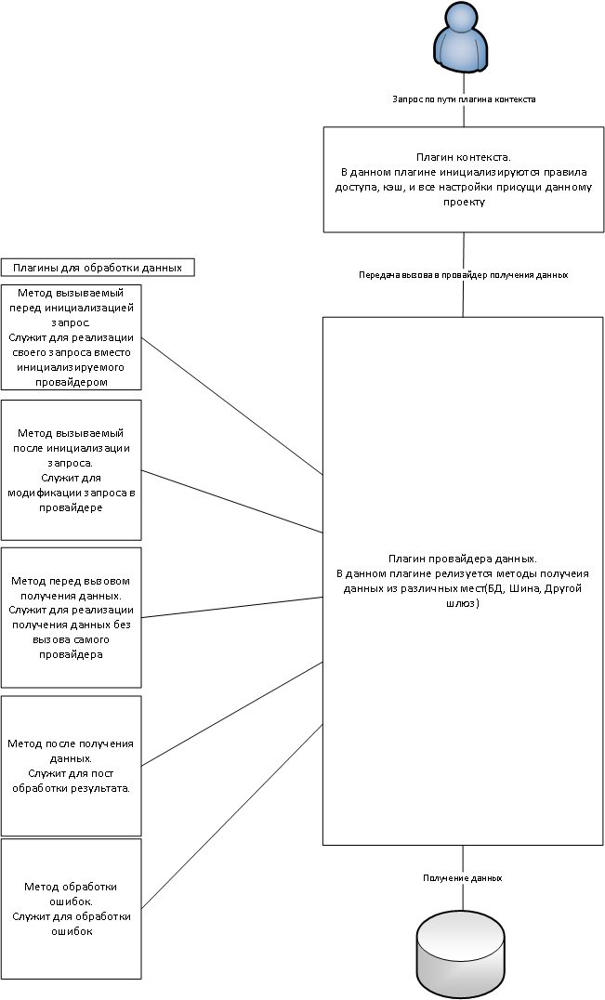

# Шлюз

Каталог для описания настроек шлюза и среднего слоя


## Описание работы шлюза


Последовательность работы.

1. Запрос от пользователя приходит на плагин контекста.
2. В плагине контекста проверяются доступы, кэшируются страницы и инициализируются данные для последующей передачи вызова в провайдер данных, либо получаем сразу результат для ответа. Контекст выбирает, какому провайдеру передать запрос на выполнение.
3. В плагине провайдера осуществляется инициализация запроса, вызов запроса с получением данных. Т.е. провайдер работает прямолинейно: получает запрос, передает его в БД/шину/другой шлюз, получает ответ и передает его обратно в контекст.
4. При необходимости провайдер вызывает плагин/плагины. Плагины данных работают на этапе работы провайдера. Если провайдеру для обработки необходимо как-то модифицировать запрос/ответ, то дополнительно привлекается плагин. Например, при печати отчетов Провайдер вызывает соответствующие плагины uspo для распаковки json, передачи его в jasper, преобразования ответа от jasper.
5. Данные отдаются пользователю.

Есть возможность реализации методов на любом этапе вызова.

Подробнее о каждом плагине можно почитать здесь


## Плагины шлюза



Создание Создание
Плагины контекста
Плагины создаются, реализуя абстрактных классов: CoreOracleContext
CoreOracleIntegrati
onContext
NullContext - абстрактный класс плагинов контекста Плагины провайдеров
NullPlugin - абстрактный класс плагинов работы с данными авторизации
NullProvider - абстрактный класс плагинов провайдеров данных AuthCrmWs
NullAuthProvider - абстрактный класс плагинов авторизационых провайдеров CoreAuthPG
NullScheduler - абстрактный класс плагинов планировщика PKOAuth
NullEvent - абстрактный класс автономных служб AdAuth
Плагины провайдеров
AdminGate
CoreOracleIntegrati
Плагины контекста on
OracleDb
PostgreSQLDb
CoreOracleContext Плагин работы с данными
JsonRowColumnExt
Плагин контекста CORE. ractor
PrepareQueryPlugin
В данном плагине кэшируются доступы, страницы, ошибки, запросы. USPOIntegration
Осуществляется проверка доступа. Отдача готовой страницы из кэша.
Основные настройки относятся к БД.

Настройки


Наименование параметра Описание

user Наименование учетной записи БД

password Пароль учетной записи БД

connectString Строка подключения к БД

poolMin Минимальное количество коннектов к БД в пуле

poolMax Максимальное количество коннектов к БД в пуле


CoreOracleIntegrationContext
Плагин инициализации интеграция с БФЛ внешними сервисами.

В данном плагине кэшируются доступы и запросы.

Настройки


Наименование параметра Описание

user Наименование учетной записи БД

password Пароль учетной записи БД

connectString Строка подключения к БД

poolMin Минимальное количество коннектов к БД в пуле

poolMax Максимальное количество коннектов к БД в пуле


Плагины провайдеров авторизации

AuthCrmWs
Плагин авторизации СУВК через шину.

Настройки


Наименование Описание
параметра

queryAuth Наименование запроса проверки авторизации

queryMetaUsers Наименование запроса получения мета информации

queryUsersActions Наименование запроса получения всех экшенов

queryUsersDepartments Наименование запроса получения департаментов по
юзеру

queryDepartments Наименование запроса получения всех департаментов

queryToken Наименование запроса получения token

queryGetCrmUrl Имя запроса получения ссылки на сувк

cronReset Время когда сбрасывается кэш. Порядок ввода Linux: * *
****

cnSystem Ид системы

clAudit Признак аудита

sessionDuration Время жизни сессии

urlCrmTemplate Шаблон ссылки

nsiGateUrl Ссылка на гейт NSI


AuthMock
Плагин для реализации заглушки авторизации для новых проектов.

Настройки


Наименование параметра Описание

adminPassword Пароль администратора

adminUser Наименование учетки администратора

viewUser Наименование учетки просмотра


ProjectTiiAuth
Плагин авторизации в проектном учете.

Настройки


Наименование параметра Описание

user Наименование учетной записи БД

password Пароль учетной записи БД

connectString Строка подключения к БД

poolMin Минимальное количество коннектов к БД в пуле

poolMax Максимальное количество коннектов к БД в пуле


CoreAuthOracle
Плагин авторизации структура Core

Настройки


Наименование параметра Описание

user Наименование учетной записи БД

password Пароль учетной записи БД

connectString Строка подключения к БД

poolMin Минимальное количество коннектов к БД в пуле

poolMax Максимальное количество коннектов к БД в пуле


CoreAuthPG
Плагин авторизации структура Core

Настройки


Наименование параметра Описание

connectString Строка подключения к БД

poolMax Максимальное количество коннектов к БД в пуле


PKOAuth
Плагин авторизации в ПКО представляет связку CoreAuth и AdAuth

Настройки


Наименование параметра Описание

user Наименование учетной записи БД

password Пароль учетной записи БД

connectString Строка подключения к БД

poolMin Минимальное количество коннектов к БД в пуле

poolMax Максимальное количество коннектов к БД в пуле


Наименование параметра Описание

adBaseDN Начальный уровень поиска в ldap.
Пример: dc=example,dc=com

adDefaultAction Список экшенов по умолчанию.
Пример: 150,250,300

adLogin Логин УЗ доступа к ldap

adMapGroups Мапинг групп и экшенов
пользователя. Пример:
NameGroup=900,200;NameGroup=100,
215

adMapUserAttr Мапинг атрибутов пользователя.
Пример: cv_login=sAMAccountName;
cv_name=cn;cv_surname=sn;
cv_email=mail;cv_cert=userCertificate

adPassword Пароль УЗ доступа к ldap

adUrl Урл к ldap. Пример: Пример: ldap://dc.
domain.com


AdAuth
Плагин авторизации в ActiveDirectory

Настройки


Наименование параметра Описание

adBaseDN Начальный уровень поиска в ldap.
Пример: dc=example,dc=com

adDefaultAction Список экшенов по умолчанию.
Пример: 150,250,300

adLogin Логин УЗ доступа к ldap

adMapGroups Мапинг групп и экшенов
пользователя. Пример:
NameGroup=900,200;NameGroup=100,
215

adMapUserAttr Мапинг атрибутов пользователя.
Пример: cv_login=sAMAccountName;
cv_name=cn;cv_surname=sn;
cv_email=mail;cv_cert=userCertificate

adPassword Пароль УЗ доступа к ldap

adUrl Урл к ldap. Пример: Пример: ldap://dc.
domain.com


Плагины провайдеров

AdminGate
Плагин администрирования шлюза.

Настройки


Наименование параметра Описание

cv_riak_url Ссылка на хранилище riak

cct_buckets Настройки хранилища в формате json


CoreOracleIntegration
Плагин работы интеграции БФЛ с внешними системами.

Настройки


Наименование Описание
параметра

timeout Время ожидания внешнего сервиса

needSession Необходимость проверки авторизации для запросов

proxy Прокси сервер для вызова внешних систем (если
необходимо)

user Наименование учетной записи БД

password Пароль учетной записи БД

connectString Строка подключения к БД

poolMin Минимальное количество коннектов к БД в пуле

poolMax Максимальное количество коннектов к БД в пуле


OracleDb

Плагин вызова запросов в БД Oracle.

Настройки


Наименование параметра Описание

core режим с инициализацией темповых таблиц

user Наименование учетной записи БД

password Пароль учетной записи БД

connectString Строка подключения к БД

poolMin Минимальное количество коннектов к БД в пуле

poolMax Максимальное количество коннектов к БД в пуле


PostgreSQLDb
Плагин вызова запросов в БД Postgres.

Настройки


Наименование параметра Описание

core Инициализация по схеме CORE

connectString Строка подключения к БД

poolMax Максимальное количество коннектов к БД в пуле


Плагин работы с данными

JsonRowColumnExtractor
Распаковываем ответ из определенных колонок из строки в json.

Настройки
Применяется одна из:

Наименование параметра Описание

columns Наименования колонок, которые надо
распаковать (через запятую)

extractSingleColumn Признак, что надо распаковать
колонку (если она одна, является
строкой и начинается с { или [ )


PrepareQueryPlugin
Модификация запроса, применение фильтров.


USPOIntegration
Плагин печати через УСПО.

Настройки


Наименование Описание
параметра

timeout Время ожидания

urlReceiver URL JS

prefixPath Префикс пути для формирование ссылки на
скачивание

queryNotification Наименование запроса для оповещения

maxExcelRows Максимальное количество строк при печати в Excel

exportUrl UUID на отчет excel


## Разработчику

Репозиторий
Структура репозитория
Репозиторий Подготовка к работе
Сборка приложения
https://github.com/essence-community/core-backend


Структура репозитория
source
- cert Сертификаты для построения защеного канала кластера
- contexts Плагины контекста
- events Плагины служб оповещений и автономных служб
- libs Библиотеки
- plugininf Пакет общих классов и интерфейсов плагинов
- plugins Плагины обработки и модификации данных
- providers Плагины получения данных
- resources Настройки
- schedulers Плагины планировщика
- server Реализация сервера
- admin реализация процесса администрирования кластера
- core общие классы
- events реализация процесса автономных служб
- http реализация кластера http сервера
- localDbNode реализация процесса локально NeDb
- master реализация основного управляющего процесса
- schedulers реализация процесса планировщика


Подготовка к работе
Для разработки надо установить Node 10+ и yarn 1.9+.
Для работы с oracle необходимо установит клиент(битность аналогичной nodejs) не
ниже 12.2 и прописать его в PATH.(Подойдет Instant Client).
Сборка всех зависимостей вызывать из папки source:


```
yarn install
```

Сборка приложения

Перейти в папку source и вызвать:


```
yarn build
```

Соберет в папку bin


## Система оповещения


В платформе CORE реализована система уведомлений, которая включает в себя три блока:

семафоры;
оповещения из БД Postgres;
оповещения из БД Oracle.

Семафоры - сообщение о недоступности системы (например, при сбросе кэша).

Анализируется таблица t_semaphore. Если cn_value <> 0, то отображается сообщение о технических работах.

Данный тип сообщений отображается для всех авторизованных пользователей.


Оповещения из БД (Oracle/Postres)- сообщения об ошибках и предупреждениях системы.

Анализируется таблица t_notification. При добавлении записи в t_notification БД оповещает шлюз.

В указанную таблицу сохраняются данные о дате возникновения ошибки/предупреждения, ИД пользователя, получившего
ошибку, признаке отправки и данные о сообщении(код ошибки из t_message, макросы динамического текста, ИД страницы и ИД
объекта на странице, вернувшего ошибку). Данный вид оповещений будет отображаться персонифицированно: только тому
пользователю, кто вызвал ошибочную операцию.


Пример


cv_message

{"cv_error":{"47":["1_1"]},"reloadpageobject":{"ck_page":"541810","ck_page_object":"
7BE1EFFCAA306BBDE053809BA8C0AD87"}}

Тип сообщения: ошибка (error), предупреждение (warning) либо информационное сообщение (info) - определяется для каждого
кода ошибки в таблице t_message (cr_type).

Все сообщения/ошибки/предупреждения отображаются в Панели оповещения в соответствии с их типом.


Настройки системы уведомлений указываются в конфигурационном файле t_events.toml.


Подробнее об обработке ошибок тут
