# Localization

[Русский](localization.md)

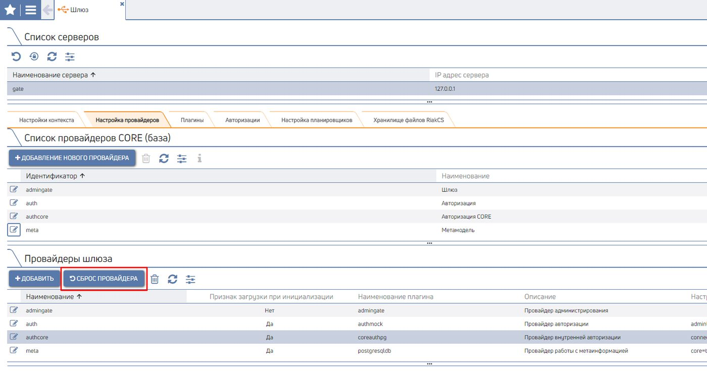

Provides a mechanism for translating Constructor interface elements into another language.

To configure Localization:

1. add the required language to the Language list;
2. add translations of the words/phrases in use to the Dictionary.

To switch the language:

1. click the Profile menu (the person icon in the upper right corner);
2. select the required language from the "Language" Combobox;

2.

3. refresh the page in the browser (press F5).

## Dictionary

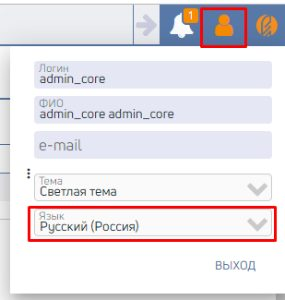

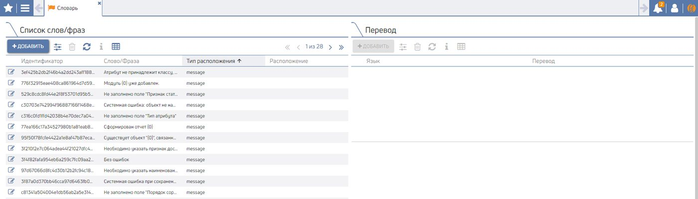

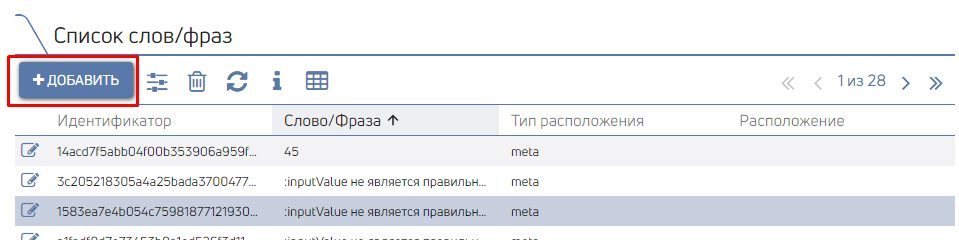

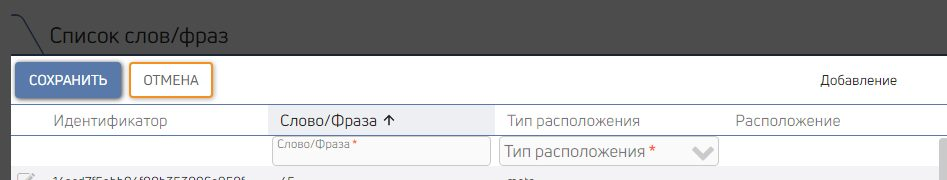

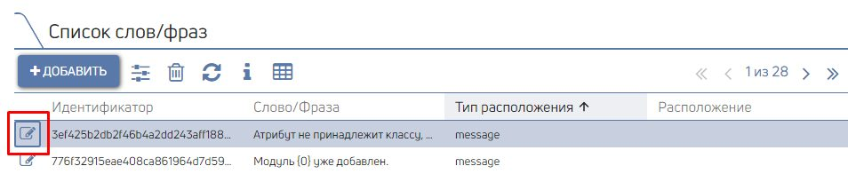

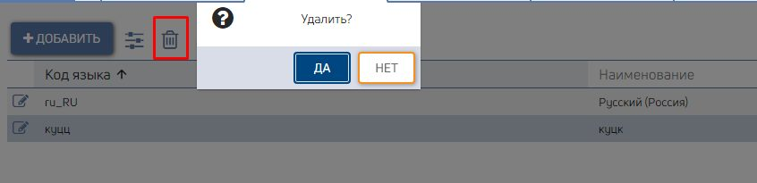

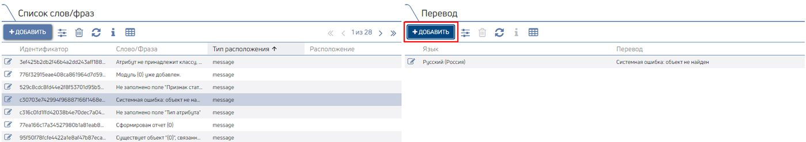

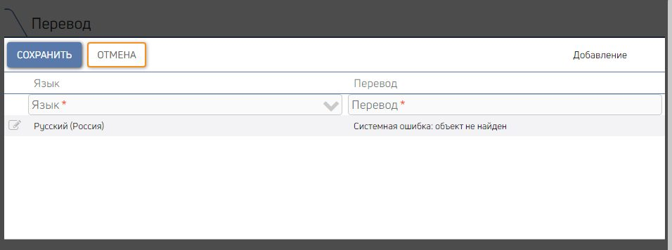

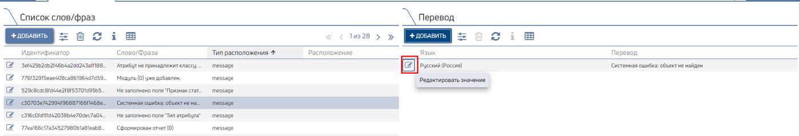

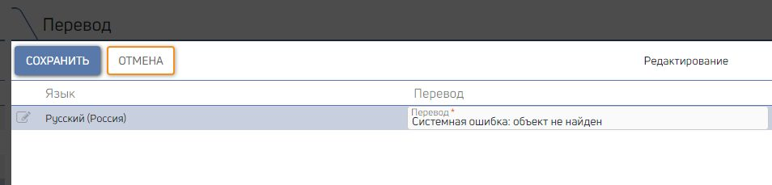

Adding new
values to the list
of translatable words/phrases
Editing words
/phrases
Deleting words/phrases
Adding a word/phrase
translation
Editing a translation
Deleting a translation

Adding new values to the list of translatable words/phrases
1. go to the "Dictionary" page (CORE Localization Dictionary);
2. all actions are performed in the "List of words/phrases" grid;
3. click the "Add" button;

4. fill in the available fields; Fields available to fill in:

Field Data type Comments
name

Word/Phrase Text Required.

Placement type Selection from Required.
a list
meta - used in the Constructor (for example, Displayed names,
validation messages, etc.);

message - used in error text from t_message

static - used in code

5. click the "Save" button.

> **Note!**
> When creating/editing objects/pages whose "Displayed name" value is missing from the
> List of words/phrases, these values will be added to the List of words/phrases automatically when the object
> /page is saved.

> **Note!**
> When a new record is added to the "List of words/phrases" grid, a record is automatically created in the child
> "Translation" grid for the default language. More here

Editing words/phrases
1. go to the "Dictionary" page (CORE Localization Dictionary);
2. all actions are performed in the "List of words/phrases" grid;
3. select the word/phrase to edit;

4. click the "Edit value" button and make the required changes; Fields available to fill in:

Field name Data type Comments

Word/Phrase Text Required.

Placement type Selection from a list

5.

5. click the "Save" button.

Deleting words/phrases
1. go to the "Dictionary" page (CORE Localization Dictionary);
2. all actions are performed in the "List of words/phrases" grid;
3. select the word/phrase to delete;
4. click the "Delete" button and confirm deletion.

Adding a word/phrase translation

1. go to the "Dictionary" page (CORE Localization Dictionary);
2. select a word/phrase from the "List of words/phrases" grid;
3. further actions are performed in the "Translation" grid;
4. click the "Add" button;

5. fill in the available fields;

Fields available to fill in:

Field name Data type Comments

Language Selection from a list Required.

Translation Text Required.

6. click the "Save" button.

> **Note!**
> If a word/phrase has no translation for the language selected by the User in the Profile menu, then the
> interface will display the translation for the default language.

Editing a translation
1. go to the "Dictionary" page (CORE Localization Dictionary);
2. select the word/phrase and translation to edit;
3. all actions are performed in the "Translation" grid;

4. click the "Edit value" button and make the required changes;

Fields available to fill in:

Field name Data type Comments

Translation Text Required.

5. click the "Save" button.

Deleting a translation
1. go to the "Dictionary" page (CORE Localization Dictionary);
2. select the word/phrase and translation to edit;
3. all actions are performed in the "Translation" grid;
4. select the translation to delete;
5. click the "Delete" button and confirm deletion.

## Language list

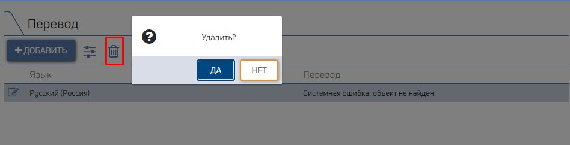

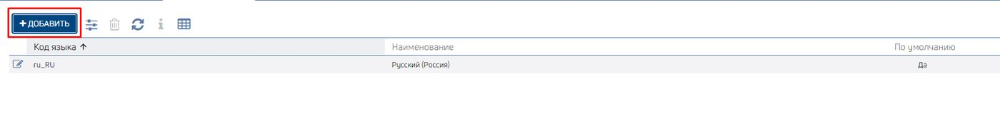

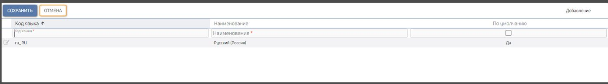

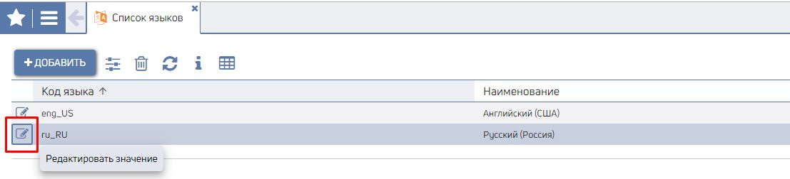

Adding a new language to the Language list
1. go to the "Language list" page (CORE Localization Language list);
2. click the "Add" button;

3. fill in the available fields;

Fields available to fill in:

Field name Data type Comments

Language code Text Required.

Name Text Required.

Default Check-box

4. click the "Save" button.

> **Note!**
> Only one language can be selected as the default language.

When a default language is created, translations into that language will be automatically
generated for all words/phrases from the List of words/phrases with the value: ##Need to translate##

Editing a language
1.

1. go to the "Language list" page (CORE Localization Language list);
2. select the language to edit;

3. click the "Edit value" button and make the required changes; Fields available to fill in:

Field name Data type Comments

Name Text Required.

Default Check-box

4. click the "Save" button.

Deleting a language
1. go to the "Language list" page (CORE Localization Language list);
2. select the language to delete;
3. click the "Delete" button and confirm deletion.

> **Note!**
> When a language is deleted, all translations into that language will be automatically deleted from the Dictionary.

The System will display a confirmation message:
