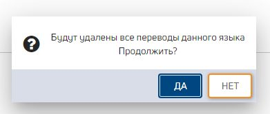
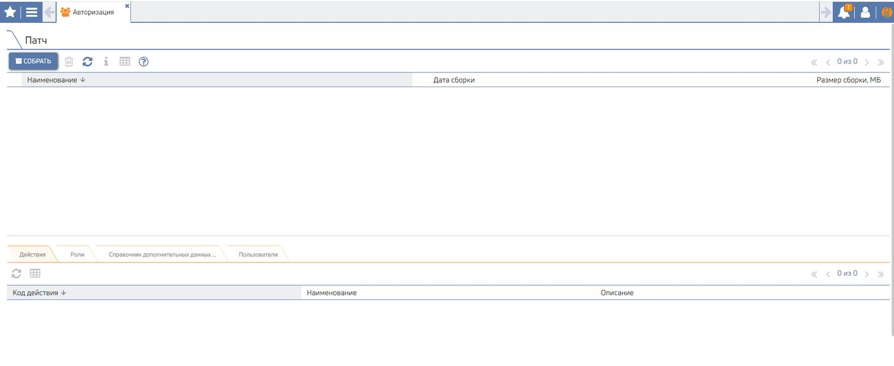
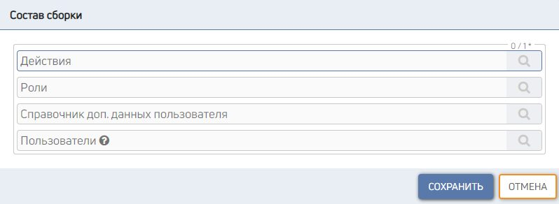
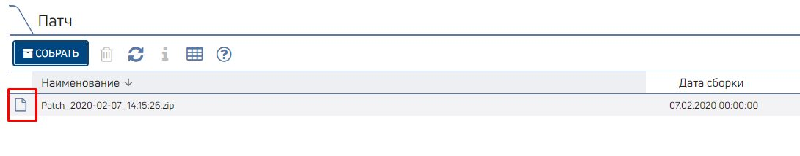
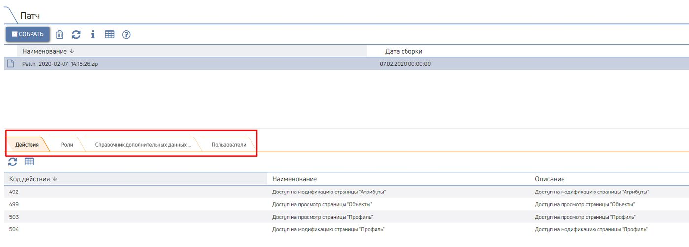
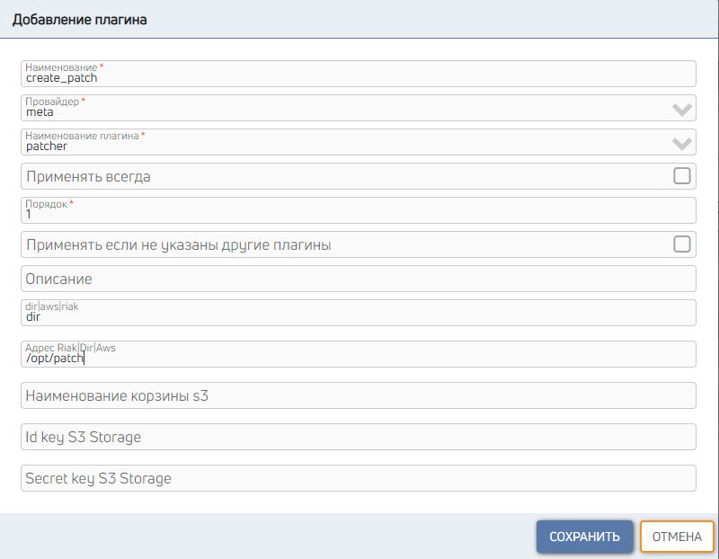
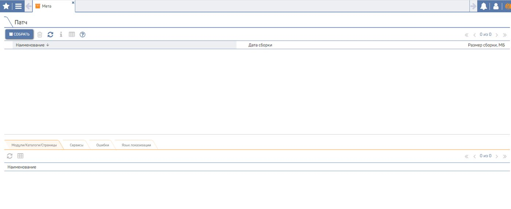
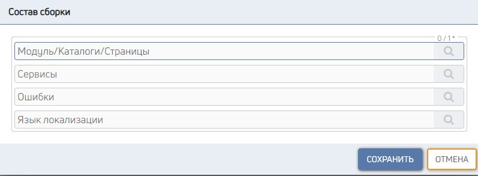
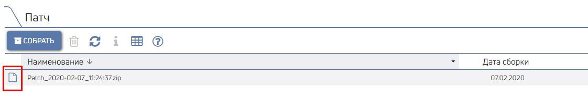
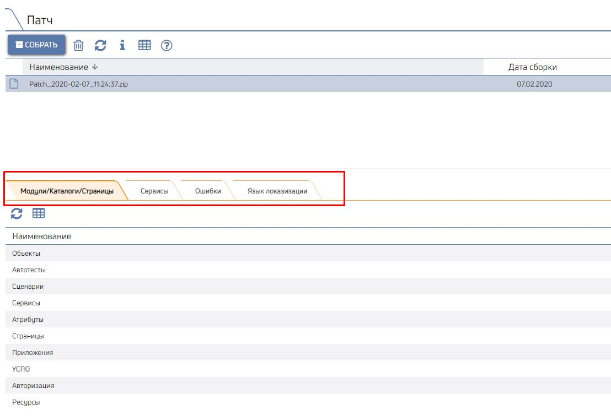

# Патчинг

Модуль патчинга позволяет выполнять перенос данных с одного сервера CORE на другой. например, переносить новые
страницы или пользователей с тестового сервера на боевой.

Платформа CORE позволяет выполнять патчинг:

метаданных (страницы/каталоги/модули, ошибки, сервисы, локализация);
внутренняя авторизация (действия, роли, пользователи);
интеграционные сервисы.


## Патчинг авторизации











Данный тип сборки доступен только после развёртывания
БД внутренней авторизации. Подробнее Создание плагина
Создание сборки
Позволяет создавать патчи со следующими данными из БД Состав сборки
внутренней авторизации: Установка

Действия;
Роли;
Справочник дополнительных данных пользователя;
Пользователи.


Создание плагина
Для создание сборок необходимо создать плагин патчера.

1. Перейти на страницу "Шлюз" (CORE Администрирование Шлюз);
2. Выбрать сервер, для которого будет создан плагин;
3. Перейти на вкладку "Плагины" и нажать кнопку "Добавить";
4. Заполнить поля в появившемся окне:

5. Нажать кнопку "Сохранить";
6. Перезапустить шлюз.


Создание сборки
Для создания патча необходимо:

1. Перейти на страницу "Авторизация" (CORE Патчинг Авторизация);

2. Нажать кнопку "Собрать";
3. в появившемся окне выбрать состав патча и нажать кнопку "Сохранить";


4. Будет сформирован архив сборки с наименованием вида "Patch_дата_время.zip" (например: Patch_2020-02-07_14:15:26. zip)
5. Скачать архив можно, нажав на кнопку:

6. Состав сборки отображается в дочерних гридах:


Состав сборки
В зависимости от выбора параметров сборки в архиве Patch*.zip папке /auth будут сформированы файлы:

Что выбрано Наименование файла Что будет выгружено

Действия Action.sql
сами действия
Action.sql.md5 связь роли и действия


Роли Role.sql
сами роли
Role.sql.md5 связь роли и действия
связь роли и пользователя


Справочник дополнительных данных пользователя Info.sql
сам справочник
Info.sql.md5 связь доп.данных и пользователя


Пользователи Account.sql
сами пользователи
Account.sql.md5 роли и пользователя


Установка
Для установки сборки необходимо:

1. распаковать архив сборки Patch_*.zip;
2. в файле liquibase.properties указать корректные адрес и порт БД;


```
driver: org.postgresql.Driver
url: jdbc:postgresql://host:port/core_auth
username: s_su
password: s_su
```

3. запустить файл update.


## Патчинг метаданных















Создание плагина
Патчинг метаданных позволяет экспортировать следующие Создание сборки
данные: Состав сборки
Установка
модули/каталоги/страницы;
сервисы;
ошибки;
словари локализации.


Создание плагина
Для создание сборок необходимо создать плагин патчера.

1. Перейти на страницу "Шлюз" (CORE Администрирование Шлюз);
2. Выбрать сервер, для которого будет создан плагин;
3. Перейти на вкладку "Плагины" и нажать кнопку "Добавить";
4. Заполнить поля в появившемся окне:


5. Нажать кнопку "Сохранить";

6. Перезапустить шлюз.


Создание сборки
Для создания патча необходимо:

1. Перейти на страницу "Мета" (CORE Патчинг Мета);


2. Нажать кнопку "Собрать";
3. в появившемся окне выбрать состав патча и нажать кнопку "Сохранить";


4. Будет сформирован архив сборки с наименованием вида "Patch_дата_время.zip" (например: Patch_2020-02-07_11:24:37. zip)
5. Скачать архив можно, нажав на кнопку:

5.


6. Состав сборки отображается в дочерних гридах:


Состав сборки
В зависимости от выбора параметров сборки в архиве Patch*.zip папке /meta будут сформированы файлы:

Что выбрано Наименование файла Что будет выгружено

Страница Page_"ИД_страницы".sql
/Каталог Сама страница и ее действия просмотра/редактирования;
/Модуль Page_"ИД_страницы".sql. Каталог/модуль, содержащие выбранную страницу;
md5 все объекты, которые имеются на странице, их атрибуты, мастер-связи
объектов;
глобальные переменные на странице;
переводы слов/фраз, используемых на странице, на все языки, которые
есть на сервере, с которого снимается патч + сами языки


Query_" Сервисы, использующиеся на выгружаемой странице
Наименование_провайде
ра".sql

Query_"
Наименование_провайде
ра".sql.md5

Сервис Query_" Выбранные сервисы из t_query
Наименование_провайде
ра".sql

Query_"
Наименование_провайде
ра".sql.md5

Ошибки Message.sql
Выбранные ошибки из t_message
Message.sql.md5 переводы слов/фраз из ошибок на все языки, которые есть на сервере, с
которого снимается патч + сами языки


Язык Localization_"Код_языка".
локализации sql выбранный язык
все переводы слов и фраз для выбранного языка
Localization_"Код_языка".
sql.md5


Установка
Для установки сборки необходимо:

1. распаковать архив сборки Patch_*.zip;
2. в файле liquibase.properties указать корректные адрес и порт БД;


```
driver: org.postgresql.Driver
url: jdbc:postgresql://host:port/core
username: s_su
password: s_su
```

3. запустить файл update.
