# Quick start

[Русский](quickstart.md)

Section describing the sequence of actions for creating and configuring Platform components.


## Step 0. Creating and configuring a provider


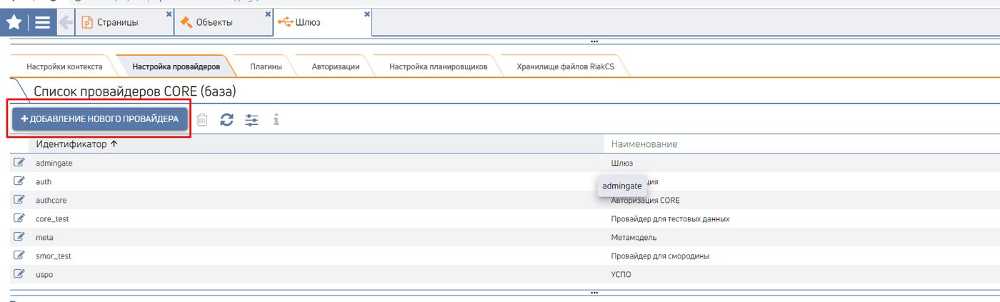

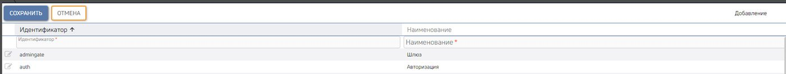

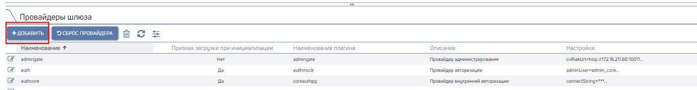

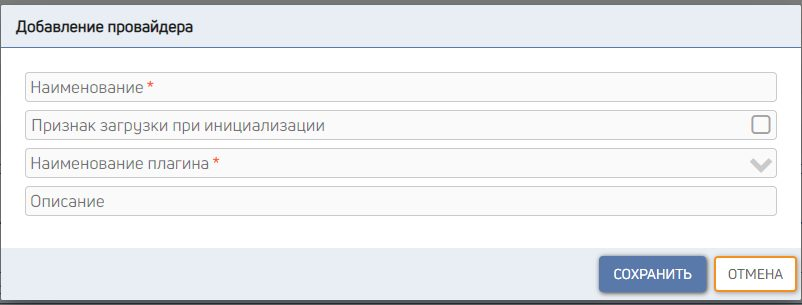

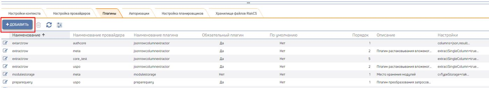

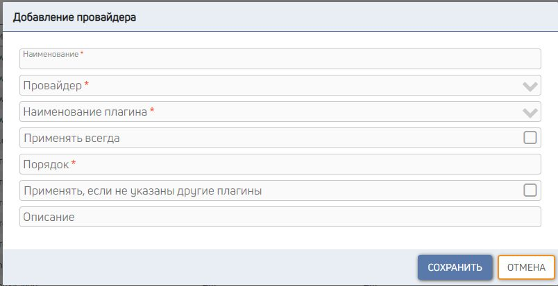

For the Platform to interact correctly with the user DB that stores business data, you must create
a provider that will access that DB.

To do this:

1. go to the "Provider settings" tab on the "Gateway" page (Menu CORE Administration Gateway):

1.


2. Add a new DB provider: specify a Unique identifier and the name of the new provider and click the "Save" button:


3. On the same tab, add a gateway provider with the same name:


4. Fill in the form fields and click the "Save" button:


Fields available to fill in:

Field name Data type Comments

Name Text Required

Load on initialization flag Yes/No Whether to load on gateway start

Plugin name Selection from a list Required

Description Text

Next, bind a request-processing plugin to the created provider.

1. go to the "Plugins" tab on the "Gateway" page (Menu CORE Administration Gateway) and click the "Add" button:


2. Fill in the form fields and click the "Save" button:


Fields available to fill in:

Field name Data type Comments

Name Text Required

Provider Selection from a list Required

Plugin name Selection from a list Required

Always apply Yes/No

Order Number Required In
what order to run the provider
plugins

Apply if no other plugins Yes/No
are specified

Description Text


3. For correct query modification and application of filters and sorting (the &SORT, &FILTER macros) you must bind the plugin - preparequery

4.

4. For correct unpacking of the response from specified row columns into JSON you must bind the plugin - jsonrowcolumn extractor


## Step 1. Display grid


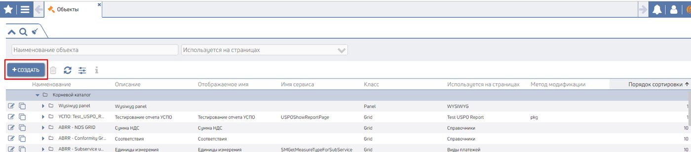

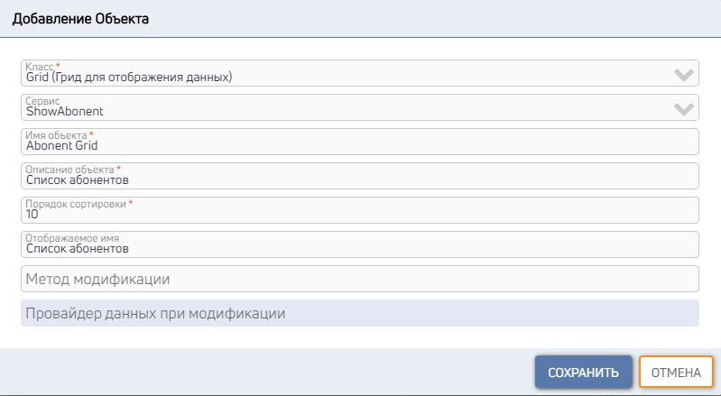

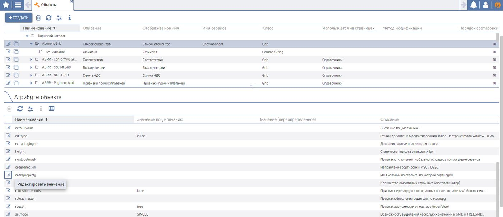

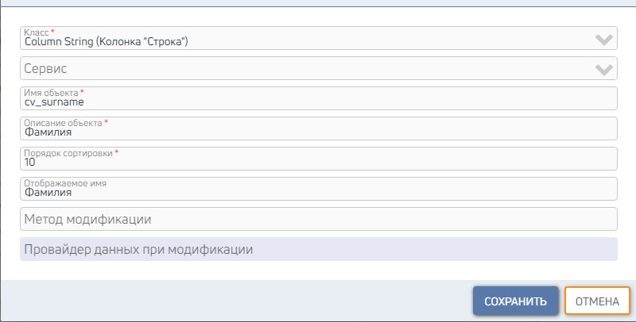

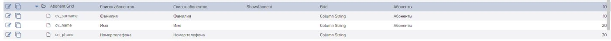

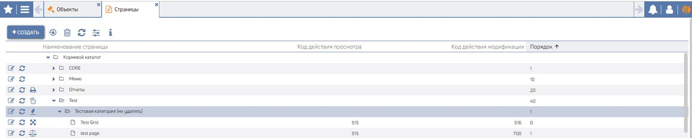

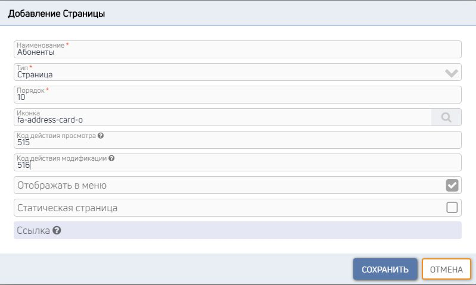

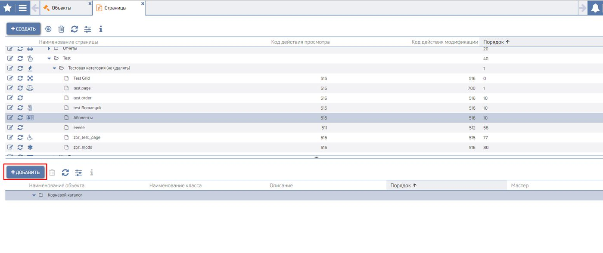

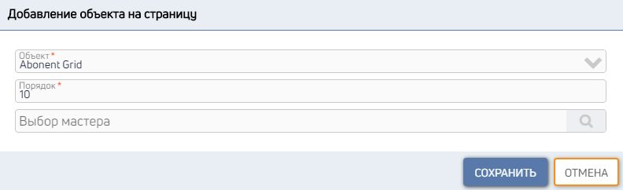

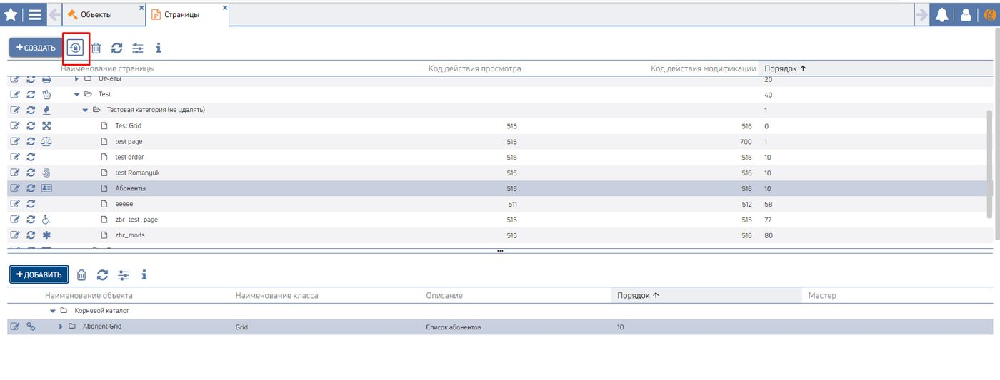

For a simple start with the Platform we will walk through
an example: we will create a page with a table that will DB
contain a list of subscribers. Service
Objects and their settings

### Page

Object on the page
Result


DB
Create a t_abonent table in the DB with data:


CK_ID CV_SURNAME CV_NAME CN_PHONE

1 Иванов Иван 5663398

2 Петров Петр 5669833

3 Сидоров Сидор 5663893


ck_id - Unique record identifier

cv_surname - Last name

cv_name - First name

cn_phone - phone number


> **Note!**
> According to the Development Standard, every table must have a primary key named
> ck_id


Service
Create a ShowAbonent service to select all data from the t_abonent table.


```
select ck_id, cv_surname, cv_name, cn_phone from t_abonent
```


> **Note!**
> According to the Development Standard, every service must contain a ck_id parameter to determine
> record uniqueness


Add the created service to the s_mt.t_query table.


Objects and their settings
Create a Grid-class object to display subscriber data:

1. go to the "Objects" page (Menu CORE GUI Constructor Objects );


2. Select the root catalog, click the "Create" button, fill in the fields, and click the "Save" button:


3. Configure the grid attributes:

Attribute name Value Comment

orderproperty ck_id Name of the parameter that identifies record uniqueness

4. Create a column to display the Last name of our subscribers:


1. In the object list, select the Abonent Grid we created, click the "Create" button, and fill in the fields:


2. Fill in the column attributes:


Attribute name Value Comment

column cv_surname Name of the parameter from the service to take values from

5. In the same way, create columns for First name and Phone number


We recommend

When creating objects, set the sort order in multiples of ten: 10, 20, 30, and so on.

Because an object's ordinal number must be unique within the parent object, this
numbering makes it easy to add up to 9 more objects between previously created
objects if needed.


6. We get a Grid with three columns:


### Page

Create a page to display our grid.

1. go to the “Pages” page (Menu CORE GUI Constructor Pages);

2. select the parent module/catalog or the root catalog in which the page will be created. In our example we select Test catalog and click the “Create” button:


3. Fill in the fields and click the "Save" button:


Object on the page
Add our Abonent Grid to the created "Subscribers" page.

1. Select the created "Subscribers" page and click the "Add object" button:

2. In the object list, find Abonent Grid and add it to the page:


3. After adding the grid to the page you must reset the cache so that the Platform loads the newly created page and the objects on it into the cache:


4. When the cache is reset, a message appears:

4.


5. Don't worry, just wait


Result
After resetting the cache, open the menu, find the "Subscribers" page, and open it.


Admire it and give yourself a pat on the back.


## Step 2. Adding/editing/deleting data in the grid


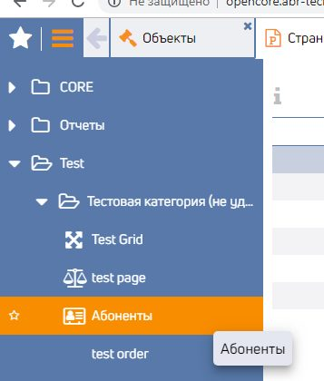

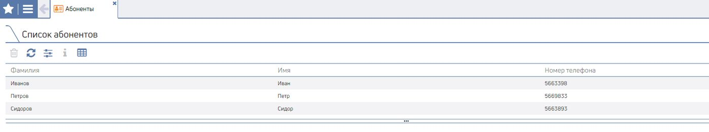

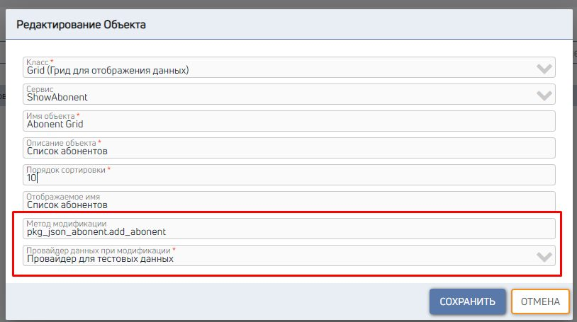

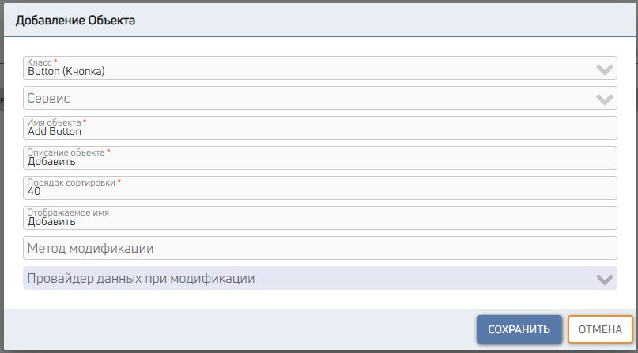

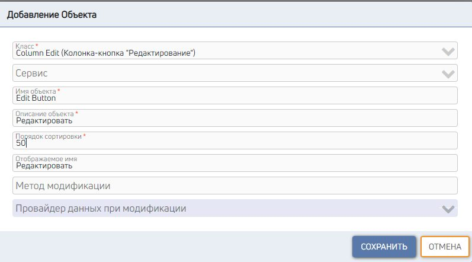

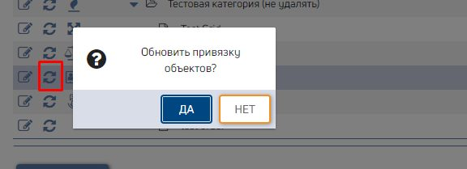

Configure the grid created in Step 1 so that data can be added/edited/deleted.


DB
You must create a function that describes adding/editing/deleting data from the t_abonent table.


Reminder:

For data to be modified correctly, the resulting data set must include
the unique identifier (ck_id) of the modified record.


Specify the name of the created modifier in the "Modification method" field for the created Abonent Grid on the
Objects page. Also select a data provider

Objects and their settings
Create add and edit buttons.

1. go to the "Objects" page (Menu CORE GUI Constructor Objects );
2. Create an "Add" button. Select Abonent Grid, click the "Create" button, fill in the fields, and click the "Save" button:

3. Configure the add button attributes:


Attribute name Value Comment

handler onCreateChildWindowMaster To open a window on create

iconfont plus Icon name from the Font Awesome font

mode 1 Add

4. Create an "Edit" button-column. Select Abonent Grid, click the "Create" button, fill in the fields, and click the "Save" button:

5. The attributes of the "Edit" button-column are already configured on the class. If desired, they can be overridden on the object.


Object on the page
After adding buttons to the object, they must appear on the page. To do this:

1. go to the "Pages" page (Menu CORE GUI Constructor Pages);
2. refresh the object bindings on the "Subscribers" page:


3. then reset the cache on the server:

4. Admire our success:
