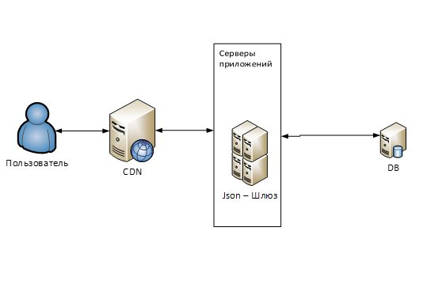
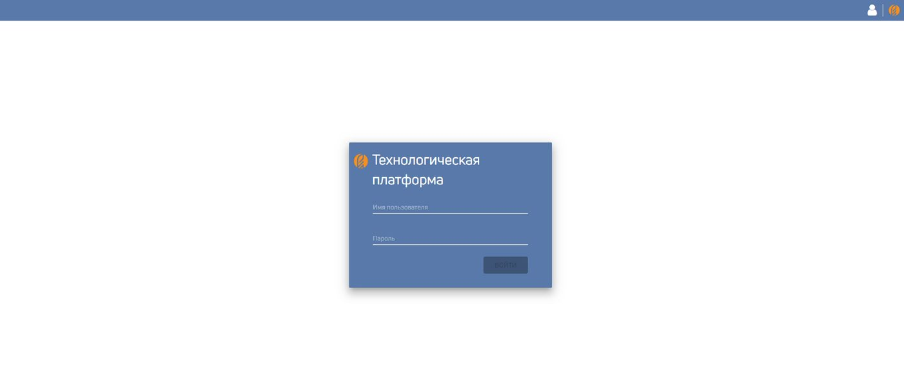
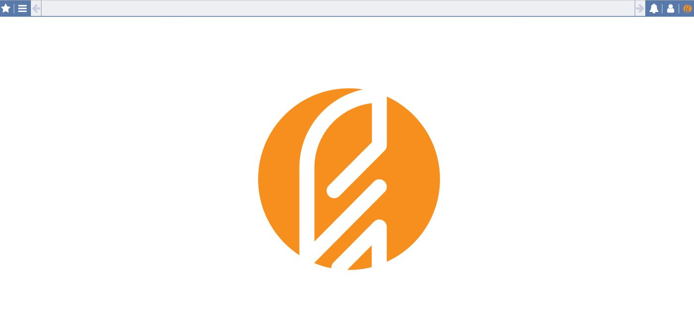

# Deploy CORE

Install and upgrade without Docker. Source stand: [install-docker.en.md](install-docker.en.md). Live gateway config: [`docker/gate/config`](../docker/gate/config) (YAML).

[Русский](install.md)

## Terms

| Term | Description |
| --- | --- |
| CORE | CORE technology platform |
| SW | Software |
| IR | Information resources |
| APC | Hardware/software complex |

The administrator needs Linux/*nix or Windows, PostgreSQL 17 (reference) / 11+ (Helm), nginx, Node.js 22+.

## Purpose and requirements



CORE is a platform for building ERP systems.

| Server | Software (reference `docker/`) |
| --- | --- |
| CORE DB | PostgreSQL 17 |
| CDN | nginx stable |
| Application | Node.js 24, Yarn 1 |
| Migrations | Java 17, Liquibase/Gradle |

## Node.js

Follow the [nodejs.org guide](https://nodejs.org/en/download/package-manager/). Need Node >= 22 (Docker uses 24).

## Database

1. Install PostgreSQL.
2. Users:

Superuser for loading:

```sql
CREATE ROLE s_su WITH
  LOGIN
  SUPERUSER
  INHERIT
  CREATEDB
  CREATEROLE
  NOREPLICATION;
```

Gateway user:

```sql
CREATE ROLE s_mc WITH LOGIN NOSUPERUSER INHERIT NOCREATEDB
NOCREATEROLE NOREPLICATION;

ALTER ROLE s_mc SET search_path TO s_mt, public, pg_catalog;
ALTER USER s_mc WITH PASSWORD 's_mc';
```

Owner of functions (no login):

```sql
CREATE ROLE s_mp WITH
  NOLOGIN
  NOSUPERUSER
  INHERIT
  NOCREATEDB
  NOCREATEROLE
  NOREPLICATION;
```

3. Database:

```sql
CREATE DATABASE core
  WITH
  OWNER = s_su
  TEMPLATE = template0
  ENCODING = 'UTF8'
  LC_COLLATE = 'ru_RU.UTF-8'
  LC_CTYPE = 'ru_RU.UTF-8'
  TABLESPACE = pg_default
  CONNECTION LIMIT = -1;

CREATE EXTENSION "uuid-ossp"
    SCHEMA public;
```

4. Unpack `dbms_core*` and set `liquibase.properties`:

```
driver: org.postgresql.Driver
url: jdbc:postgresql://host:port/core
username: s_su
password: s_su
```

5. Run `update`.
6. System settings:

```sql
UPDATE s_mt.t_sys_setting
SET cv_value='/core-module'
WHERE ck_id='g_sys_module_url';

UPDATE s_mt.t_sys_setting
SET cv_value='/gate-core'
WHERE ck_id='g_sys_gate_url';
```

## Gateway

Archive `ungate_*.zip`.

1. Unpack (e.g. `/home/user/work_gate/ungate` or `c:\work_gate\ungate`).
2. Install dependencies:

```
npm install -g yarn
yarn install
```

3. Config is YAML. Reference: [`docker/gate/config`](../docker/gate/config). Directory, e.g. `/home/user/work_gate/configs`: `t_servers.yaml`, `t_context.yaml`, `t_providers.yaml`, `t_plugins.yaml`, `t_events.yaml`, `t_query.yaml`, `t_schedulers.yaml`, `logger.json`.

`$$indexCreated` at the end of files is the NeDB index — leave it.

### t_servers.yaml

```yaml
- ck_id: gate
  cv_ip: 127.0.0.1
- $$indexCreated:
      fieldName: ck_id
      unique: true
      sparse: false
```

- `ck_id` — hostname or `GATE_NODE_NAME`
- `cv_ip` — node IP/DNS

### t_context.yaml

```yaml
- ck_id: core
  cv_path: /api
  cv_description: Основные настройки метаинформации
  ck_d_plugin: CorePGContext
  cct_params:
      debug: true
      disableCache: true
      poolMax: 100
      maxPostSize: 10000000
      user: s_mc
      password: s_mc
      connectString: postgres://postgres:5432/core
- $$indexCreated:
      fieldName: ck_id
      unique: true
      sparse: false
```

`connectString` is the DB host; gateway login `s_mc` is in `cct_params.user` / `password`.

### t_providers.yaml

Reference uses `authcore` (`coreauthpg`), not AuthMock.

```yaml
- ck_id: admingate
  cv_description: Провайдер администрирования
  ck_d_plugin: admingate
  cl_autoload: 0
  cct_params: {}
- ck_id: authcore
  cl_autoload: 1
  ck_d_plugin: coreauthpg
  cv_description: Провайдер внутренней авторизации
  cct_params:
      user: s_ac
      password: s_ac
      connectString: postgres://postgres:5432/core_auth
      poolMax: 10
      sessionDuration: 2000
      onlySession: false
- ck_id: meta
  cv_description: Провайдер работы с метаинформацией
  cl_autoload: true
  ck_d_plugin: PostgreSQLDb
  cct_params:
      user: s_mc
      password: s_mc
      core: true
      poolMin: 1
      poolMax: 100
      connectString: postgres://postgres:5432/core
- $$indexCreated:
      fieldName: ck_id
      unique: true
      sparse: false
```

### t_plugins.yaml

Full file: [`docker/gate/config/t_plugins.yaml`](../docker/gate/config/t_plugins.yaml). Minimum for `meta` and `authcore`:

```yaml
- cv_name: preparequery
  cv_description: Плагин преобразования запросов filter,sort
  ck_d_provider: authcore
  ck_d_plugin: PrepareQuery
  cl_required: 1
  cl_default: 0
  cct_params: {}
  ck_id: PrepareQuery:authcore
  cn_order: 1
- cv_name: preparequery
  cv_description: Плагин преобразования запросов filter,sort
  ck_d_provider: meta
  ck_d_plugin: PrepareQuery
  cl_required: 1
  cl_default: 0
  cct_params: {}
  ck_id: PrepareQuery:meta
  cn_order: 1
- cv_name: extractrow
  cv_description: Плагин распаковывания вложеного json
  ck_d_provider: authcore
  ck_d_plugin: JsonRowColumnExtractor
  cl_required: 1
  cl_default: 0
  ck_id: extractRow:authcore
  cn_order: 2
  cct_params:
      extractSingleColumn: true
      columns: json,result
- cv_name: extractrow
  cv_description: Плагин распаковывания вложеного json
  ck_d_provider: meta
  ck_d_plugin: JsonRowColumnExtractor
  cl_required: 1
  cl_default: 0
  ck_id: extractRow:meta
  cn_order: 2
  cct_params:
      extractSingleColumn: true
      columns: json,result
- $$indexCreated:
      fieldName: ck_id
      unique: true
      sparse: false
```

### t_events.yaml

```yaml
- cv_description: Локализация meta
  ck_d_plugin: CorePgLocalization
  ck_id: localization
  cct_params:
      poolMin: 1
      poolMax: 100
      user: s_mc
      password: s_mc
      connectString: postgres://postgres:5432/core
- cv_description: Оповещение meta
  ck_d_plugin: CorePgNotification
  ck_id: meta
  cct_params:
      poolMin: 1
      poolMax: 100
      user: s_mc
      password: s_mc
      connectString: postgres://postgres:5432/core
- cv_description: Семафор meta
  ck_d_plugin: CorePgSemaphore
  ck_id: semaphore
  cct_params:
      poolMin: 1
      poolMax: 100
      user: s_mc
      password: s_mc
      connectString: postgres://postgres:5432/core
- $$indexCreated:
      fieldName: ck_id
      unique: true
      sparse: false
```

### logger.json

Reference: [`docker/gate/config/logger.json`](../docker/gate/config/logger.json).

```json
{
    "handlers": {
        "errors": {
            "class": "rufus/handlers/file",
            "file": "/var/log/ungate_error.log",
            "level": "ERROR"
        },
        "main": {
            "class": "rufus/handlers/rotating",
            "file": "/var/log/ungate_main.log",
            "maxSize": "30mb",
            "maxFile": "30"
        },
        "console": {
            "class": "rufus/handlers/console"
        }
    },
    "loggers": {
        "root": {
            "level": "TRACE",
            "handlers": ["main", "errors"]
        }
    }
}
```

### Start on Windows

Administrator rights required.

```
npm install node-windows -g
npm link node-windows
set LOGGER_CONF=c:\work_gate\configs\logger.json
set PROPERTY_DIR=c:\work_gate\configs
set GATE_UPLOAD_DIR=c:\work_gate\tmp
set NEDB_TEMP_DB=c:\work_gate\tmp\db
yarn installSvc
sc start gate_core.exe
```

### Start on Linux (systemd)

Superuser required. `/home/user/work_gate/start.sh`:

```bash
#!/bin/bash
cd /home/user/work_gate/ungate
/home/user/work_gate/ungate/node_modules/.bin/nodemon 1>/dev/null 2>/home/user/work_gate/logs/daemon_error.log
```

```
chmod +x /home/user/work_gate/start.sh
```

`/etc/systemd/system/gate_core.service`:

```ini
[Unit]
Description=Core Nodemon
After=network.target

[Service]
#User=web-nodejs
LimitNOFILE=infinity
LimitNPROC=infinity
LimitCORE=infinity
Environment=LOGGER_CONF=/home/user/work_gate/configs/logger.json
Environment=PROPERTY_DIR=/home/user/work_gate/configs
Environment=GATE_UPLOAD_DIR=/home/user/work_gate/tmp
Environment=NEDB_TEMP_DB=/home/user/work_gate/tmp/db
WorkingDirectory=/home/user/work_gate/ungate
ExecStart=/home/user/work_gate/start.sh

[Install]
WantedBy=multi-user.target
```

```
systemctl start gate_core
```

## nginx (CDN)

1. Install [nginx](https://nginx.org/).
2. Frontend directory (e.g. `/home/user/www_core`), unpack `core_*.zip`.
3. `conf.d/core.conf` — Docker reference: [`docker/server/nginx.conf`](../docker/server/nginx.conf).

```nginx
map $http_upgrade $connection_upgrade {
    default upgrade;
    ''      close;
}

server {
    listen       80;
    server_name localhost;
    access_log /home/user/log/access_core.log              main;
    root   /home/user/www_core;

    location /gate-core {
        proxy_pass http://host:port/api;
    }

    location /core-module {
        alias /home/user/core-module;
    }

    location /core-assets {
        alias /home/user/core-assets;
    }

    location /core_notification {
        proxy_pass http://host:port/notification;
        proxy_http_version 1.1;
        proxy_set_header Upgrade $http_upgrade;
        proxy_set_header Connection "Upgrade";
        proxy_set_header X-Forwarded-For $proxy_add_x_forwarded_for;
    }

    location = /essence_core.js {
        add_header Cache-Control no-cache;
        if_modified_since off;
        expires 0;
    }

    location = /version.json {
        add_header Cache-Control no-cache;
        if_modified_since off;
        expires 0;
    }

    location @index {
        add_header Cache-Control no-cache;
        if_modified_since off;
        expires 0;
        try_files /index.html =404;
        types { } default_type "text/html; charset=utf-8";
    }
}
```

Check: `http://$CDN_HOST/` — login screen. Reference `authcore`: `admin_core` / `admin_core`.

## Check





## Cluster

Add nodes in `t_servers.yaml` and restart gateways. In nginx:

```nginx
upstream nodejscluster {
    least_conn;
    ip_hash;
    server 192.168.1.1:8080;
    server 192.168.1.2:8080;
}
```

`proxy_pass` for `/gate-core` and `/core_notification` — `http://nodejscluster/...`.

## Upgrade

Do not downgrade the database. Take a dump first.

- DB: unpack `dbms_core*.zip`, set URL in `liquibase.properties`, run `update`.
- Gateway: stop, replace files from `ungate_*.zip`, `yarn install`, start.
- Frontend: unpack `core*.zip` over the frontend directory.
